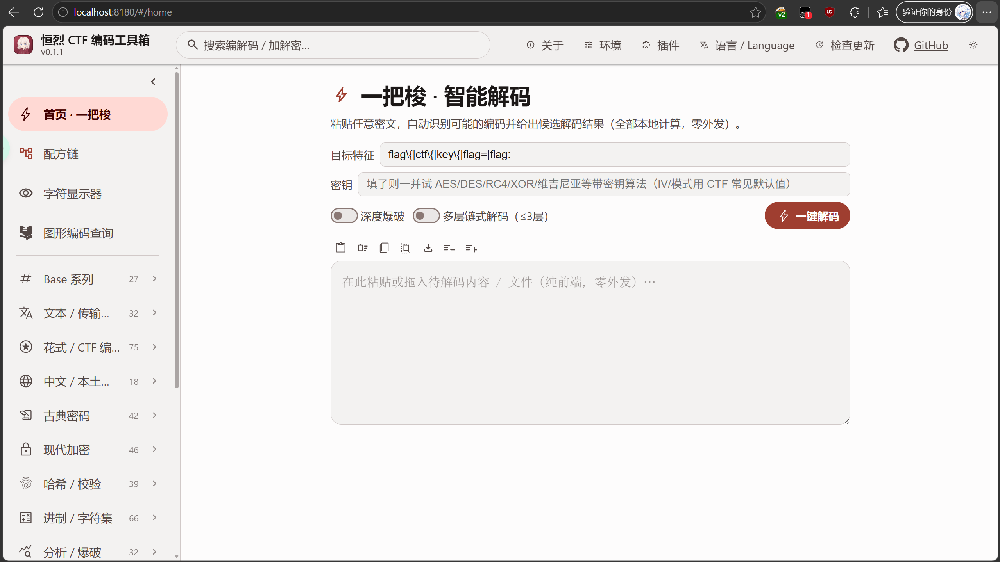
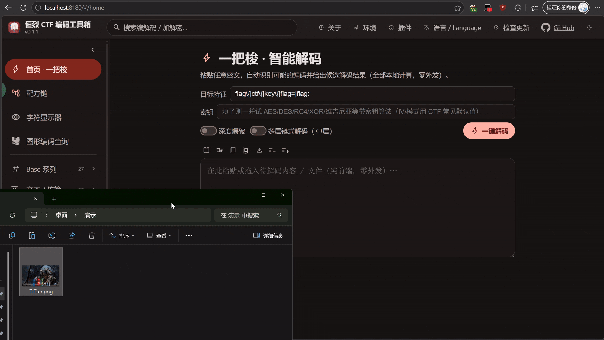
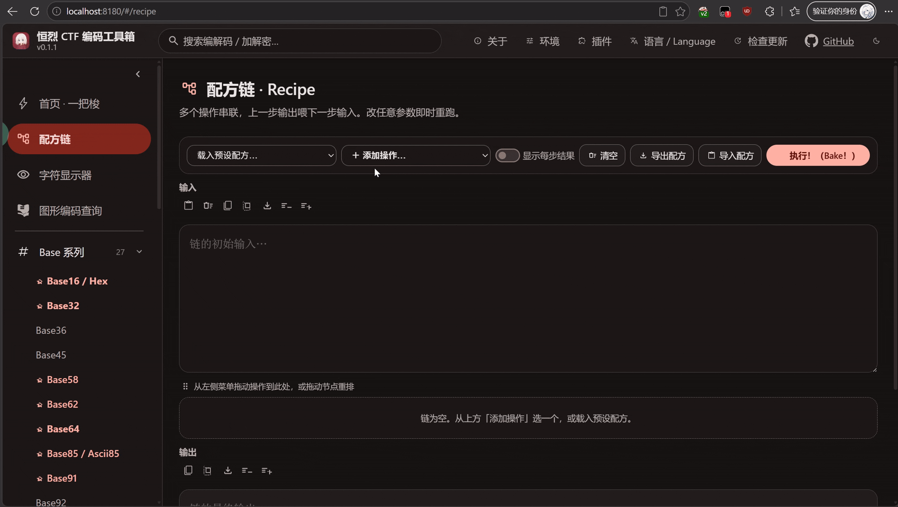
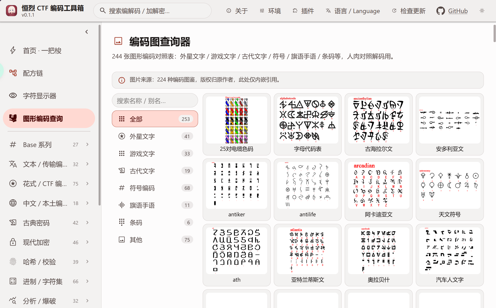
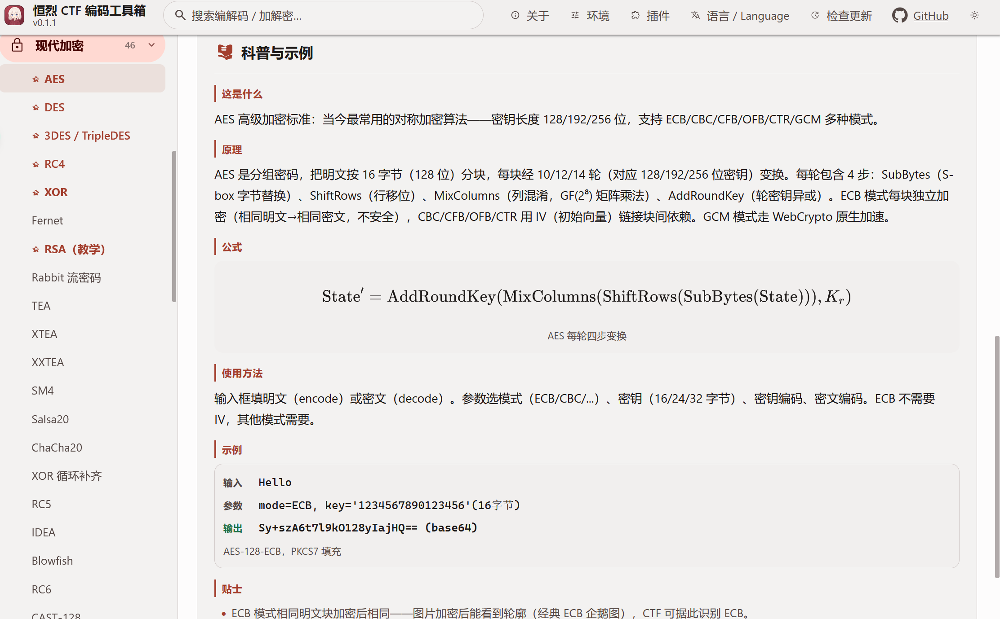
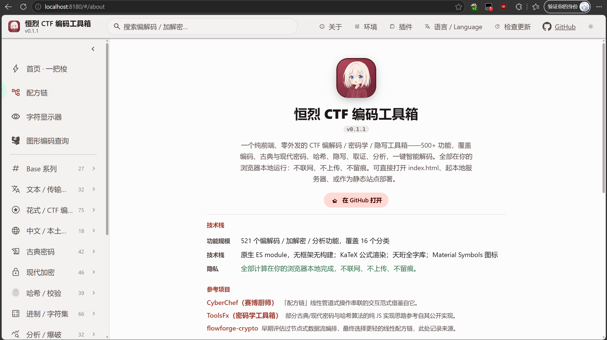
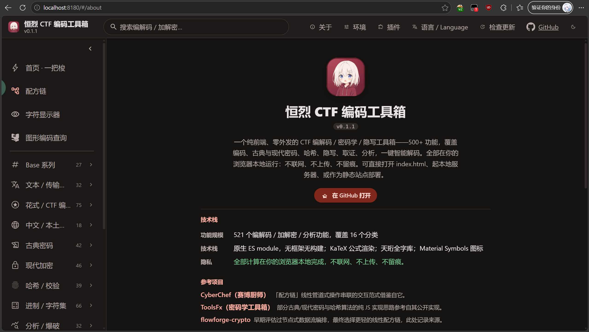

<p align="center">
  
</p>
<h1 align="center">
  <span>恒烈 CTF 编码工具箱 · EBCTFCodeBox</span>
</h1>
<p align="center">
  <span align="center">本地优先、零外发的编解码 / 加解密 / 隐写分析工具箱：810 个注册操作覆盖 23 类能力，绝大多数在浏览器本地运行，Windows 另可启用本地桥能力，macOS / Linux 提供双击启动器。</span>
</p>

<p align="center">
  <a href="https://github.com/Henglie/EBCTFCodeBox/stargazers"></a>
  <a href="https://github.com/Henglie/EBCTFCodeBox/blob/main/LICENSE"></a>
  <a href="https://github.com/Henglie/EBCTFCodeBox/releases"></a>
</p>
<p align="center">
  <a href="https://github.com/Henglie/EBCTFCodeBox/issues"></a>
  <a href="https://github.com/Henglie/EBCTFCodeBox/pulls"></a>
  <a href="https://github.com/Henglie/EBCTFCodeBox/network/members"></a>
</p>

> [!WARNING]
> 本工具仅供 CTF 学习、竞赛与安全研究使用。请勿将其用于任何违法违规、侵犯他人权益或可能给你自己带来麻烦的用途。使用者需自行承担因不当使用产生的一切后果。
> 如果你在使用中发现 Bug、算法结果异常或文档缺失，欢迎提交 Issue，最好附上输入样例、期望输出和复现步骤。

## 目录

- [快速下载](#快速下载)　　　　[更新日志](#更新日志)
- [项目简介](#项目简介)　　　　[特点](#特点)
- [界面预览](#界面预览)　　　　[运行](#运行)
- [平台兼容性](#平台兼容性)　　[性能要求](#性能要求)
- [目录结构](#目录结构)　　　　[编解码全清单](#编解码全清单810-ops--23-分类)
- [插件与 AI 接入](#插件与-ai-接入)　[开源协议](#开源协议)
- [第三方资源与许可](#第三方资源与许可)　[隐私](#隐私)

## 快速下载

> 核心处理本地运行、零外发。下载解压后双击 `通用点我启动.py` 即可使用（需本机有 Python 3）。Windows 可启用本地桥，macOS / Linux 自动跳过桥接能力。

| 网盘 | 链接 | 提取码 |
|---|---|---|
| 百度网盘 | https://pan.baidu.com/s/1Uqq_ONMBG9qA0dJvUG53Og?pwd=0000 | 0000 |
| 夸克网盘 | https://pan.quark.cn/s/3b7e573b19c0 | 无 |

当前版本 **v0.1.9**。源码始终以 GitHub 仓库为准：[github.com/Henglie/EBCTFCodeBox](https://github.com/Henglie/EBCTFCodeBox)。

## 更新日志

## v0.1.9

### 新增功能

- 新增操作十余个
- 新增安全随机数四档
- 新增随机信标拉取
- 新增联网熵服务器模式
- 新增鼠标熵采集可叠加各档
- 自定义代码可取增强随机数
- BLS 全族升级新曲线
- 新增德语法语界面
- 新增日韩俄语界面
- 新增图像工具八件
- 凯撒新增全字符位移档
- 新增精灵图序列帧互转
- 图像重处理改按钮执行

### 修复

- 修复静默报错三十余处
- 更正 jsfuck 编码方向
- 更正键盘坐标编码方向
- 去掉取数量原生增减箭头
- 修复英文界面科普回落中文
- 修复区位码含数字不往返
- 修复 EBCDIC 静默丢字符

### 优化

- 首屏资源大幅瘦身
- 补充古典密码图示
- 界面细节多处统一
- 关于页显示语言进度
- 启动器合并为单个
- 增强随机开关只挂取随机算法
- 增强随机档位与环境面板统一
- 增强随机性对内置库来源作说明
- 补充 RSA 裸预言机安全提示
- 补充 RSA 英文科普
- 线路码默认档解码还原文本
- EBCDIC 默认码页改 cp1047


## 项目简介

`恒烈 CTF 编码工具箱`（EBCTFCodeBox）是一个以 CTF 场景为入口、面向通用编解码与密码学需求的本地优先工具箱。

它把编码、古典密码、现代加密、哈希校验、进制转换、密码分析爆破、隐写图像等能力汇聚到一个页面里。核心计算在浏览器本地完成，不上传用户输入；Windows 可选启用本地桥。目标是兼顾赛场解题、密码学学习与日常工具需求。

核心设计：

- 原生 ES module，无框架、无构建步骤
- C / emscripten 编译的 WASM 承担高性能算法
- Material 3 温和红主题，暗 / 亮色切换
- 内置天珩全字库，冷僻字符照样显示
- 20 种语言

---

## 特点

- **本地优先 · 零外发**：原生 ES module，无框架、无构建步骤。核心编解码在浏览器本地执行，不上传用户输入；「外链」只生成 URL。PWA 更新仅下载本站资源，本地桥只访问 `127.0.0.1`，外部 AI 仅在用户主动配置 endpoint 后启用。
- **一把梭智能解码**：粘贴或拖入内容，自动识别可能的编码链并给出候选解码结果，支持 crib 目标特征过滤与深度爆破。
- **788 个注册操作 · 23 分类**：覆盖 Base、文本传输、花式 CTF、深奥编程语言、中文本土、古典密码、现代加密（分组 / 流 / 非对称 / 其他）、哈希校验、进制字符集（含素数判定与筛选）、分析爆破、密码攻击、压缩归档、口令与归档破解、取证流量、文件格式结构、数据结构、图像与二维码、音频音视频、隐写及 4 个可选 Windows GUI 桥入口。完整清单由 registry 自动生成。
- **解码强度四件套**（v0.1.2）：强度档位 + 自定义算法池 + **暴力爆破独立通道**（XOR/凯撒/字典/彩虹表/HMAC/PBE/Playfair/ZIP/CRC32/bkcrack，结果单独归组展示不污染主排序）+ **解析层数 1~3 选择**。
- **宽松判定模式**（v0.1.2）：增强/极强/最强/自定义档只按字符种类数放行算法，变体编码题（「喵呜」表 0/1、emoji 表二进制）也能参与解码；默认/快速档保持严格定义域识别。
- **密钥+密文一键尝试**：给定密文与密钥，自动枚举 AES/DES/3DES/RC4/XOR/Fernet × 多种模式 × 多种编码组合。
- **文件拖入分析**：拖入文件自动检测类型、附加数据、图像宽高异常等。
- **全 Unicode 显示**：内置天珩全字库，按 Unicode 平面按需加载，生僻字、古文字、Emoji 均可正常显示。
- **Material 3 温和红主题**，暗/亮色切换，20 种语言。

> 想看完整的功能介绍与场景演示，见 [`介绍文章.md`](./介绍文章.md)。

## 界面预览

<p align="center">
  
</p>

<p align="center"><i>一把梭 · 智能解码：粘进去自动识别编码链并给出候选结果</i></p>

<p align="center">
  
</p>

<p align="center"><i>拖入文件自动识别类型 + 剥离附加数据</i></p>

<p align="center">
  
</p>

<p align="center"><i>配方链：把多个算法串成一条可视化流水线</i></p>

<table>
  <tr>
    <td></td>
    <td></td>
  </tr>
  <tr>
    <td align="center"><i>图形编码图鉴 · 253 张对照表</i></td>
    <td align="center"><i>每个算法附带 edu 科普卡</i></td>
  </tr>
  <tr>
    <td></td>
    <td></td>
  </tr>
  <tr>
    <td align="center"><i>亮色主题</i></td>
    <td align="center"><i>暗色主题（Material 3 昼夜切换）</i></td>
  </tr>
</table>

## 运行

纯静态，任意静态服务器即可。推荐用附带脚本（双击或命令行）：

```bash
py 通用点我启动.py     # Windows（用 py，不用 python3）
python3 通用点我启动.py # macOS / Linux
```

脚本会同时起静态服务器 + 本地桥（bridge.py，固定 8181，仅 Windows 有实际能力），并用系统默认浏览器打开。桥在同进程后台线程内运行，不弹第二个窗口。

### Linux / macOS 双击启动

与 Windows 的「双击 exe 启动」对等。根目录只放**双击入口**，二进制内核收在 `bin/` 子目录（避免误点）：

| 文件 | 平台 | 用法 |
|---|---|---|
| `Windows点我启动.exe` | Windows | **双击**即可（32 位单文件，兼容 64 位与 ARM64 Windows） |
| `macOS点我启动.command` | macOS | Finder 里**双击**它 → 自动打开「终端」并进入控制面板 |
| `Linux点我启动.sh` | Linux | KDE（Dolphin）直接**双击**；GNOME（Nautilus）右键 → 运行（或属性里勾选「允许作为程序执行」后双击） |
| `bin/macOS启动器` | macOS | universal2 单文件（Apple Silicon + Intel 双架构），由上面的 .command 调起，无需直接点击 |
| `bin/Linux启动器` | Linux | x86_64 ELF，由上面的 .sh 调起，无需直接点击 |

- macOS 用 `.command` 是因为 Finder 双击裸二进制不会打开终端；Linux 各桌面对裸二进制双击行为不一致，`.sh` + 可执行位是通用做法。
- **首次使用**：解压后双击无反应先赋一次执行权限（`chmod +x macOS点我启动.command bin/macOS启动器 Linux点我启动.sh bin/Linux启动器`）；启动器未签名，macOS 首开被 Gatekeeper 拦时在「系统设置 → 隐私与安全性」点「仍要打开」或右键 → 打开。
- **功能与 Windows 一致**：同一套 C 源码，控制面板同为 1 重启服务 / 2 清除占用端口 / 3 本地桥设置 / 4 打开浏览器 / 5 刷新状态 / 0 退出（Linux/macOS 为键盘行式菜单，无鼠标点击与悬停高亮，属终端能力差异）；本地桥、MCP、pyc 反编、环境探测全可用。Windows 专属的 GUI 工具拉起与系统强调色在这两个平台自动降级提示。两份产物已过静态验收（架构/链接依赖/分支指纹/端点串），真机运行验收持续进行。

或直接用任意静态服务器指向项目根目录。首版无需 build，改完刷新即生效。

### 无 Python 部署

本项目是纯静态资源，任意 HTTP 服务器均可托管（ES module 要求 http(s) 环境，不能直接双击 `index.html` 用 file:// 打开）。无 Python 或不想用启动脚本时，任选其一：

```bash
npx serve .                    # Node.js（任选端口）
python3 -m http.server 8180    # 已装 Python 3 但不想用启动脚本
php -S localhost:8180          # PHP 内置服务器
```

nginx / Apache / Caddy 等正式 Web 服务器同样可用，需注意两点：

1. `.wasm` 必须以 `application/wasm` MIME 送出，否则浏览器拒收流式编译。
2. 多线程 WASM（如 bkcrack 的 pthread 产物）依赖 `SharedArrayBuffer`，要求下发跨源隔离头：

   ```
   Cross-Origin-Opener-Policy: same-origin
   Cross-Origin-Embedder-Policy: require-corp
   ```

   附带的 `通用点我启动.py` 已默认下发这两个头；自建服务器需自行配置。缺失这两个头时，多线程 WASM op 会优雅降级或提示不可用，纯前端功能不受影响。

PWA 已完整接线（`manifest.json` + `sw.js`）：首次在线访问后预缓存 709 项核心运行资源（版本更新时按校验和增量补下，只传有变化的文件），支持安装到桌面和核心功能完全断网运行；大体积按需资产（天珩字库四平面、WASM、IDS 拼字数据、编码对照图、KaTeX）首次用到后即缓存、之后同样离线可用。顶栏“检查更新”会下载完整新版本后再询问刷新。

## 平台兼容性

| 平台 | 前端功能 | 本地桥（exe 工具） | 启动方式 |
|---|---|---|---|
| Windows | 全功能（主平台） | JPHS / OpenPuff / OurSecret（GUI 启动）+ pyc/exe 本地反编 + 系统强调色同步 | `py 通用点我启动.py` |
| macOS | 全功能 | 不可用（无 .exe），桥自动跳过，相关 op 灰置提示 | 双击 `macOS点我启动.command`，或 `python3 通用点我启动.py` |
| Linux | 全功能 | 同 macOS，桥自动跳过 | 双击 `Linux点我启动.sh`，或 `python3 通用点我启动.py` |
| ChromeOS | 全功能（经 Crostini Linux 容器） | 同 Linux | `python3 通用点我启动.py`（Crostini 内） |
| 鸿蒙 / Android / iOS | 全功能（PWA，触屏响应式） | 不可用（移动端无法运行 exe） | 浏览器打开部署地址，可选「添加到主屏幕」 |

说明：
- 「本地桥」指 `bridge.py`（端口 8181，仅 Windows）提供 GUI 启动、pyc/exe 反编与系统强调色等本机能力。桥不可用时，浏览器本地能力仍正常，依赖桥的入口会降级提示。
- 移动端 / 鸿蒙经 PWA 安装后可离线使用；字库 / WASM / 图鉴等大资产按需缓存，首次使用时在线加载一次。
- 桥只监听 `127.0.0.1`，绝不外发，恪守零外发红线。

### 浏览器要求

需支持 ES module、WebAssembly、Web Workers、Service Worker、Web Crypto API、DecompressionStream 的现代浏览器：

- Chrome / Edge 90+
- Firefox 113+
- Safari 16.4+

## 性能要求

本项目核心为纯前端应用，常规计算在浏览器本地完成，无服务端算力依赖；少数 Windows 本地桥能力另行注明。以下为各维度的要求与建议：

| 维度 | 最低 | 建议 | 说明 |
|---|---|---|---|
| CPU | 单核 | 4 核+ | Web Worker 池线程数 = `min(8, navigator.hardwareConcurrency)`，多核可加速爆破 / 大文件分片运算 |
| 内存 | 512 MB | 1 GB+ | 天珩全字库与 WASM 按需加载，大文件分析视文件大小线性增长 |
| GPU | 不需要 | 启用硬件加速即可 | 无 GPU 计算，浏览器合成层走 GPU 加速可改善滚动 / 动画流畅度 |
| 磁盘 | 预留 100 MB+ | 同左 | 代码、字库、WASM 与图鉴会随版本增长，以实际发行包为准 |
| 网络 | 首次加载需连接 | 稳定连接 | 不上传用户输入；PWA 安装后核心功能可离线 |
| OS 位数 | 32 位可用 | 64 位 | 64 位浏览器可寻址更大内存，利于大文件分析 |
| 架构 | x86 / x64 / ARM 均可 | 同左 | 浏览器抽象底层架构，WASM 跨架构运行 |

WASM 多线程（`SharedArrayBuffer`）需跨源隔离头（COOP/COEP），`通用点我启动.py` 已默认下发；缺失时多线程 op 降级为单线程或提示不可用，不影响其余功能。首屏使用 HTTP/1.1 keep-alive、ES module 入口前置和字库懒加载；完整离线资源由 Service Worker 在页面加载后后台安装。

## 目录结构

```
index.html          入口
src/
  main.js           UI 驱动（注册表声明式渲染）
  core/             算法层（纯函数，每个模块自注册进 registry）
  ui/               样式 + 图标 + 字体加载
  i18n/             20 种语言文案（中英静态主表 + 18 动态分片，含 RTL 与四门民族语言）
public/
  icons/            Material Symbols Rounded 图标（SVG）
  fonts/th/         天珩首屏子集 + 4 平面 WOFF2
参考/              算法码表核对资料 + 研究成果
```

## 编解码全清单（810 ops · 23 分类）

> 本节由 `node tools/gen_readme_ops.mjs` 从主入口真实 import 闭包生成；opId 即注册表唯一标识。

### Base 系列（30 ops）

| opId | 名称 | 说明 |
|---|---|---|
| base16 | Base16 / Hex |  |
| base32 | Base32 |  |
| base36 | Base36 |  |
| base45 | Base45 |  |
| base58 | Base58 |  |
| base62 | Base62 |  |
| base64 | Base64 |  |
| base85 | Base85 / Ascii85 |  |
| base91 | Base91 |  |
| base92 | Base92 |  |
| base100 | Base100 |  |
| radixN | 任意进制 |  |
| baseCustom | 自定义字母表 Base |  |
| base58check | Base58Check |  |
| radix64 | Radix64 (crypt) |  |
| base69 | Base69 |  |
| z85 | Z85 (ZeroMQ) |  |
| base85ipv6 | Base85 IPv6 |  |
| base2048 | Base2048 |  |
| base65536 | Base65536 |  |
| ecoji | Ecoji |  |
| base64steg | Base64 隐写 |  |
| base32steg | Base32 隐写 |  |
| base64dict | 凯撒自定义字典 Base64 |  |
| multilineBase64 | 多行 Base64 |  |
| base64decompress | Base64 + Zlib |  |
| modhex | Modhex（YubiKey） |  |
| citrixCtx1 | Citrix CTX1 |  |
| crockford32 | Crockford Base32 |  |
| dxBase64 | DXBase64 |  |

### 文本 / 传输编码（39 ops）

| opId | 名称 | 说明 |
|---|---|---|
| url | URL 编码 |  |
| htmlEntity | HTML 实体 |  |
| unicodeEscape | Unicode 转义 |  |
| quotedPrintable | Quoted-Printable |  |
| uuencode | UUencode |  |
| xxencode | XXencode |  |
| jsfuck | JSFuck |  |
| utf7 | UTF-7 编码 |  |
| punycode | Punycode (IDN) |  |
| jsHex | JS Hex 转义 |  |
| mixHexOctBin | 混排进制解码 |  |
| hexReverse | Hex 字节内反转 |  |
| leetSpeak | Leet Speak (1337) |  |
| netbios | NetBIOS 编码 |  |
| caretMdecode | Caret/M 控制字符 |  |
| natoAlphabet | NATO 音标字母 |  |
| asciiControl | ASCII 控制字符 |  |
| gbCharset | GBK / GB2312 / GB18030 |  |
| gb2312QuWei | GB2312 区位码 |  |
| big5 | Big5 繁体中文 |  |
| shiftJis | Shift-JIS 日文 |  |
| eucKr | EUC-KR 韩文 |  |
| latinCharset | Latin / ISO-8859 / Windows 单字节 |  |
| ebcdic | EBCDIC |  |
| utf16 | UTF-16 BE/LE |  |
| mojibakeFix | 乱码修复 (Mojibake) |  |
| urlQueryParse | URL Query 解析 |  |
| cookieParse | Cookie 解析 |  |
| httpBasicAuth | HTTP Basic 认证 |  |
| dataUriParse | Data URI 解析 |  |
| magnetParse | Magnet 链接解析 |  |
| hexdump | Hexdump 互转（xxd） |  |
| fullwidth | 全角密码 |  |
| bubblebabble | BubbleBabble 编码 |  |
| jsEscape | JS escape 编码 |  |
| ppencode | ppencode |  |
| mimeMultipart | MIME multipart 解析 |  |
| yenc | yEnc 编 / 解码 |  |
| binhex | BinHex 4.0 编 / 解码 |  |

### 花式 / CTF 编码（77 ops）

| opId | 名称 | 说明 |
|---|---|---|
| morse | 摩斯电码 |  |
| bacon | 培根密码 |  |
| rot13 | ROT13 |  |
| rot5 | ROT5 |  |
| rot18 | ROT18 |  |
| rot47 | ROT47 |  |
| atbash | Atbash |  |
| a1z26 | A1Z26 |  |
| dna | DNA 编码 |  |
| keyboard | 键盘坐标 |  |
| ook | Ook! |  |
| cetacean | 鲸语 Cetacean |  |
| yygq | 兽音译者 |  |
| braille | 盲文 Braille |  |
| eightdiagram | 六十四卦 |  |
| aaencode | 颜文字 aaencode |  |
| baudot | 博多码 Baudot |  |
| type7 | Cisco Type7 |  |
| decabit | Decabit 脉冲码 |  |
| txtmoji | txtmoji emoji 加密 |  |
| keyCode | JS keyCode 表 |  |
| shiftKey | 上档键符号 |  |
| keyword9 | T9 九宫格 |  |
| keyboardSurround | 键盘包围键 |  |
| qweAbc | QWERTY→ABC |  |
| mirrorLetters | 镜像字母 |  |
| hieroglyphs | 圣书体字母 MdC |  |
| sga | 银河标准字母 SGA |  |
| occult | 神秘学字母四件 |  |
| marineFlags | 国际信号旗文本码 |  |
| americanMorse | 美式摩斯码 |  |
| cnTelegraphMorse | 中文电码摩斯 |  |
| tapCode | 敲击码 Tap Code |  |
| semaphore | 旗语 Semaphore |  |
| dtmf | DTMF 双音多频 |  |
| morseRhythm | 摩斯节奏规范化 |  |
| pigpen | 猪圈密码 Pigpen |  |
| keyboardShift | 键盘漂移 |  |
| layoutMap | 键盘布局映射 |  |
| t9Phone | 手机九宫格 T9 |  |
| stenoLetter | Steno 速记字母 |  |
| arrowKey | 方向键编码 |  |
| manchester | 曼彻斯特编码 |  |
| diffManchester | 差分曼彻斯特编码 |  |
| nrzi | NRZI 编码 |  |
| miller | 密勒码 |  |
| fourB5B | 4B5B 编码 |  |
| pwmPpm | PWM/PPM 脉冲调制 |  |
| musicNotation | 音乐记号互转 |  |
| musicInfo | 音符全息信息 |  |
| kenny | Kenny 语 |  |
| alienAlphabet | 外星字母 |  |
| futhark | 卢恩符文 Futhark |  |
| chuckUnary | Chuck Norris 一元码 |  |
| wingdings | Wingdings 符号字体 |  |
| fracmorse | 分数摩斯 FracMorse |  |
| qqxiuzi_arrow | 千千秀字·箭头 |  |
| qqxiuzi_flower | 千千秀字·花 |  |
| qqxiuzi_ipa | 千千秀字·IPA |  |
| qqxiuzi_letter | 千千秀字·字母 |  |
| qqxiuzi_braille | 千千秀字·盲文 |  |
| qqxiuzi_chinese | 千千秀字·汉字 |  |
| qqxiuzi_music | 千千秀字·音乐 |  |
| lolcode | LOLCODE |  |
| clockCipher | 表盘码 / 时钟码 |  |
| rot8000 | ROT8000 |  |
| jjencode | JJEncode |  |
| spoon | Spoon |  |
| carbonaro | Carbonaro 码 |  |
| albam | Albam 码 |  |
| twinHex | Twin-Hex 双字符编码 |  |
| trollScript | TrollScript |  |
| asciiSum | ASCII 前缀累加和 |  |
| wabun | Wabun 和文摩尔斯 |  |
| astroSymbols | 天文 / 黄道符号 |  |
| emojiAes | emoji-aes 加密 |  |
| roar | 兽音译者（嗷呜啊~） |  |

### 深奥编程语言（15 ops）

| opId | 名称 | 说明 |
|---|---|---|
| brainfuck | BrainFuck |  |
| whitespace | Whitespace |  |
| malbolge | Malbolge 识别 |  |
| deadfish | Deadfish |  |
| befunge | Befunge-93 执行 |  |
| emojicodeIdent | Emojicode 识别 |  |
| pietIdent | Piet 识别 |  |
| malbolgeExec | Malbolge 执行 |  |
| pietExec | Piet 执行 |  |
| blub | Blub! |  |
| cow | COW / MOO |  |
| brainlollerDecode | Brainloller 解码 |  |
| brainlollerEncode | Brainloller 编码 |  |
| braincopterDecode | Braincopter 解码 |  |
| braincopterEncode | Braincopter 编码 |  |

### 中文 / 本土编码（20 ops）

| opId | 名称 | 说明 |
|---|---|---|
| pawnshop | 当铺密码 |  |
| stemBranch | 天干地支 |  |
| baiJiaXing | 百家姓 |  |
| element | 元素周期表 |  |
| foyu | 佛曰 |  |
| shzyhxjzg | 社会主义核心价值观 |  |
| makkaPakka | 玛卡巴卡 |  |
| countingRods | 算筹数字 |  |
| suiYanSuiYu | 随言随语 |  |
| fuyouyue | 佛又曰 |  |
| tianshu | 天书 |  |
| xiongyue | 熊曰 |  |
| huoxingwen | 火星文 |  |
| jianfan | 简繁转换 |  |
| numToPinyin | 数字转拼音 |  |
| hanziToPinyin | 汉字转拼音 |  |
| moyue | 魔曰 |  |
| xiangyue | 想曰 XiangYue |  |
| xiangyueEnc | 想曰 XiangYue 加密 |  |
| yueChang | 曰唱 |  |

### 古典密码（71 ops）

| opId | 名称 | 说明 |
|---|---|---|
| railFence | 栅栏密码 |  |
| caesar | 凯撒密码 |  |
| scytale | Scytale 密码棒 |  |
| vigenere | 维吉尼亚 |  |
| gronsfeld | Gronsfeld |  |
| beaufort | Beaufort |  |
| autokey | AutoKey 自动密钥 |  |
| porta | Porta |  |
| playfair | Playfair |  |
| nihilist | Nihilist 虚无党 |  |
| columnar | 列移位 |  |
| hill | Hill 希尔 |  |
| affine | 仿射 |  |
| bifid | Bifid 双分 |  |
| trifid | Trifid 三分 |  |
| polybius | Polybius 方阵 |  |
| adfgx | ADFGX |  |
| adfgvx | ADFGVX |  |
| foursquare | FourSquare 四方 |  |
| graycode | 格雷码 GrayCode |  |
| trithemius | Trithemius 渐进移位 |  |
| jefferson | 杰斐逊轮盘 |  |
| amsco | AMSCO 密码 |  |
| ragbaby | Ragbaby 密码 |  |
| trilitere | Trilitère 三元密码 |  |
| skipCipher | Skip 跳读密码 |  |
| vic | VIC 密码 |  |
| phillips | Phillips 密码 |  |
| bellaso | Bellaso 密码 |  |
| slidefair | Slidefair 密码 |  |
| collon | Collon 密码 |  |
| dancingMen | 跳舞小人 Dancing Men |  |
| zodiac | 黄道十二宫 Z408 |  |
| threeSquare | 三方密码 Three-square |  |
| monomeBinome | Monome-Binome 单子双子 |  |
| yuanYin | 元音密码 |  |
| columnReplace | 列置换密码 |  |
| rowsReplace | 行置换密码 |  |
| otp | 一次一密 OTP |  |
| keywordcipher | 关键字密码 |  |
| simplesub | 简单替换 |  |
| runningkey | 滚动密钥 |  |
| homophonic | 同音替换 |  |
| doubleTrans | 双重列移位 |  |
| pollux | Pollux 密码 |  |
| morbit | Morbit 密码 |  |
| bookCipher | 书卷密码 |  |
| turningGrille | 转动格栅 |  |
| cardanGrille | 卡丹格 Cardan |  |
| bazeries | Bazeries 密码 |  |
| fenham | Fenham 密码 |  |
| pizzini | Pizzini 密码 |  |
| kamasutra | Kamasutra 爱经密码 |  |
| enigma | Enigma 恩尼格玛机 |  |
| m209 | M-209 转轮密码机 |  |
| rotSpecial | Rot 任意位移 |  |
| goldbug | GoldBug 金甲虫密码 |  |
| routeCipher | 曲路密码 |  |
| caesarBox | 凯撒箱换位 Caesar Box |  |
| curveCipher | 曲路密码 Curve Cipher |  |
| chaocipher | Chaocipher |  |
| straddleCheckerboard | 跨界棋盘 |  |
| nihilistCipher | Nihilist 密码 |  |
| solitaire | Solitaire 扑克流密码 |  |
| ls47 | LS47 字母牌密码 |  |
| alberti | Alberti 圆盘 |  |
| gematria | Gematria 数值 |  |
| foursquarekw | Four-square 四方（keyword） |  |
| twosquare | Two-square 双方 |  |
| beaufortVariant | 变体 Beaufort |  |
| redefence | Redefence 栅栏 |  |

### 现代密码·分组（32 ops）

| opId | 名称 | 说明 |
|---|---|---|
| aes | AES | 高级加密标准（ECB/CBC/CFB/OFB/CTR 纯 JS + GCM WebCrypto，key 16/24/32 字节） |
| des | DES | 数据加密标准（FIPS-46-3，key 8 字节，块 8 字节） |
| des3 | 3DES / TripleDES | 三重 DES（EDE，key 16 或 24 字节，块 8 字节） |
| kuznyechik | Kuznyechik（GOST R 34.12-2015） |  |
| tea | TEA |  |
| xtea | XTEA |  |
| xxtea | XXTEA |  |
| sm4 | SM4 |  |
| noekeon | Noekeon |  |
| shacal2 | SHACAL-2 |  |
| cast6 | CAST-256 |  |
| rc5 | RC5 |  |
| idea | IDEA |  |
| blowfish | Blowfish |  |
| rc6 | RC6 |  |
| cast5 | CAST-128 |  |
| twofish | Twofish |  |
| aesCmac | AES-CMAC |  |
| sm4Cmac | SM4-CMAC |  |
| camellia | Camellia（RFC 3713） |  |
| seed | SEED（RFC 4269） |  |
| rc2 | RC2 |  |
| aesKeyWrap | AES Key Wrap |  |
| simonSpeck | Simon / Speck 轻量密码 |  |
| des2Mitm | 2DES 中间相遇 |  |
| magma | Magma（GOST R 34.12-2015） |  |
| present | PRESENT 轻量分组密码 |  |
| serpent | Serpent |  |
| aria | ARIA（RFC 5794） |  |
| threefish | Threefish 可调分组密码 |  |
| skipjack | Skipjack 分组密码 |  |
| mars | MARS 分组密码 |  |

### 现代密码·流（21 ops）

| opId | 名称 | 说明 |
|---|---|---|
| rc4 | RC4 | RC4 流密码（自反，key 任意长） |
| xor | XOR | 重复密钥异或（自反，CTF 最常用；单字节爆破见分析类 xorBrute） |
| rabbit | Rabbit 流密码 | RFC 4503 Rabbit 流密码（128-bit key + 64-bit IV）。encode: 文本→Hex 密文；decode: Hex→文本。对称可逆。RFC4503 §3 测试向量（全 0 key/IV）已验证。 |
| salsa20 | Salsa20 |  |
| chacha20 | ChaCha20 |  |
| flashSwirl | FlashSwirl 闪旋 |  |
| zuc | ZUC 祖冲之 |  |
| a51 | A5/1 流密码 |  |
| a52 | A5/2 流密码 |  |
| e0 | E0 流密码 |  |
| hc128 | HC-128 流密码 |  |
| hc256 | HC-256 流密码 |  |
| sosemanuk | Sosemanuk |  |
| spritz | Spritz 流密码 |  |
| vmpc | VMPC 流密码 |  |
| mickey | MICKEY-128 2.0 |  |
| trivium | Trivium 流密码 |  |
| grainV1 | Grain v1 流密码 |  |
| grain128aead | Grain-128AEAD 认证加密 |  |
| rc4Drop | RC4-drop / CipherSaber-2 |  |
| xsalsa20 | XSalsa20 |  |

### 现代密码·非对称（105 ops）

| opId | 名称 | 说明 |
|---|---|---|
| rsa | RSA | RSA 模幂加解密：加密 c=mᵉ mod n，解密 m=cᵈ mod n。支持 hex/base64 密文与明文字节串（解密直出 flag）；填 p,q 自动推 n 和 d。 |
| ecdsaKeyGen | ECDSA 密钥对生成 |  |
| ecdsaSign | ECDSA 签名 |  |
| ecdsaVerify | ECDSA 验签 |  |
| ecdsaSigConvert | ECDSA 签名格式转换 |  |
| eccCalc | ECC 点运算 |  |
| rsaGenKeyPair | RSA 密钥对生成 |  |
| mlkemKeyGen | ML-KEM 密钥生成 |  |
| mlkemEncaps | ML-KEM 封装 |  |
| mlkemDecaps | ML-KEM 解封装 |  |
| rsaParams | RSA 参数计算（p,q→n,φ,d） |  |
| rsaModinv | 模逆（a⁻¹ mod m） |  |
| rsaEgcd | 扩展欧几里得（Bézout） |  |
| rsaCrt | 中国剩余定理 CRT |  |
| rsaModpow | 大数快速幂（base^exp mod m） |  |
| sm2KeyGen | SM2 密钥对生成 |  |
| sm2Encrypt | SM2 加密 |  |
| sm2Decrypt | SM2 解密 |  |
| sm2Sign | SM2 签名 |  |
| sm2Verify | SM2 验签 |  |
| sm2KeyExchange | SM2 密钥交换 |  |
| sm9KeyGen | SM9 密钥生成 |  |
| sm9Sign | SM9 签名 |  |
| sm9Verify | SM9 验签 |  |
| sm9Encrypt | SM9 加密 |  |
| sm9Decrypt | SM9 解密 |  |
| x25519KeyGen | X25519 密钥生成 |  |
| x25519Shared | X25519 共享密钥（双方私钥） |  |
| x25519SharedFromPub | X25519 共享密钥（私钥+对方公钥） |  |
| xwingKeyGen | X-Wing 密钥生成 |  |
| xwingEncaps | X-Wing 封装 |  |
| xwingDecaps | X-Wing 解封装 |  |
| xmssKeyGen | XMSS 密钥生成 |  |
| xmssSign | XMSS 签名 |  |
| xmssVerify | XMSS 验签 |  |
| lmsSign | LMS/HSS 签名 |  |
| lmsVerify | LMS/HSS 验签 |  |
| hqcKeyGen | HQC 密钥生成 |  |
| hqcEncrypt | HQC 加密 |  |
| hqcDecrypt | HQC 解密 |  |
| ntruKeyGen | NTRU 密钥生成（真参数） |  |
| ntruEncrypt | NTRU 加密（真参数） |  |
| ntruDecrypt | NTRU 解密（真参数） |  |
| blsKeyGen | BLS 密钥生成 |  |
| blsSign | BLS 签名 |  |
| blsVerify | BLS 验签 |  |
| blsAggVerify | BLS 聚合验签 |  |
| merkleProve | Merkle 包含证明 |  |
| merkleVerify | Merkle 证明验证 |  |
| pedersenCommit | Pedersen 承诺 |  |
| feldmanVss | Feldman VSS |  |
| lsagSign | LSAG 环签名 |  |
| lsagVerify | LSAG 环签名验证 |  |
| elgamal | ElGamal |  |
| elgamalKeyGen | ElGamal 密钥生成 |  |
| pemToHex | PEM → DER |  |
| hexToPem | DER → PEM |  |
| pemToJwk | PEM → JWK |  |
| jwkToPem | JWK → PEM |  |
| pubFromPriv | 私钥 → 公钥 |  |
| rsaSign | RSA 签名 |  |
| rsaVerify | RSA 验签 |  |
| ed448Sign | Ed448 签名 |  |
| ed448Verify | Ed448 验签 |  |
| x448KeyGen | X448 密钥生成 |  |
| x448Shared | X448 共享密钥 |  |
| gostSign | GOST R 34.10-2012 签名 |  |
| gostVerify | GOST R 34.10-2012 验签 |  |
| pgpGenKeyPair | PGP 密钥对生成 |  |
| pgpEncrypt | PGP 加密 |  |
| pgpDecrypt | PGP 解密 |  |
| pgpSign | PGP 签名 |  |
| pgpVerify | PGP 验签 |  |
| pgpEncryptAndSign | PGP 加密并签名 |  |
| pgpDecryptAndVerify | PGP 解密并验签 |  |
| pgpParseKey | PGP 密钥解析 |  |
| ed25519KeyGen | Ed25519 密钥生成 |  |
| ed25519Sign | Ed25519 签名 |  |
| ed25519Verify | Ed25519 验签 |  |
| mldsaKeyGen | ML-DSA 密钥生成 |  |
| mldsaSign | ML-DSA 签名 |  |
| mldsaVerify | ML-DSA 验签 |  |
| slhdsaKeyGen | SLH-DSA 密钥生成 |  |
| slhdsaSign | SLH-DSA 签名 |  |
| slhdsaVerify | SLH-DSA 验签 |  |
| knapsack | 背包加密（Merkle-Hellman） |  |
| dsaParamGen | DSA 密钥对/参数组生成 |  |
| dsaSign | DSA 签名 |  |
| dsaVerify | DSA 验签 |  |
| dsaReuseK | DSA 重用 k 攻击 |  |
| x509Parse | X.509 证书解析 |  |
| sshHostKeyParse | SSH 公钥解析（authorized_keys/known_hosts） |  |
| csrParse | CSR 证书请求解析（PKCS#10） |  |
| crlParse | X.509 CRL 吊销列表解析 |  |
| lweToy | LWE 玩具加解密 |  |
| ntruToy | NTRU 玩具加解密 |  |
| rabin | Rabin 密码 |  |
| paillierKeyGen | Paillier 密钥对生成 |  |
| paillierEncrypt | Paillier 加密 |  |
| paillierDecrypt | Paillier 解密 |  |
| paillierHomAdd | Paillier 同态加 |  |
| schnorrKeyGen | Schnorr 密钥对生成 |  |
| schnorrSign | Schnorr 签名 |  |
| schnorrVerify | Schnorr 验签 |  |
| schnorrReuseK | Schnorr nonce 重用攻击 |  |

### 现代密码·其他（29 ops）

| opId | 名称 | 说明 |
|---|---|---|
| fernet | Fernet | 对称令牌（AES-128-CBC + HMAC-SHA256，key 为 base64url 32 字节） |
| xorStrings | XOR 循环补齐 |  |
| jwt | JWT |  |
| jwtNone | JWT None 攻击 |  |
| jweIdentify | JWE 结构识别 |  |
| pasetoIdentify | PASETO 识别 |  |
| jwtSign | JWT 签发 |  |
| jwtVerify | JWT 验签 |  |
| godzillaPhpXorBase64 | 哥斯拉 PHP_XOR_BASE64 |  |
| behinderAesEcb | 冰蝎 AES-ECB |  |
| ror13Hash | ROR13 API 哈希 |  |
| byteArith | 字节算术 (mod 256) |  |
| bwt | BWT 块排序变换 |  |
| flaskSessionDecode | Flask Session 解码 |  |
| flaskSessionSign | Flask Session 签发 |  |
| flaskSessionVerify | Flask Session 验签 |  |
| hotp | HOTP |  |
| totp | TOTP |  |
| dlp | 离散对数求解（DLP） |  |
| ascon | Ascon-AEAD128 |  |
| bb84Qkd | BB84 量子密钥分发仿真 |  |
| jwsSign | JWS 签发 |  |
| jwsVerify | JWS 验签 |  |
| jweEncrypt | JWE 加密 |  |
| jweDecrypt | JWE 解密 |  |
| pasetoV4Sign | PASETO v4 签发（public） |  |
| pasetoV4Verify | PASETO v4 验签（public） |  |
| shamir | Shamir 秘密共享 |  |
| jwtCrack | JWT 密钥爆破（小字典演示） |  |

### 哈希 / 校验（66 ops）

| opId | 名称 | 说明 |
|---|---|---|
| md5 | MD5 | MD5 消息摘要（128 位，RFC 1321，纯 JS） |
| md4 | MD4 | MD4 消息摘要（128 位，RFC 1320，纯 JS，NTLM 基础） |
| sha1 | SHA-1 | SHA-1 消息摘要（160 位，WebCrypto） |
| sha256 | SHA-256 | SHA-256 消息摘要（256 位，WebCrypto） |
| sha384 | SHA-384 | SHA-384 消息摘要（384 位，WebCrypto） |
| sha512 | SHA-512 | SHA-512 消息摘要（512 位，WebCrypto） |
| hmac | HMAC | HMAC 消息认证码（参数：密钥 + 哈希算法，WebCrypto） |
| crc32 | CRC32 | CRC32 校验（IEEE 802.3，查表法） |
| crc16 | CRC16 | CRC16 校验（CCITT-FALSE，多项式 0x1021） |
| ntlm | NTLM | NTLM 哈希（MD4 of UTF-16LE 密码，Windows 密码存储） |
| sha3 | SHA-3 | SHA-3（FIPS 202，纯 JS Keccak，位宽可选 224/256/384/512） |
| keccak256 | Keccak-256 | Keccak-256（以太坊，padding 0x01，256 位） |
| shake128 | SHAKE128 | SHAKE128 可扩展输出（FIPS 202，参数：输出字节数） |
| shake256 | SHAKE256 | SHAKE256 可扩展输出（FIPS 202，参数：输出字节数） |
| ssdeep | SSDEEP 模糊哈希 |  |
| sm3 | SM3 |  |
| ripemd160 | RIPEMD-160 |  |
| blake2b | BLAKE2b |  |
| blake2s | BLAKE2s |  |
| adler32 | Adler-32 |  |
| crc8 | CRC-8 |  |
| crc8_maxim | CRC-8/MAXIM |  |
| crc64 | CRC-64 |  |
| crc32c | CRC-32C |  |
| fnv1a | FNV-1a |  |
| murmur3_32 | MurmurHash3-32 |  |
| md6 | MD6 |  |
| snefru | Snefru |  |
| sha0 | SHA-0 |  |
| has160 | HAS-160 |  |
| gostHash | GOST R 34.11-94 |  |
| argon2 | Argon2 KDF（Argon2d/i/id） |  |
| tiger | Tiger / Tiger2 哈希（192-bit） |  |
| kupyna | Kupyna 哈希（DSTU 7564:2014） |  |
| kmac | KMAC |  |
| cmacExt | CMAC 扩展 |  |
| crcGeneric | 通用 CRC（参数化） |  |
| crc16Modbus | CRC-16/MODBUS |  |
| crc16CcittTrue | CRC-16/CCITT-FALSE |  |
| crc16Arc | CRC-16/ARC |  |
| crc16Xmodem | CRC-16/XMODEM |  |
| fletcher | Fletcher |  |
| bsdSum | BSD checksum |  |
| sysvSum | SysV checksum |  |
| verhoeff | Verhoeff 校验 |  |
| md2 | MD2 |  |
| pbkdf2 | PBKDF2 |  |
| hkdf | HKDF |  |
| lmHash | LM Hash |  |
| evpBytesToKey | EVP_BytesToKey |  |
| asconHash | Ascon-Hash256 |  |
| streebog | Streebog（GOST R 34.11-2012） |  |
| bcrypt | Bcrypt |  |
| siphash | SipHash-2-4 / 1-3 |  |
| scrypt | scrypt 密钥派生 |  |
| balloon | Balloon 密钥派生 |  |
| lyra2 | Lyra2 密钥派生 |  |
| yescrypt | yescrypt 密钥派生 |  |
| blake3 | BLAKE3 |  |
| pearson | Pearson 哈希 |  |
| whirlpool | Whirlpool |  |
| skein | Skein |  |
| grostl | Grøstl |  |
| jh | JH |  |
| xxhash | xxHash 极速哈希 |  |
| cityhash | CityHash 非加密哈希 |  |

### 进制 / 字符集（80 ops）

| opId | 名称 | 说明 |
|---|---|---|
| iban | IBAN 校验位（mod-97） |  |
| mayaNumerals | 玛雅数字 |  |
| babylonianNumerals | 巴比伦数字 |  |
| egyptianNumerals | 埃及数字 |  |
| radixConvert | 进制互转 |  |
| asciiRadix | 字符↔进制ASCII |  |
| ieee754 | IEEE754 浮点 |  |
| bcd | BCD 码 |  |
| binPad | 二进制补零对齐 |  |
| hybridCode | 混合进制解码 |  |
| separationAscii | 数字串分割 ASCII |  |
| asciiOffset | ASCII 偏移 |  |
| decimalToFloat | 十进制转任意进制浮点 |  |
| binaryComplement | 原码反码补码 |  |
| completion | 补零对齐 |  |
| splitHex | Hex N 位分割 |  |
| standardCode | 字符集互转 |  |
| timestamp | 时间戳 ↔ 时间 |  |
| gcd | 最大公约数 |  |
| primeFactor | 素数分解 |  |
| fibonacci | 斐波那契解码 |  |
| negabase | 负进制 |  |
| balancedTernary | 平衡三进制 |  |
| factorialBase | 阶乘进制 |  |
| zeckendorf | Zeckendorf 表示 |  |
| roman | 罗马数字 |  |
| chineseNum | 中文数字 |  |
| continuedFraction | 连分数 |  |
| sternBrocot | Stern-Brocot 路径 |  |
| collatz | Collatz 序列 |  |
| primeGen | 大素数生成 |  |
| primeTest | 素性检验（Miller-Rabin） |  |
| ipv4Int | IPv4 ↔ 整数 |  |
| ipv6Format | IPv6 压缩/展开 |  |
| macFormat | MAC 地址格式互转 |  |
| cidrCalc | CIDR 子网计算 |  |
| userAgentParse | User-Agent 解析 |  |
| unixTime | Unix 时间戳 ↔ ISO8601 |  |
| filetime | Windows FILETIME ↔ ISO8601 |  |
| hfsTime | Mac HFS+ 时间 ↔ ISO8601 |  |
| cocoaTime | Cocoa 时间 ↔ ISO8601 |  |
| dosDateTime | DOS 日期时间 ↔ ISO8601 |  |
| chineseDate | 汉字日期 ↔ ISO8601 |  |
| tzConvert | 时区转换 |  |
| luhn | Luhn 校验位 |  |
| isbn | ISBN-10/13 校验位 |  |
| ean13 | EAN-13 校验位 |  |
| cnidCheck | 身份证 18 位校验位 |  |
| upc | UPC-A 校验位 |  |
| bankBin | 银行卡 BIN 识别 |  |
| geoDms | 度分秒 ↔ 十进制 |  |
| geoHash | Geohash 编码 |  |
| geoPlusCode | Plus Code / OLC |  |
| geoMaidenhead | Maidenhead 网格 |  |
| geoUtm | UTM 坐标 |  |
| color | 颜色编码互转 |  |
| colorInfo | 颜色全息信息 |  |
| bitReverse | 位反转 |  |
| bitRotate | 位循环移位 |  |
| byteSwap | 字节序反转 |  |
| bitPlaneExtract | 位平面提取 |  |
| byteReverse | 整串字节倒序 |  |
| julianDate | 儒略日 ↔ ISO8601 |  |
| excelDate | Excel 序列日期 ↔ ISO8601 |  |
| chromeTime | Chrome 时间 ↔ ISO8601 |  |
| snowflakeId | 雪花 ID 解析 |  |
| unixPerms | UNIX 文件权限 |  |
| hammingCode | 海明码 Hamming Code |  |
| bech32 | Bech32 编码 |  |
| uuidParse | UUID 解析 |  |
| varint | VarInt (LEB128) |  |
| pipNumerals | 点数记数（骰面 / 骨牌） |  |
| bigCalc | 大数计算器（BigInt） |  |
| primeInspector | 素数判定与筛选 |  |
| randomSeed | 随机种子生成 |  |
| randomSecure | 增强随机安全 |  |
| randBeacon | 公开随机信标验证 |  |
| radixAll | 一键多进制转换 |  |
| progCalc | 程序员计算器 | 位运算表达式求值（手写递归下降解析器，无 eval）：& \| ^ ~ << >> >>> + - * / % **、括号、rotl/rotr 循环移位；8/16/32/64 位字宽掩码回绕（全程 BigInt），有/无符号切换；一次输出十进制/十六进制/八进制/二进制（4 位分组）/补码/popcount/前导零/尾随零。 |
| objectIdTime | ObjectID 时间戳解析 |  |

### 分析 / 爆破（46 ops）

| opId | 名称 | 说明 |
|---|---|---|
| xorBrute | XOR 单字节爆破 |  |
| freqDist | 字符频率分布 |  |
| entropy | 香农熵 |  |
| wordFreq | 词频统计 |  |
| hammingDistance | 汉明距离 |  |
| levenshtein | 编辑距离 |  |
| strContrast | 等长 ASCII 对比 |  |
| debruijn | De Bruijn 序列 |  |
| textIntConverter | 文本↔大整数 |  |
| extractHashes | 提取哈希串 |  |
| getAllCasings | 大小写全排列 |  |
| alternatingCaps | 交替大小写 |  |
| hashTypeIdentify | 哈希类型识别 |  |
| vigenereAuto | 维吉尼亚全自动破解 |  |
| hillKnownPlain | Hill 已知明文攻击 |  |
| playfairCrack | Playfair 爬山破解 |  |
| freqAnalysis | 频率分析（n-gram） |  |
| icAnalysis | 重合指数 IC（含分组） |  |
| kasiskiTest | Kasiski 检验 |  |
| chiSquareAnalysis | 卡方检验（详细） |  |
| subCipherSolver | 单表替换自动求解 |  |
| caesarBrute | 凯撒/ROT 自动求位移 |  |
| ecCurveIdent | 椭圆曲线参数识别 |  |
| sstiKeyword | SSTI 关键字识别 |  |
| xorCribDrag | XOR crib-drag 已知明文拖动 |  |
| shaLengthExtend | SHA 长度扩展 |  |
| birthdayCollision | 生日碰撞演示 |  |
| dictGen | 字典生成 |  |
| formatSniff | 格式嗅探 |  |
| flagExtract | flag 自动提取器 |  |
| xorAnalyze | xortool 一体化（重复密钥 XOR 分析） |  |
| spiralMatrix | 螺旋矩阵读取 |  |
| nonogram | 数织 / Nonogram 求解 |  |
| randu | RANDU 弱 LCG |  |
| truncLcgRecover | 截断 LCG 种子恢复 |  |
| babaiCvp | Babai 最近平面（CVP） |  |
| hnpRecover | HNP 隐藏数问题 |  |
| spnAnalysis | SPN 差分/线性分析 |  |
| md5CollisionShow | MD5 截断碰撞演示 |  |
| crc32Reverse | CRC32 反向碰撞 |  |
| geffeGenerate | Geffe 生成器 |  |
| geffeAttack | Geffe 相关攻击 |  |
| pcapRepair | pcap 文件修复 |  |
| lfsrRecover | LFSR 序列恢复 |  |
| xorshiftRecover | xorshift 状态恢复 |  |
| rc4Visualize | RC4 KSA/PRGA 可视化 |  |

### 密码攻击（21 ops）

| opId | 名称 | 说明 |
|---|---|---|
| ecdsaReuseK | ECDSA nonce 重用攻击 |  |
| hashDictCrack | 哈希字典爆破（小字典演示） |  |
| rainbowQuery | 彩虹表查询（本地演示小表） |  |
| hmacKeyBrute | HMAC 密钥爆破（小字典演示） |  |
| rsaSmallE | RSA 小 e 攻击（整数开根） |  |
| rsaCommonModulus | RSA 共模攻击 |  |
| rsaWiener | RSA Wiener 攻击（连分数） |  |
| rsaFermat | 费马分解（p,q 相近） |  |
| rsaPollard | Pollard rho 分解 |  |
| lllAttack | 格基归约 LLL 攻击 |  |
| rsaDpDqLeak | RSA dp/dq 泄露求 d |  |
| rsaLsbOracle | RSA LSB Oracle 攻击 |  |
| rsaBleichenbacher | RSA Bleichenbacher 攻击 |  |
| rsaCoppersmith | RSA Coppersmith 小根攻击 |  |
| rsaBonehDurfee | RSA Boneh-Durfee 提示 |  |
| pbeAesBrute | PBE-AES 口令爆破（小字典演示） |  |
| rsaBatchGcd | RSA 公共因子分解（批量 GCD） |  |
| rsaHastad | RSA Hastad 广播攻击 |  |
| rsaPollardPm1 | RSA Pollard p-1 分解 |  |
| prngAttack | PRNG 破解（LCG / MT19937） |  |
| hashLengthExtension | 哈希长度扩展攻击（MD5/SHA1/SHA256） |  |

### 压缩 / 归档（16 ops）

| opId | 名称 | 说明 |
|---|---|---|
| gzipCodec | Gzip 解压 / 压缩 | gzip 流双向（浏览器 DecompressionStream；输入 hex/base64/UTF-8 自动识别） |
| zlibCodec | Zlib 解压 / 压缩 | zlib 流（含 2 字节头 + adler32 尾）双向；浏览器实测 |
| deflateRawCodec | Raw Deflate 解压 / 压缩 | raw deflate（无 zlib 头）双向；浏览器实测 |
| b64CompressedProbe | Base64 内嵌压缩流探测 | 扫文本中 base64 段 → 解码 → magic 识别 → 尝试 gzip/zlib/deflate 解压 |
| lznt1 | LZNT1 解压 |  |
| rle | RLE 行程编码 |  |
| lzw | 标准 LZW（GIF/TIFF） |  |
| elias | Elias Gamma/Delta 编码 |  |
| lz4Dec | LZ4 解压 |  |
| bzip2Dec | bzip2 解压 |  |
| lzstring | LZString 压缩 (LZW) |  |
| sevenZipExtract | 7z 归档解析 / 解压 | 识别 7z 签名 + 解析 SignatureHeader/StartHeader（CRC 校验）；放置 public/wasm/7zz.js 后可真列表/解压（LZMA 等，wasm 缺失自动降级） |
| archiveUnified | 压缩 / 归档归一分析 |  |
| zipRepair | ZIP 伪加密修复 |  |
| zipPseudoEncrypt | ZIP 伪加密（置位） |  |
| zipCreate | ZIP 创建（出题） |  |

### 口令 / 归档破解（10 ops）

| opId | 名称 | 说明 |
|---|---|---|
| office2john | Office 哈希提取（office2john） |  |
| crc32Collision | CRC32 碰撞爆破 |  |
| zipBrute | ZIP 弱口令爆破（小字典快验） |  |
| zip2john | ZIP 哈希提取（zip2john） |  |
| zipCrc32Brute | ZIP CRC32 内容爆破 |  |
| sevenZip2john | 7z 哈希提取（7z2john） |  |
| pdf2john | PDF 哈希提取（pdf2john） |  |
| rar2john | RAR 哈希提取（rar2john） |  |
| sshkey2john | SSH 私钥哈希提取（sshkey2john） |  |
| bkcrackAttack | ZipCrypto 已知明文攻击 (bkcrack) |  |

### 取证 / 流量（19 ops）

| opId | 名称 | 说明 |
|---|---|---|
| pcapParse | pcap/pcapng 结构解析 | 解析 pcap/pcapng 流量文件：全局头+包记录+Ethernet/IPv4/IPv6/TCP/UDP/ICMP/HTTP/DNS 分帧，输出包摘要表+协议详情+载荷提取。纯前端零依赖 |
| pcapTcpReassemble | TCP 流重组 | 按 5 元组聚合 TCP 段，seq 排序去重，还原各方向完整字节流（HTTP 提取的基础）。纯前端零依赖，复用 pcapParse 分帧 |
| pcapHttpExtract | HTTP 对象提取 | 基于 TCP 重组解析 HTTP 请求/响应，处理 chunked 传输与 gzip/deflate 解压（纯 JS inflate），导出传输的文件/文本 |
| pcapDnsTunnel | DNS 隧道检测 | 提取 DNS query 子域名数据标签，拼接后尝试 base32/base64/hex 解码，检出 DNS 隧道外泄的隐藏数据。复用 pcapParse DNS 分帧 |
| pcapIcmpPayload | ICMP 载荷提取 | 提取 ICMP echo 载荷，按 id/seq 排序拼接，还原 ICMP 隐写/隧道外泄的数据。复用 pcapParse ICMP 分帧 |
| pcapFieldExtract | pcap 字段提取/过滤 | 逐包提取 ip.id / TTL / TCP urgent pointer / DNS qry-answer 等字段，支持协议与方向过滤（src:/dst:/port=），输出表格/TSV/纯值三档（纯值 TTL 列可直接接 TTL 隐写解码） |
| mcLevelDat | Minecraft level.dat 解析 | 解析 Minecraft Java 版世界存档 level.dat（gzip 压缩的 NBT）：种子/出生点/GameRules/版本/DataVersion，高亮非常规 GameRule 与异常坐标等可疑字段。自写大端序 NBT 解析器，Long 用 BigInt，纯前端零外发 |
| mcMapRender | Minecraft 地图渲染 | 把 Minecraft Java 版地图物品 map_#.dat（gzip NBT，根下 data.colors 为 128×128 调色板索引）渲染成 PNG：内置 62 个 MapColor 基础色 + 4 档明暗，解码 16384 字节为 RGBA，手写最小 PNG 编码器（零 canvas 依赖）提供完整文件下载和缩略预览。CTF 常用地图画二维码/像素画/隐藏文字。支持最近邻放大便于看二维码。复用 mcSave 的 NBT 解析器，纯前端零外发 |
| trailerCarve | 文件附加数据剥离 | 识别载体正体结束偏移（PNG IEND/JPEG FFD9/GIF 3B/ZIP EOCD/BMP/RIFF/PDF %%EOF），剥出尾部附加字节并识别魔数；或 binwalk 式全文扫描内嵌文件 |
| oleExtract | OLE/CFB 容器静态提取 |  |
| foremostCarve | 文件雕刻（Foremost JS） |  |
| trafficReadable | 流量可读结论 |  |
| usbKeyboard | USB 键盘流量解析 |  |
| usbMouse | USB 鼠标流量解析 |  |
| ftpExtract | FTP 对象提取 |  |
| tlsDecrypt | TLS1.2 已知密钥还原 |  |
| wpaDecrypt | WPA2 握手校验/CCMP 解密 |  |
| mcTextExtract | Minecraft 文本情报提取 |  |
| mcNbtView | Minecraft NBT 树查看器 |  |

### 文件格式 / 结构（11 ops）

| opId | 名称 | 说明 |
|---|---|---|
| pycExeDecompile | pyc/exe 反编（本地桥） | 拖入 .pyc 或 PyInstaller 打包 .exe，经本地 bridge.py 自动判 Python 版本并反编为源码（uncompyle6/decompyle3，3.9+ 走 pylingual 实验链路；仅 Windows，需先起 python bridge.py） |
| htmlCommentExtract | HTML 注释提取 |  |
| zipCommentExtract | ZIP 注释提取 |  |
| scriptDecoder | MS 脚本解码（.vbe/.jse） |  |
| adsTool | NTFS ADS 备用数据流 |  |
| stringsExtract | 字符串提取（strings） |  |
| pdfObjects | PDF 对象解析 |  |
| ooxmlMeta | OOXML 元数据提取 |  |
| apkManifest | APK Manifest 解析 |  |
| elfInfo | ELF 可执行信息 |  |
| peInfo | PE 可执行信息 |  |

### 数据结构 / 序列化（21 ops）

| opId | 名称 | 说明 |
|---|---|---|
| hexRange | Hex 区间提取 | 提取指定偏移区间的字节，多格式展示（hex/dec/oct/bin/ASCII/UTF-8） |
| hexStats | 字节分布统计 | 字节值分布（256 桶密度网格/3 桶）+ 可打印率 + 全局/滑窗香农熵（曲线定位加密/压缩区）+ top-N 高频字节 |
| stegoDetect | 隐写检测（文本 / 文件） |  |
| b64urlJson | Base64url ↔ JSON |  |
| pemParse | PEM/DER 结构解析 |  |
| asn1Parse | ASN.1 TLV 解析 |  |
| sshPubkeyParse | SSH 公钥解析 |  |
| btcAddressIdent | 比特币地址识别 |  |
| ethAddressIdent | 以太坊地址识别 |  |
| protobufParse | Protobuf Wire 解析 |  |
| msgpackParse | MessagePack 解析 |  |
| cborParse | CBOR 解析 |  |
| bsonParse | BSON 文档解析 |  |
| phpSerializeParse | PHP serialize 解析 |  |
| javaSerializeIdent | Java 序列化识别 |  |
| diffTool | 差异对比 |  |
| rison | Rison |  |
| pickleDisasm | Pickle 反汇编 |  |
| cryptoAddrUnified | 加密货币地址解析 |  |
| huffmanCodec | 哈夫曼编解码（通用） |  |
| unitConv | 单位换算 | 数据量 B/KB/MB/GB/TB/PB 与 KiB/MiB/GiB/TiB/PiB 两制并列（SI 1000 制 vs IEC 60027-2 1024 制，系数全部可溯源）；速率 bps/Kbps/Mbps/Gbps ↔ B/s/KB/s/MB/s（bit×8）；时间 ns~d；纯数字触发时间戳纪元对照（Unix 秒/毫秒、FILETIME、Cocoa、Chrome μs、DOS 打包，数量级自动嗅探）；频率 Hz~GHz；角度 deg/rad/gon。数据量全程 BigInt 有理数，PB 级零精度损失，精确小数与截断位明确标注。 |

### 图像 / 二维码（33 ops）

| opId | 名称 | 说明 |
|---|---|---|
| pngChunkList | PNG 全块解析 | 列举 PNG 所有 chunk（IHDR/PLTE/tEXt/zTXt/iTXt/bKGD/iCCP/IDAT/IEND 等），解析文本块与元数据（压缩文本经仓库内 inflate 解出，无需 pako）；可导出逐块原字节（含长度/类型/CRC）、PLTE 调色板与调色板索引位流 |
| jpegAppList | JPEG APPn 段列举 | 列举 JPEG 所有 APP0-APP15 段及 marker 段（SOF/DQT/DHT/COM 等），标识段内容 |
| gifComment | GIF 注释扩展 | 提取 GIF 89a 注释扩展块（0x21 0xFE），拼接所有 sub-block 文本 |
| gifFrames | GIF 多帧提取 | 逐帧解码合成并压缩为 PNG，单 ZIP 下载；默认全部帧，受4096帧/128MiB ZIP及像素、时间预算约束，失败不交付不完整包 |
| iccStrip | ICC 剥离 | 剥离 ICC profile（PNG iCCP chunk / JPEG APP2 ICC_PROFILE 段），返回去 ICC 后的 base64 |
| qrGen | QR 码生成 | 纯 JS QR 编码（数字/字母/字节模式 + L/M/Q/H 纠错），输出可扫描二维码 PNG（含静默区）+ 0/1 矩阵 JSON。核心移植自 Nayuki (MIT) |
| barcodeIdentify | 条码类型判定 | 2D（QR/Aztec/DataMatrix 结构识别）+ 1D（EAN/UPC/ISBN/ITF/Code39/Codabar 校验位判定） |
| qrDecode | QR 码解码 | 从 0/1 矩阵反解 QR 内容：finder 检测 + 格式信息 + 之字形取数 + 掩码还原 + RS 纠错 + 数字/字母/字节模式还原。开「诊断」输出版本/ECL/掩码/RS纠错数/分段模式全流程报告 |
| pngSizeRecover | PNG 宽高爆破恢复 | 检测 PNG IHDR CRC 篡改 + 爆破恢复真实宽高（CTF 改高度藏图经典；先只爆高度 O(N) 秒出，再爆宽度，最后双爆兜底；输出修复后 base64） |
| bmpSizeRecover | BMP 宽高修复 | 检测 BMP 宽高与像素数据量不一致 + 反推真实宽高（BMP 无 CRC，用像素字节数整除 rowSize 反推；CTF 改 BMP 宽高藏图；输出修复后 base64） |
| jpgSizeRecover | JPEG 宽高修复 | 基线 JPEG 数 MCU 反推真实高度（SOF 无校验和，熵解码扫描数据数块即得；CTF 改高度藏图的 JPEG 版）+ 手动强制宽高，输出修复后 base64 |
| qrScanImage | 二维码扫描解析 | 二维码一个入口全包：粘贴图片自动扫描，粘贴文本矩阵自动解析。图片（PNG/JPEG/GIF/BMP/WebP）解出内容；0/1 矩阵或 ASCII art 给出版本/纠错级/掩码/finder 体检。定位符被抹掉或遮挡也能解（网格重建 + 穷举 + 擦除纠错）。「读码范围」放开后可一并读出图中的条码（Code128/EAN/UPC/ITF 等）与 DataMatrix/PDF417/Aztec，多枚符号在诊断报告里逐个列出；勾「诊断报告」失败时给出卡在哪一步与建议。全程本地计算。 |
| imageBasic | 图像基础操作 |  |
| pngText | PNG 文本块读写 |  |
| pngHeight | PNG 高度修改 |  |
| exifExtract | EXIF 提取 |  |
| bitplaneSlicing | 位平面分解 |  |
| imageDiff | 图像差异对比 |  |
| qrFormatBrute | QR 格式信息爆破 |  |
| barcodeGen | 条码生成（Code128/EAN-13/DataMatrix） |  |
| imageStructUnified | 图像结构分析（归一） |  |
| bin2img | 二进制转图片 |  |
| img2dataURI | 图片转 Base64/dataURI |  |
| dataToImage | 数值数据渲染成图 |  |
| bmpPalette | BMP 调色板隐写分析 |  |
| gifTiming | GIF 帧时序隐写 |  |
| imageCompress | 图片压缩 |  |
| imageGray | 图片黑白化 |  |
| imagePixelate | 图片像素化 |  |
| imageFrosted | 图片毛玻璃 |  |
| imageSketch | 图片转素描 |  |
| imageToText | 图片文字化（字符画） |  |
| gifCompose | GIF 合成 |  |
| spriteSheet | 精灵图互转 |  |

### 音频 / 音视频（7 ops）

| opId | 名称 | 说明 |
|---|---|---|
| dtmfWav | DTMF 拨号音 WAV | 按键序列 ↔ 拨号音 WAV：encode 数字(0-9 A-D * #)→叠加行/列双正弦 16位单声道 WAV(base64)；decode WAV(base64/hex)→Goertzel 检 8 基频→按键。解码支持整数 PCM(8/16/24/32bit)/IEEE float(32/64bit)/µ-law，对标并超越 dtmf2num。 |
| wavHeader | WAV 头解析 | 解析 RIFF/WAVE 结构：遍历 chunk + fmt 块（采样率/位深/声道/格式码）+ data 块时长；输入 hex/base64/UTF-8 自动识别 |
| sstvIdent | SSTV 模式识别 | 检测 1200Hz 起始同步脉冲 + VIS 码，标注可能的 SSTV 模式（Robot/Scottie/Martin/PD）；仅识别不解调图像 |
| pcmTransforms | PCM 波形变换 |  |
| sstv | SSTV 慢扫描电视 编/解 |  |
| morseWav | 摩斯音频编解码 |  |
| spectrogram | 音频频谱图（STFT） |  |

### 文本隐写（13 ops）

| opId | 名称 | 说明 |
|---|---|---|
| zeroWidth | 零宽字符隐写 |  |
| zeroChar | 零宽摩斯密码 |  |
| zwTags | Unicode Tag 走私 |  |
| zwVarSel | 变体选择器隐写 |  |
| emojiSubst | emoji 替换隐写 |  |
| tadpole | 蝌蚪文 |  |
| textBlindWatermark | 文本盲水印 |  |
| snow | SNOW 空白隐写 |  |
| acrostic | 藏头/藏尾/藏中 |  |
| everyN | 等距取字隐写 |  |
| caseBitStego | 大小写位隐写 |  |
| nthChar | 第 N 字隐写 |  |
| wordSpacingBits | 词距位隐写 |  |

### 文件隐写（27 ops）

| opId | 名称 | 说明 |
|---|---|---|
| audioLsb | 音频 LSB 提取 | 从 WAV PCM 样本最低有效位提取隐藏比特流 → 文本/hex + 原字节下载；支持 8/16/24/32 位深、按声道选取、每样本多位 |
| audioLsbEmbed | 音频 LSB 嵌入（出题） | 把载荷写进 WAV PCM 样本最低位（或每样本多位）生成隐写 WAV；位布局与 audioLsb 提取一一对应；输入非 WAV 时按原始 PCM 封装 |
| lsbImage | LSB 像素隐写 |  |
| pixelJihad | PixelJihad |  |
| arnoldCat | Arnold 猫脸变换 |  |
| arnoldCatBrute | Arnold 猫脸暴破 |  |
| f5stego | F5 JPEG 隐写 编/解 |  |
| jphswinLaunch | JPHS · JPEG 隐写 |  |
| openpuffLaunch | OpenPuff · 多载体 |  |
| oursecretLaunch | OurSecret · 隐写 |  |
| jsteg | jsteg JPEG 隐写 编/解 |  |
| dctWatermark | DCT 盲水印 |  |
| dualFftWatermark | 双图盲水印(F) 频域叠加 |  |
| outguess | OutGuess 隐写（双向） |  |
| steghide | steghide 隐写（双向） |  |
| gifshuffle | GifShuffle 调色板隐写 |  |
| watermarkhFft | WaterMarkH 频域隐形水印 |  |
| dwtSvdWatermark | DWT-DCT-SVD 盲水印 |  |
| mirageTank | 幻影坦克 |  |
| tomatoScramble | 小番茄图片混淆 |  |
| imgFft | 图像 2D FFT 幅度谱 |  |
| ttlStego | TTL 隐写（IP 包 TTL 序列） |  |
| stegosaurus | Stegosaurus pyc 隐写检测 |  |
| stegpy | stegpy 隐写（stegv3） |  |
| stereogramSolver | 立体图求解 |  |
| lsbEmbed | LSB 嵌入（出题） |  |
| deepsoundExtract | DeepSound 提取 |  |

## 插件与 AI 接入

工具箱是声明式注册表驱动的：每个算法就是一条 `{id, cat, name, params, encode/decode/run, detect}` 记录，UI 全自动渲染。这套契约同样对第三方开放。

### 插件 SDK

第三方可零主项目改动写插件：一个插件 = 一个标准 ESM 模块，只面对宿主注入的受控 `ctx`，不 import 主项目内部模块。插件能注册算法 op（自动进菜单、搜索、一键解码）、新增分类、注入多语言文案、用命名空间隔离的本地存储。所有注册动作在卸载时精确回收。

- 开发指南：[`src/plugin/README.md`](./src/plugin/README.md)
- 参考插件（活样板，照抄改名即起步）：[`src/plugin/examples/hello-cipher/index.js`](./src/plugin/examples/hello-cipher/index.js)

### 给外部 AI 用（MCP / Skills）

工具箱的能力面可暴露给支持 MCP 的 AI 客户端或 Agent，全程本地进程、零外发。能力面单一事实源在 `src/plugin/mcpBridge.js`，对外提供 6 个 MCP 工具：列分类、列 op、查 op 参数 schema、智能识别编码、跑指定 op、一键智能解码。浏览器内 AI 面板、Node stdio server、CLI Skill 三端复用同一份定义。

- MCP server（Claude Desktop 等接入）：[`mcp/README.md`](./mcp/README.md)
- Skill（Claude Code / CLI Agent）：[`skills/ebctf-decode/`](./skills/ebctf-decode/)

AI 的联网出口只有可选的 `aiClient`，且必须用户自备 endpoint + key，直连用户站点，主项目不中转、不记录。默认关闭。

## 贡献者

以下名单与工具箱「关于」页的「作者与贡献者」完全一致，按关于页顺序列出。

**创始人 · 作者**

- 恒烈 · EternalBlaze — 创始人 · 作者。

**作者**

- 小布丁 — 作者。

**贡献者**

- Enze：提出配方链交互优化方案。
- yy2m1a0 — 内测员 · 一键多重解码评分算法优化。
- 霍雅 — 内测员 · 昼夜切换优化。
- 0x0off — 内测员 · 真题算法补充建议。
- 懒羊羊大王 — 内测员 · 发现 fancy 系列算法判定过于严谨，促成宽松判定模式。
- 风之暇想 — 内测员 · 新增多种现代加密算法提议。
- jluvb — V0.1.2 部分编码转义错误纠正。
- smile1110 — 提出 ECC 等现代密码算法扩充提议（v0.1.6 密钥生命周期与签名扩充方向即由此推进）。
- 拉面：反馈千千秀字、佛曰、SNOW 的原版兼容性，Unicode 与 Twin-Hex 空白边界，以及 Whitespace 执行、Malbolge 识别问题；提出 Scytale 双密钥形式、零宽隐写字符集与格式扩充、科普和工具分类纠正、Brainfuck 非标准变体功能取舍建议。
- qinling072：提出补充 OutGuess 等图像隐写算法。

## Community

- [Linux.Do](https://linux.do) — 本项目非常认可 LinuxDo 社区！

## 开源协议

本项目自有代码采用 **Apache License 2.0**，可自由使用、修改与再分发，详见根目录 [`LICENSE`](./LICENSE) 全文。第三方资源按各自许可证使用。

第三方组件（如 vendored 的 abracadabra-cn、各 WASM 库等）各自遵循其原始许可证。

## 第三方资源与许可

本项目自身代码依 Apache License 2.0 授权。使用的第三方资源如下：

### 宽松许可组件

- [noble curves / noble hashes](https://github.com/paulmillr/noble-curves)（MIT © Paul Miller）— 椭圆曲线与哈希，随包 `src/core/lib/noble/`（含 LICENSE.txt）。
- [bwip-js](https://github.com/metafilter/bwip-js) 4.11.4 + [BWIPP](https://github.com/bwipp/postscriptbarcode) 2026-05-28（双 MIT）— 条形码生成。
- [material-color-utilities](https://github.com/material-foundation/material-color-utilities) 0.4.0（Apache-2.0）— 动态取色。
- [zxing-wasm](https://github.com/Sec-ant/zxing-wasm)（MIT © 2023 Ze-Zheng Wu；上游 ZXing-C++ 为 Apache-2.0）— 二维码/条码解码。
- [CodeMirror 6](https://github.com/codemirror/dev)（MIT）— 自定义算法编辑器内核。
- [KaTeX](https://github.com/KaTeX/KaTeX) 0.16.11（MIT，字体 OFL）— 数学公式渲染。

### 图标 · Material Symbols Rounded

- 来源：Google [Material Symbols](https://fonts.google.com/icons)（`@material-symbols/svg-400`）
- 许可：**Apache License 2.0**，可自由商用 / 修改 / 再分发。
- 用法：官方 SVG path 内联进 `src/ui/icons.js`，零请求、零 CDN。

### 字体 · 天珩全字库（全字堂）

- 来源：沈天珩「全字堂」 <http://cheonhyeong.com/index.html>
- 版本：天珩全字库 V5.0.0（编译日期 2025-09-25）
- 覆盖：全 Unicode，支持 15 万余汉字及 Unicode 17.0 所定义的各类符号、小语种等。
- 文件：`public/fonts/th/th-ctf-subset.woff2`（首屏子集）、`th-p0.woff2`（平面 0 BMP）、`th-p1.woff2`（平面 1 SMP）、`th-p2.woff2`（平面 2 SIP）、`th-p16.woff2`（平面 3+）。
- **许可与使用声明**：天珩官方说明第六条载明「为保护字库之版权（包括各大公司的字形版权和本人的整理制作）……**请勿用于商业用途**」。本项目为开源、非商业的 CTF 学习工具，仅在本地引用天珩字库用于显示生僻字符，不对字库本身做任何商业利用，符合上述使用边界。天珩字库的版权归沈天珩及相关字形原始版权方所有；如需商用请联系原作者获取授权，或替换为可商用字体（如思源黑体 / 花园明朝 HanaMin，均为 SIL OFL 许可）。

## 隐私

零外发是本工具的招牌：核心算法默认不上传用户输入；PWA 与检查更新只下载本站资源；本地桥只访问 `127.0.0.1`；外部 AI 仅在用户主动配置 endpoint 与密钥后直连该地址，主项目不做中转或记录。
