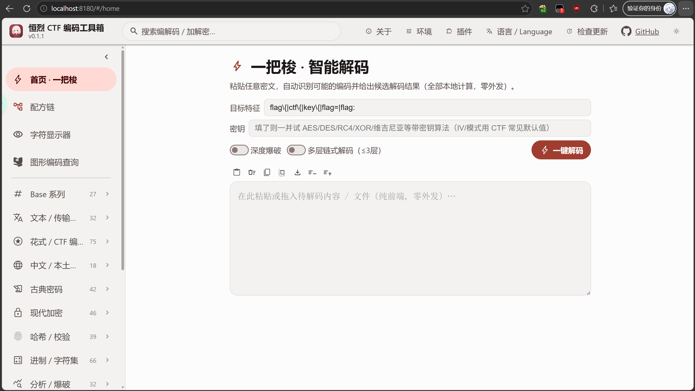
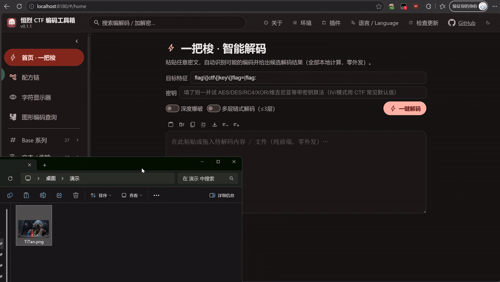
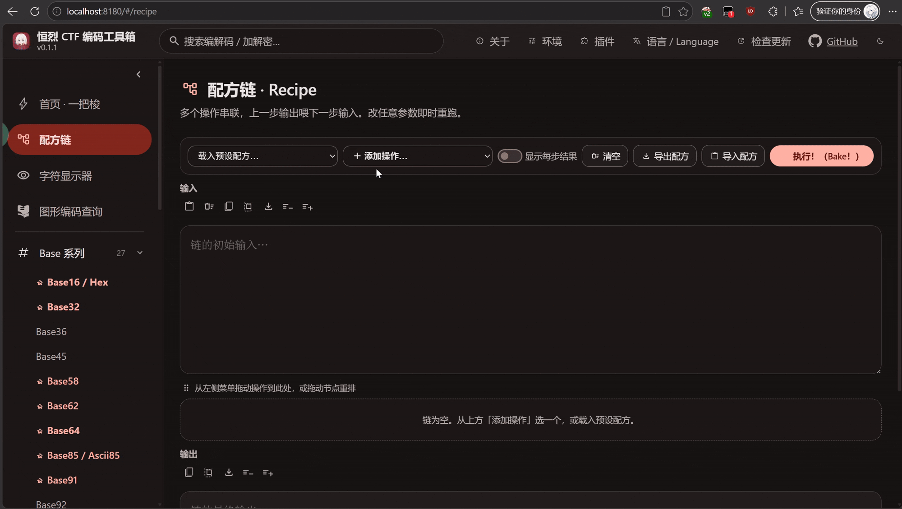
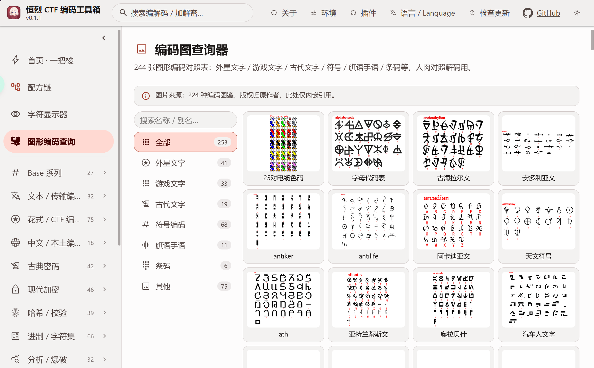
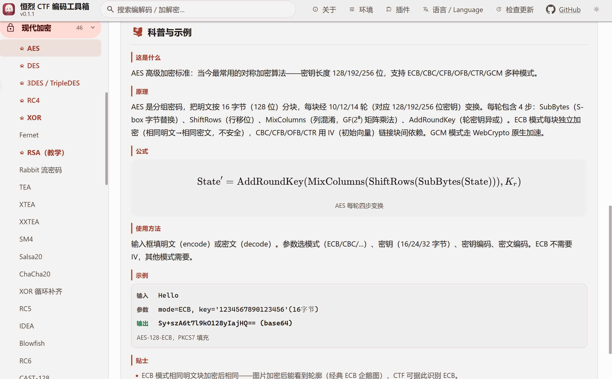
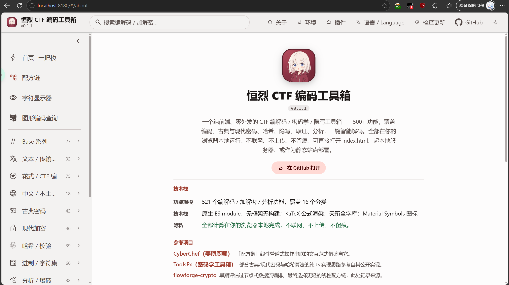
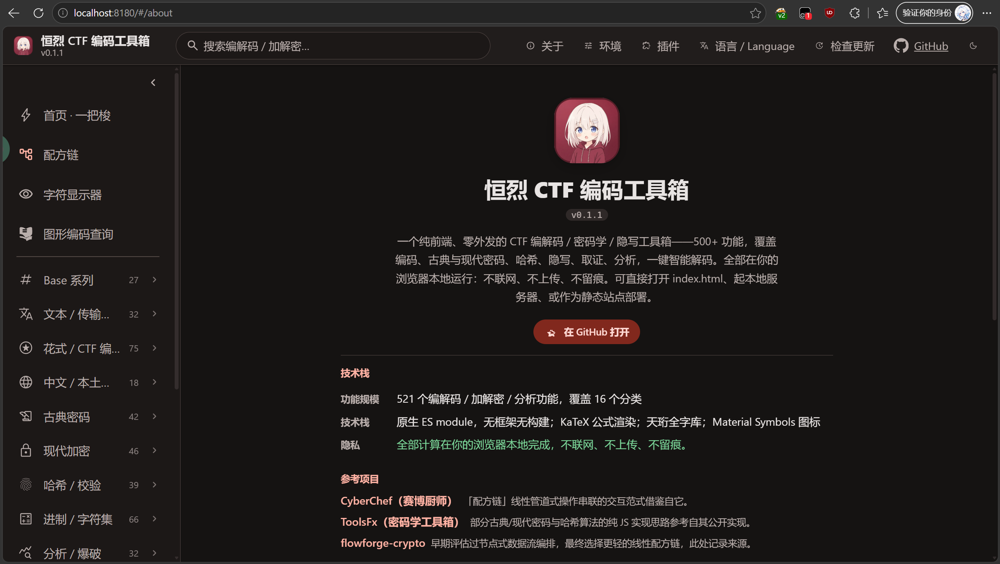

<p align="center">
  <a href="./README.md">简体中文</a> · <b>English</b>
</p>

<p align="center">
  
</p>
<h1 align="center">
  <span>EternalBlaze CTF Codebox · EBCTFCodeBox</span>
</h1>
<p align="center">
  <span align="center">A local-first, zero-upload codec / cryptography / steganalysis toolbox: 878 registered operations across 23 categories, most running entirely in your browser; Windows can additionally enable local-bridge capabilities, while macOS / Linux ship with double-click launchers.</span>
</p>

<p align="center">
  <a href="https://github.com/Henglie/EBCTFCodeBox/stargazers"></a>
  <a href="https://github.com/Henglie/EBCTFCodeBox/blob/main/LICENSE"></a>
  <a href="https://github.com/Henglie/EBCTFCodeBox/releases"></a>
</p>
<p align="center">
  <a href="https://github.com/Henglie/EBCTFCodeBox/issues"></a>
  <a href="https://github.com/Henglie/EBCTFCodeBox/pulls"></a>
  <a href="https://github.com/Henglie/EBCTFCodeBox/network/members"></a>
</p>

> [!WARNING]
> This tool is intended solely for CTF learning, competitions, and security research. Do not use it for anything illegal, for infringing on the rights of others, or for any purpose that could get you into trouble. You are responsible for all consequences of improper use.
> If you find a bug, an incorrect algorithm result, or missing documentation, feel free to open an Issue, ideally with a sample input, the expected output, and reproduction steps.

## Table of Contents

- [Quick Download](#quick-download)　　　　[Changelog](#changelog)
- [Introduction](#introduction)　　　　[Features](#features)
- [Screenshots](#screenshots)　　　　[Running](#running)
- [Platform Compatibility](#platform-compatibility)　　[Performance Requirements](#performance-requirements)
- [Directory Structure](#directory-structure)　　　　[Full Codec List](#full-codec-list-878-ops--23-categories)
- [Plugins & AI Access](#plugins--ai-access)　　[License](#license)
- [Third-party Resources & Licenses](#third-party-resources--licenses)　　[Privacy](#privacy)
- [Keywords](#keywords)

## Quick Download

> Core processing runs locally with zero upload. Download, unzip, and double-click `通用点我启动.py` (the "double-click launcher") to start — requires Python 3 on your machine. Windows can enable the local bridge; macOS / Linux automatically skip bridge-only capabilities.

| Cloud drive | Link | Passcode |
|---|---|---|
| Baidu Netdisk | https://pan.baidu.com/s/1Uqq_ONMBG9qA0dJvUG53Og?pwd=0000 | 0000 |
| Quark | https://pan.quark.cn/s/3b7e573b19c0 | none |

Current version **v0.1.12**. The source of truth is always the GitHub repository: [github.com/Henglie/EBCTFCodeBox](https://github.com/Henglie/EBCTFCodeBox).

## Changelog

## v0.1.12

### New

- Yunying cipher (01248); KNN A/B classifier; standalone StegSolve page.
- Rail Fence Z mode; W mode offset 0–64 and smart-decode support.
- Five Chinese lookup codecs: Wubi 86/98, Chinese Telegraph, Zhengma, Four-Corner, Cangjie.
- AEAD/PQC/ZIP/ECDH/RSA-OAEP/HPKE/Mach-O/WASM/GB18030/UTF-32/SHA-224/cSHAKE ops.
- Streaming file analysis, automatic stego leads and artifacts; smart result actions.
- Official plugin discovery from addons/; dCode plugin Beta with 408 ops.

### Fixed

- Real translation coverage; Chinese first, English second; language modal closes on route changes.
- Phantom_QR hang, stale result TOC, TOC dot overlap and runbar alignment.
- F5/QR limited samples stay explicit failures; pyc/bkcrack/imageDiff/archive fixes.

### Verification

878 main ops; 408 plugin ops; 110 challenges / 153 files; stage 1630 / manifest 2634; not pushed or released. See [CHANGELOG.md](./CHANGELOG.md).

## Introduction

`EternalBlaze CTF Codebox` (EBCTFCodeBox) is a local-first toolbox built around CTF scenarios but aimed at general-purpose encoding/decoding and cryptography needs.

It gathers encoding, classical ciphers, modern cryptography, hash verification, radix conversion, cryptanalysis / brute force, steganography, and image tooling into a single page. Core computation happens locally in the browser — your input is never uploaded; Windows can optionally enable a local bridge. The goal is to serve competition solving, cryptography learning, and everyday toolbox needs alike.

Core design:

- Native ES modules, no framework, no build step
- High-performance algorithms compiled to WASM from C / emscripten
- Material 3 warm-red theme, light / dark modes
- Bundled Cheonhyeong full-font library — rare glyphs render everywhere
- 20 languages

---

## Features

- **Local-first · zero upload**: Native ES modules, no framework, no build step. Core codecs run in-browser and never upload your input; "external link" ops only generate URLs. PWA updates fetch site assets only, the local bridge only talks to `127.0.0.1`, and external AI is only used after you configure an endpoint yourself.
- **One-shot smart decoding**: Paste or drop content; it detects possible encoding chains and returns ranked decode candidates, with crib-based filtering and deep brute force.
- **878 registered operations · 23 categories**: covering Base, text / transfer encodings, fancy CTF encodings, esoteric programming languages, Chinese / domestic encodings, classical ciphers, modern crypto (block / stream / asymmetric / other), hashes & checksums, radix & charsets (incl. primality testing and sieving), analysis / brute force, password attacks, compression & archives, password / archive cracking, forensics & traffic, file-format structures, data structures, images & QR codes, audio & video, steganography, plus 4 optional Windows GUI bridge entries. The complete list is generated automatically from the registry.
- **Decoding-strength quartet** (v0.1.2): strength levels + custom algorithm pool + a **separate brute-force channel** (XOR / Caesar / dictionary / rainbow-table / HMAC / PBE / Playfair / ZIP / CRC32 / bkcrack — results are grouped separately so they don't pollute the main ranking) + **decode depth 1–3**.
- **Lenient matching mode** (v0.1.2): at the Enhanced / Very Strong / Maximum / Custom levels, algorithms are admitted by character-class count alone, so variant-encoding challenges (a "meow" table for 0/1, emoji-as-binary) also participate; Default / Fast keep strict domain detection.
- **Key + ciphertext one-shot attack**: given ciphertext and a key, automatically enumerates AES / DES / 3DES / RC4 / XOR / Fernet × cipher modes × encoding combinations.
- **Drag-in file analysis**: dropping a file auto-detects its type, appended data, anomalous image dimensions, and more.
- **Full Unicode display**: bundled Cheonhyeong full-font library, loaded per Unicode plane on demand — rare characters, ancient scripts, and emoji all render correctly.
- **Cross-linked explainer cards**: when an explainer mentions an algorithm this toolbox implements, the name links to that op page in a new tab; only high-confidence names/aliases qualify, and book titles, code, formulas, and generic words are skipped.
- **Material 3 warm-red theme**, light / dark toggle, 20 languages.

> For the full feature walkthrough and scenario demos, see [`介绍文章.md`](./介绍文章.md) (Chinese).

## Screenshots

<p align="center">
  
</p>

<p align="center"><i>One-shot smart decoding: paste text and get ranked decode chains automatically</i></p>

<p align="center">
  
</p>

<p align="center"><i>Drop a file to auto-detect its type and strip appended data</i></p>

<p align="center">
  
</p>

<p align="center"><i>Recipe chains: wire multiple algorithms into a visual pipeline</i></p>

<table>
  <tr>
    <td></td>
    <td></td>
  </tr>
  <tr>
    <td align="center"><i>Encoding chart gallery · 253 reference tables</i></td>
    <td align="center"><i>Every algorithm ships with an edu explainer card</i></td>
  </tr>
  <tr>
    <td></td>
    <td></td>
  </tr>
  <tr>
    <td align="center"><i>Light theme</i></td>
    <td align="center"><i>Dark theme (Material 3 day/night)</i></td>
  </tr>
</table>

## Running

Pure static — any static server works. The bundled script is recommended (double-click or command line):

```bash
py 通用点我启动.py     # Windows (use py, not python3)
python3 通用点我启动.py # macOS / Linux
```

The script starts the static server and the local bridge (bridge.py, fixed port 8181, real capabilities on Windows only) together, then opens your default browser. The bridge runs in a background thread of the same process — no second window.

### Double-click launch on Linux / macOS

Equivalent to the "double-click the exe" flow on Windows. Only the **double-click entry points** live in the root; the binary cores are tucked into `bin/` (so they don't get clicked by mistake):

| File | Platform | How to use |
|---|---|---|
| `Windows点我启动.exe` | Windows | **Double-click** (32-bit single file, works on 64-bit and ARM64 Windows) |
| `macOS点我启动.command` | macOS | **Double-click** in Finder → Terminal opens and the control panel runs |
| `Linux点我启动.sh` | Linux | KDE (Dolphin): **double-click**; GNOME (Nautilus): right-click → Run (or tick "Allow executing as program" in Properties, then double-click) |
| `bin/macOS启动器` | macOS | universal2 single file (Apple Silicon + Intel), invoked by the .command above — no need to click directly |
| `bin/Linux启动器` | Linux | x86_64 ELF, invoked by the .sh above — no need to click directly |

- macOS uses `.command` because Finder won't open a terminal for a bare binary; Linux desktop environments disagree on double-click behaviour for raw binaries, so `.sh` + the executable bit is the portable choice.
- **First use**: if double-clicking does nothing after unzipping, grant the executable bit once (`chmod +x macOS点我启动.command bin/macOS启动器 Linux点我启动.sh bin/Linux启动器`). The launchers are unsigned — if Gatekeeper blocks the first open on macOS, click "Open Anyway" in System Settings → Privacy & Security, or right-click → Open.
- **Feature parity with Windows**: same C source; the control panel is 1 restart service / 2 free the occupied port / 3 local-bridge settings / 4 open browser / 5 refresh status / 0 exit (keyboard-driven line menu on Linux/macOS — no mouse hover highlighting, a terminal capability difference); local bridge, MCP, pyc decompile, and environment probing all work. Windows-only GUI tool launching and system accent colour degrade gracefully with a notice on these platforms. Both artifacts have passed static acceptance (architecture / linked dependencies / branch fingerprints / endpoint strings); real-machine acceptance is ongoing.

Or point any static server at the project root. There is no build step: edit and refresh.

### Deploying without Python

The project is pure static assets and can be hosted by any HTTP server (ES modules require an http(s) context — you cannot just double-click `index.html` over file://). Without Python, or if you would rather not use the launcher, pick one:

```bash
npx serve .                    # Node.js (pick any port)
python3 -m http.server 8180    # Python 3 installed, but not using the launcher
php -S localhost:8180          # PHP built-in server
```

Full web servers (nginx / Apache / Caddy, …) work too; two caveats:

1. `.wasm` must be served as `application/wasm`, otherwise the browser refuses streaming compilation.
2. Multithreaded WASM (e.g. bkcrack's pthread build) relies on `SharedArrayBuffer` and requires cross-origin isolation headers:

   ```
   Cross-Origin-Opener-Policy: same-origin
   Cross-Origin-Embedder-Policy: require-corp
   ```

   The bundled `通用点我启动.py` sends both headers by default; self-hosted servers need their own configuration. When the headers are missing, multithreaded WASM ops degrade gracefully or report unavailable — pure frontend features are unaffected.

The PWA is fully wired (`manifest.json` + `sw.js`): after the first online visit it precaches 853 core runtime assets (version updates are fetched incrementally by checksum — only changed files are transferred), supports installing to the desktop, and runs core features fully offline. Large on-demand assets (the four Cheonhyeong font planes, WASM, IDS composition data, encoding charts, KaTeX) are cached on first use and then work offline as well. The "Check for updates" button in the top bar downloads the complete new version before asking you to refresh.

## Platform Compatibility

| Platform | Frontend features | Local bridge (exe tools) | Launch |
|---|---|---|---|
| Windows | Full (primary platform) | JPHS / OpenPuff / OurSecret (GUI launch) + pyc/exe local decompile + system accent colour sync | `py 通用点我启动.py` |
| macOS | Full | Unavailable (no .exe); the bridge is auto-skipped and related ops grey out with a notice | Double-click `macOS点我启动.command`, or `python3 通用点我启动.py` |
| Linux | Full | Same as macOS, bridge auto-skipped | Double-click `Linux点我启动.sh`, or `python3 通用点我启动.py` |
| ChromeOS | Full (via the Crostini Linux container) | Same as Linux | `python3 通用点我启动.py` (inside Crostini) |
| HarmonyOS / Android / iOS | Full (PWA, touch-responsive) | Unavailable (no exe on mobile) | Open the deployed URL in a browser; optionally "Add to Home Screen" |

Notes:

- "Local bridge" refers to `bridge.py` (port 8181, Windows only), providing GUI launching, pyc/exe decompile, system accent colour, and other on-device capabilities. When the bridge is unavailable, in-browser features still work; bridge-dependent entries degrade with a notice.
- Mobile / HarmonyOS works offline after installing as a PWA; large assets (fonts / WASM / charts) are cached on demand and fetched once online at first use.
- The bridge only listens on `127.0.0.1` and never sends anything out — the zero-upload rule holds.

### Browser Requirements

Requires a modern browser with ES modules, WebAssembly, Web Workers, Service Worker, Web Crypto API, and DecompressionStream:

- Chrome / Edge 90+
- Firefox 113+
- Safari 16.4+

## Performance Requirements

The project is a pure frontend application — regular computation happens in the browser, with no server-side compute dependency; the few Windows local-bridge capabilities are noted separately. Requirements and suggestions per dimension:

| Dimension | Minimum | Recommended | Notes |
|---|---|---|---|
| CPU | single core | 4 cores+ | Web Worker pool size = `min(8, navigator.hardwareConcurrency)`; more cores speed up brute force / chunked large-file work |
| Memory | 512 MB | 1 GB+ | Cheonhyeong fonts and WASM load on demand; large-file analysis grows linearly with file size |
| GPU | not needed | hardware acceleration on | No GPU compute; GPU-accelerated compositing improves scroll / animation smoothness |
| Disk | keep 100 MB+ free | same | Code, fonts, WASM, and charts grow with versions — refer to the actual release package |
| Network | connection needed for first load | stable connection | Input is never uploaded; core features work offline after PWA install |
| Architecture | x86 / x64 / ARM all fine | same | The browser abstracts the architecture; WASM runs across them |

Multithreaded WASM (`SharedArrayBuffer`) needs the cross-origin isolation headers (COOP/COEP); `通用点我启动.py` sends them by default, and without them multithreaded ops fall back to single-thread or report unavailable, without affecting anything else. First paint uses HTTP/1.1 keep-alive, an early ES module entry, and lazy font loading; the complete offline assets are installed by the Service Worker in the background after the page loads.

## Directory Structure

```
index.html          entry
src/
  main.js           UI driver (declarative rendering from the registry)
  core/             algorithm layer (pure functions; each module self-registers into the registry)
  ui/               styles + icons + font loading
  i18n/             20 language packs (static zh/en master + 18 dynamic shards, incl. RTL and four ethnic-language packs)
public/
  icons/            Material Symbols Rounded icons (SVG)
  fonts/th/         Cheonhyeong first-paint subset + 4 plane WOFF2 files
资料/               algorithm cross-check tables + research artifacts (dev-only; not shipped in release packages)
```

## Full Codec List (878 ops · 23 categories)

> This section is generated from the real import closure; opId is the unique registry identifier.

### Base (30 ops)

| opId | Name | Notes |
|---|---|---|
| base16 | Base16 / Hex | Hexadecimal encoding, each byte as two hex chars, supports custom alphabet, uppercase, and space separator. |
| base32 | Base32 | RFC 4648 Base32 encoding, 5-bit grouping, supports custom alphabet. |
| base36 | Base36 | Treats whole bytes as a big integer, converts to base-36 string using 0-9a-z. |
| base45 | Base45 | RFC 9285 Base45 encoding, 2 bytes to 3 chars, common in QR codes. Space is a data character with value 36 (not a separator); triplets decoding above 65535 MUST be rejected per RFC 9285 section 6. |
| base58 | Base58 | Base58 encoding (Bitcoin alphabet), omits ambiguous chars, supports custom alphabet. |
| base62 | Base62 | Base62 encoding using 0-9A-Za-z charset, supports custom alphabet. |
| base64 | Base64 | Standard Base64 encoding, supports URL-safe variant and custom alphabet. |
| base85 | Base85 / Ascii85 | Adobe Ascii85 encoding, wrapped in <~ ~>, z compresses zero groups. |
| base91 | Base91 | basE91 encoding, maps byte stream to 91-char set, more efficient than Base64. |
| base92 | Base92 | Base92 encoding, 13-bit blocks to char pairs, supports custom alphabet. |
| base100 | Base100 | Base100 emoji encoding, each byte maps to one emoji (starting at U+1F3F7). |
| radixN | Arbitrary Radix | Converts text to/from N-radix big integer (N = 2..95), custom alphabet supported. |
| baseCustom | Custom Alphabet Base | Custom-alphabet Base encoding, radix equals alphabet length. |
| base58check | Base58Check | Base58 + double SHA-256 4-byte checksum (Bitcoin address checksum) |
| radix64 | Radix64 (crypt) | Password crypt alphabet ./A-Za-z0-9 (bit-packed, no padding) |
| base69 | Base69 | pshihn 7-byte blocking (with padding marker) |
| z85 | Z85 (ZeroMQ) | ZeroMQ Base85 dictionary-style (4 bytes → 5 chars) |
| base85ipv6 | Base85 IPv6 | IPv6-alphabet Base85 variant (RFC 1924) |
| base2048 | Base2048 | qntm 11-bit encoding (compact Unicode representation) |
| base65536 | Base65536 | Every 2 bytes → 1 CJK character (compact Unicode representation) |
| ecoji | Ecoji | 1024-emoji alphabet + padding (5 bytes → 4 emoji) |
| base64steg | Base64 Steganography | base64 padding-bit steganography (multiline, hides/extracts hidden information) |
| base32steg | Base32 Steganography | base32 padding-bit steganography (multiline, hides information in the last char's redundant bits, replicates the base64steg offset method) |
| base64dict | Caesar Custom Dict Base64 | Replaces the standard base64 alphabet with a 64-char custom dictionary |
| multilineBase64 | Multiline Base64 | Multiline base64 decode / line-split encode |
| base64decompress | Base64 + Zlib | base64 ↔ zlib compression (browser DecompressionStream) |
| modhex | Modhex (YubiKey) | YubiKey keyboard-layout-independent hexadecimal: alphabet cbdefghijklnrtuv ↔ 0-9a-f per-character substitution (UTF-8 byte stream), bidirectional; case-insensitive, decoding auto-tolerates common separators |
| citrixCtx1 | Citrix CTX1 | Citrix password encoding (common in .ica/Citrix credentials): UTF-16LE bytes chained-XOR 0xA5, each result's two nibbles +0x41 each mapped to A-P characters; bidirectional |
| crockford32 | Crockford Base32 | Human-readable Base32 (excludes I/L/O/U, o→0 i/l→1 tolerated, - ignored; optional mod 37 check digit * ~ $ = U); bitstream same convention as the Base32 op's crockford mode |
| dxBase64 | DXBase64 | 风之暇想 DXBase64: raw deflate + random-salt repeating XOR + CRC16-checksummed Base64 variant (checksummed, ciphertext differs every run, no key needed, anti-mangling) |

### Text / Transfer Encodings (42 ops)

| opId | Name | Notes |
|---|---|---|
| url | URL Encoding | RFC 3986 percent-encoding (standard/full/plus, three modes) |
| htmlEntity | HTML Entities | Named entities (&amp; etc.) + numeric forms (&#NN; / &#xHH;) |
| unicodeEscape | Unicode Escape | \uXXXX / U+XXXX / &#xHH;, three formats |
| quotedPrintable | Quoted-Printable | RFC 2045 (=XX escapes, soft line-break folding) |
| uuencode | UUencode | Unix-to-Unix (bytes-per-line value +32 at line start, 6-bit mapped to 32-95) |
| xxencode | XXencode | XX encoding (alphabet +-0-9A-Za-z, structure same as UU) |
| jsfuck | JSFuck | JS built from the six characters []()!+ (encode/decode; decode runs in a Function sandbox) |
| utf7 | UTF-7 Encoding | RFC 2152 (+...- modified base64, UTF-16BE) |
| punycode | Punycode (IDN) | RFC 3492 internationalized domain names (xn-- prefix, split by .) |
| jsHex | JS Hex Escape | \xXX byte escapes (unlike \uXXXX, per byte not per character) |
| mixHexOctBin | Mixed Radix Decode | Decodes mixed-prefix digit strings (0x/0b/0o/0d) into characters |
| hexReverse | Hex Byte Reverse | Swaps nibbles within each hex pair (1a2b → a1b2, self-inverse) |
| leetSpeak | Leet Speak (1337) | Classic 1337 letter substitution (A→4, E→3, O→0 etc.) |
| netbios | NetBIOS Encoding | Nibble + 'A' offset (each byte split into 4-bit halves + 'A') |
| caretMdecode | Caret/M Control | ^X = Ctrl+X (& 0x1F), M-X = Meta-X (\| 0x80) |
| natoAlphabet | NATO Phonetic Alphabet | NATO phonetic alphabet (A→Alpha, B→Bravo, ...) |
| asciiControl | ASCII Control Chars | Control character names ↔ ASCII values + Unicode symbols |
| utf32 | UTF-32 LE/BE | UTF-32 codec (fixed 4 bytes per code point): LE (FF FE 00 00 BOM) / BE (00 00 FE FF BOM); auto-detects the BOM, otherwise uses the selected endianness; length not a multiple of 4, surrogates and values above 0x10FFFF raise. Parameters: direction + endianness. |
| gb18030 | GB18030 strict (four-byte aware) | Strict GB18030 codec (same source as the WHATWG index): full four-byte region (rare hanzi, emoji, supplementary-plane linear region); encoding raises only for U+E5E5 and unpaired surrogates instead of silently falling back to UTF-8; decoding raises on invalid sequences/truncation/out-of-range pointers. Parameter: direction. |
| gbCharset | GBK / GB2312 / GB18030 | Chinese charsets ↔ UTF-8 (TextDecoder decode + runtime reverse-table encoding) |
| gb2312QuWei | GB2312 Quwei Code | Hanzi ↔ 4-digit qu-wei code (qu 01-94, wei 01-94, byte = qu/wei + 0xA0; ASCII passthrough). Without a separator, digits adjacent to a qu-wei code or runs of 4+ digits become indistinguishable, so newline separation is applied automatically to keep round-trips lossless |
| big5 | Big5 Traditional Chinese | Big5 ↔ UTF-8 (TextDecoder + reverse-table build) |
| shiftJis | Shift-JIS Japanese | Shift-JIS ↔ UTF-8 (TextDecoder + reverse-table build) |
| eucKr | EUC-KR Korean | EUC-KR ↔ UTF-8 (TextDecoder + reverse-table build) |
| latinCharset | Latin / ISO-8859 / Windows single-byte | Full ISO-8859 family + Windows codepages ↔ UTF-8 (single-byte direct mapping) |
| ebcdic | EBCDIC | IBM EBCDIC ↔ ASCII (embedded 037/1047 tables; default cp1047 includes []{}^~\; unrepresentable characters raise an error instead of silently becoming ?) |
| utf16 | UTF-16 BE/LE | UTF-16 encode/decode + BOM handling (encode can add BOM, decode auto-detects BOM) |
| mojibakeFix | Mojibake Fix | Restores common charset mismatches (decode = fix, encode = make garbled samples); some directions are lossy |
| urlQueryParse | URL Query Parse | Parses URL query strings (k=v&k=v after ?), percent-decode + '+' to space, lists key-values line by line. Full URLs accepted |
| cookieParse | Cookie Parse | Parses Cookie request headers (multiple name=value) or Set-Cookie response headers (key-values + attributes). Auto-strips Cookie:/Set-Cookie: prefixes |
| httpBasicAuth | HTTP Basic Auth | HTTP Basic authentication: encode builds 'Basic <base64>' from user:pass; decode restores 'Basic xxx' or bare base64 to user:pass |
| dataUriParse | Data URI Parse | Bidirectional data URI (text-level protocol): encode builds a data: URI from text with the chosen MIME + encoding; decode parses a data: URI into MIME + content (binary/image payloads are returned as files). Use Base64/dataURI to Image to restore image files, and Base64 for generic Base64 |
| magnetParse | Magnet Link Parse | Parses magnet:? links: xt exact topic (extracts the BTIH hash), dn display name, tr Tracker list, xl file size etc. |
| hexdump | Hexdump (xxd) | xxd-style hex dump ↔ original text: the encode direction outputs the 'offset: hex in two-byte groups + ASCII' three-column form (byte-identical to xxd, line width/case adjustable); the decode direction tolerates common formats such as xxd / hexdump -C / CyberChef (including * repeat lines) |
| fullwidth | Fullwidth | ASCII halfwidth ↔ fullwidth (space included), offset 0xFEE0 |
| bubblebabble | BubbleBabble Encoding | Antti Huima 2000 misread-resistant encoding: 2 bytes → 6 chars, wrapped in x, separated by - (e.g. ping → xisak-nerek-loxix). For readable CTF fingerprints/checksums |
| jsEscape | JS escape Encoding | Legacy JavaScript escape()/unescape() encoding: ASCII alphanumerics and @*_+-./ unencoded, other ASCII → %XX, non-ASCII → %uXXXX (UTF-16 code unit). Semantics differ from encodeURI/encodeURIComponent; old-style escape challenges appear in CTF occasionally |
| ppencode | ppencode | Perl keyword encoding (PPEncode): bytes → a pseudo-program of perl keywords (256-keyword dictionary + random candidates); running it prints the original |
| mimeMultipart | MIME Multipart Parser | Parses multipart/mixed mail/HTTP bodies: splits parts at the boundary, recognizes Content-Type/Transfer-Encoding (base64/QP/7bit) and decodes the body; the encode direction combines with \| separators |
| yenc | yEnc Encode / Decode | yEnc (Usenet binary transfer encoding, yEnc-1.3 spec): each byte +42 mod 256, the critical bytes NUL/CR/LF/'=' escaped with '=' +64. Leading TAB/space/'.' conservatively escaped. encode takes UTF-8 bytes, decode auto-skips =ybegin/=yend control lines |
| binhex | BinHex 4.0 Encode / Decode | Mac BinHex 4.0 (Yves Lempereur spec + Python binhex): 6-bit alphabet + RLE90 compression + CRC-16-CCITT. decode parses filename/type/creator/data fork/resource fork and verifies all three CRCs; encode wraps UTF-8 text into a compliant BinHex (data fork, empty resource fork) |
| regexTool | Generic Regex Extract / Replace | Regex extract or replace with a pre-compile structural whitelist: extract takes whole match / n-th group / all groups (tab-joined), with dedupe and first-only, joined by a configurable separator; replace expands $1..$9, $&amp;, $$. Backreferences, dangerous nested quantifiers, lookbehind and non-standard extensions are rejected before compilation (ReDoS defence); empty pattern, invalid regex and zero matches raise explicitly |

### Fancy / CTF Encodings (79 ops)

| opId | Name | Notes |
|---|---|---|
| scoutStick | Scout Stick Cipher (Chinese Code) | dCode's Code Chinois, also called the Samurai/scout stick cipher: horizontal bars encode the vowel index (A/E/I/O/U/Y = 1-6) and vertical bars the consonant offset after that vowel; DCODE = `\|\|\|- \|\|- ---- \|\|\|- --` (vertical bars first). Supports the Samurai role swap and horizontal-first notation; non-letters pass through |
| morse | Morse Code | Morse code (ITU-R M.1677): letters/digits/punctuation mapped to dots and dashes, / separates words. The table adds a few non-ITU punctuation marks (! ; & _ $ and { } * # %; & and % share shapes with ITU prosigns but differ in meaning); a token that is neither dots/dashes nor a table code is ignored as a whole. |
| bacon | Bacon Cipher | Bacon cipher: each letter as 5-bit a/b string, supports 24-letter (I=J, U=V) and 26-letter versions. |
| yunying | Yunying Cipher (01248) | 0 separates letters; 1/2/4/8 weights sum to A-Z; encoding accepts A-Z only, decoding rejects sums outside 1-26. |
| rot13 | ROT13 | ROT13: shifts letters by 13, self-reciprocal (applying twice restores original). |
| rot5 | ROT5 | ROT5: shifts digits by 5, self-reciprocal. |
| rot18 | ROT18 | ROT18: combination of ROT13 and ROT5, handles both letters and digits, self-reciprocal. |
| rot47 | ROT47 | ROT47: shifts ASCII 33-126 range by 47, self-reciprocal. |
| atbash | Atbash | Atbash cipher: reversed alphabet mapping (A<->Z), self-reciprocal. |
| a1z26 | A1Z26 | A1Z26 encoding: one-to-one mapping between letters and numbers 1-26. |
| dna | DNA Encoding | DNA encoding: 3-letter codons (A/C/G/T) mapped to/from characters. |
| keyboard | Keyboard Coords | Keyboard coordinate encoding: letters as QWERTY row/column positions (e.g., Q=11). |
| ook | Ook! | BrainFuck dialect (three tokens Ook. Ook? Ook!) |
| cetacean | Cetacean | 16-bit binary (1->e, 0->E) |
| yygq | Beast Sound Translator | Meme-phrase bitstream encoding (就这¿ / 不会吧？) |
| braille | Braille | U+2800 block ↔ ASCII (auto: auto-detect table / nabcc: standard 6-dot / raw: shuffled dictionary) |
| eightdiagram | 64 Hexagrams | base64 → 64-hexagram mapping |
| aaencode | AAEncode (Kaomoji) | aaencode kaomoji-style JS encoding (ASCII in octal / non-ASCII in hex) |
| baudot | Baudot Code | ITA2/ITA1 Baudot 5-bit binary (letters/figures dual table, mode switching) |
| type7 | Cisco Type7 | Cisco password Type7 (MAGIC_VALUES 53-entry XOR, 2-digit seed prefix) |
| decabit | Decabit Pulse Code | Decabit 10-symbol +− pulse encoding (0-126 char table) |
| txtmoji | txtmoji Emoji Cipher | txtmoji.com emoji encryption (AES-256-CBC OpenSSL + 65-emoji alphabet substitution + fixed-prefix cut). Password is a decimal/any passphrase. Common CTF form: emoji ciphertext whose title is the password |
| keyCode | JS keyCode Table | JS event.keyCode 8-222 → key names (multiple values separated by spaces/commas/semicolons) |
| shiftKey | Shift-Key Symbol | Shift+digit/symbol ↔ symbol/digit (self-reciprocal, both directions) |
| keyword9 | T9 Keyboard | Mobile T9 keypad, four modes: two digits / repeated digits / digits+\\|/ / letters+length; encode covers the last two modes |
| keyboardSurround | Keyboard Surround | Neighbor-key set → center key, or numeric coordinates → character (nliqwerty); encode reverses: center key → neighbor set, character → coordinates |
| qweAbc | QWERTY to ABC | QWERTY/QWERTZ/AZERTY keyboard ↔ standard ABC alphabet (decode lists all layouts; encode follows the target layout) |
| mirrorLetters | Mirror Letters | Latin letters ↔ horizontally mirrored Unicode glyphs (A↔A, b↔d, a→ɒ, E→Ǝ…; the five pairs ()[]{}<>/\ are this tool's conventional mirror pairs, not the Unicode Bidi_Mirrored property; digits not mapped), strictly invertible in both directions |
| hieroglyphs | Hieroglyphic Alphabet (MdC) | Latin letters ↔ Egyptian hieroglyphic unilaterals (Manuel de Codage, dCode convention): 20 letters encodable (A B D F G H I K L M N P Q R S T W X Y Z), C/E/J/O/U/V error with no glyph; decoding accepts 30 glyphs (including the 𓏭𓂝𓏲𓐝𓋔𓎛𓄡𓈙𓍿𓆓 variants) and normalizes output to uppercase; SPHINX→𓋴𓊪𓉔𓇋𓈖𓐍 |
| sga | Standard Galactic Alphabet (SGA) | 26 Latin letters ↔ Standard Galactic Alphabet (Commander Keen / Minecraft enchanting-table script); the text domain uses dCode's folk Unicode adaptation string (ᔑʖᓵ↸ᒷ⎓⊣⍑╎⋮ꖌꖎᒲリ𝙹!¡ᑑ∷ᓭℸ̣⚍⍊∴̇/\|\|, dCode self-assessed 'bad but widespread'); digits pass through untranslated, u/x carry combining dots (bare ℸ/∴ tolerated) |
| occult | Occult Alphabets (4) | theban mode: Theban alphabet, 24 glyphs (J→I, V/W→U merged, word-final . preserved, text token = letter, see dCode for the graphic layer); lunaire mode: Katz lunar alphabet (Ñ→N, 27 slots); celestial/malachim modes: Agrippa celestial / Malachim alphabets — Latin↔Hebrew transliteration (ג=C/G, ו=F/U/V/W, י=I/J/Y converge, X errors with no counterpart, ט/ס/צ error); CELESTIAL→גהלהשתיאל |
| marineFlags | International Signal Flags | International maritime signal flags (ICS): one flag per A-Z letter / 0-9 digit, text token = the character itself (flags have no Unicode, per dCode internal slot names); substitute mode: the 1st..4th repeated flags within a group are expressed with the k/l/m/n substitute flags (SOS→SOk), decoding restores in reverse and validates substitute references; off mode errors on k/l/m/n |
| americanMorse | American Morse | American Morse Code (19th-century continental telegraph, with internal spacing/long dash _, letters separated by /) |
| cnTelegraphMorse | Chinese Telegraph Morse | 4-digit Chinese telegraph code ↔ Morse (groups of 4; Chinese must first be looked up in the Standard Telegraph Codebook) |
| tapCode | Tap Code | 5×5 Polybius square tap code (row-column digit pairs, space-separated; optional I/J merge or K→C merge) |
| semaphore | Semaphore | Letters ↔ two-flag direction pairs (8 directions, based on Wikipedia Flag semaphore) |
| dtmf | DTMF Tones | DTMF keys → row-column frequency pairs (ITU-T Q.23, 697-941 × 1209-1633 Hz) |
| morseRhythm | Morse Rhythm Normalize | Morse dot/dash normalization (· − ↔ . -, multiple dot-dash variants supported) |
| pigpen | Pigpen Cipher | 26 letters in 3 grid zones (token form: textual descriptions 1A-3H) |
| keyboardShift | Keyboard Shift | QWERTY three-row cyclic shift (params: shift amount + direction) |
| layoutMap | Keyboard Layout Map | QWERTY ↔ Dvorak ↔ Colemak physical key-position mapping (47-key bijection, case preserved) |
| t9Phone | T9 Phone Keypad | Mobile T9 keypad encoding: twoDigit = fixed two digits (key number + press count, a=21 … z=94, space=00); multitap = multi-tap (2=a 22=b 222=c, space separates words, 0=space) |
| stenoLetter | Steno Alphabet | Steno-machine letter chords (Plover fingerspelling form, A-Z ↔ single stroke, space separates words) |
| arrowKey | Arrow-key Code | ↑↓←→ ↔ WASD / UDLR / numeric keypad (scheme chosen by parameter, lossless round-trip within a scheme) |
| manchester | Manchester Encoding | Manchester Encoding: transition at each bit center, 0/01 ↔ 1/10 (IEEE 802.3 / G.E. Thomas dual conventions). Input text or bitstream |
| diffManchester | Differential Manchester | Differential Manchester: always transitions mid-bit (clock), 0 = transition at period start, 1 = no transition (IEEE 802.5 Token Ring convention) |
| nrzi | NRZI Encoding | Non-Return-to-Zero Inverted: USB convention 0=transition/1=no transition, classic convention 1=transition/0=no transition. Used by USB 2.0 / Fast Ethernet |
| miller | Miller Code | Miller Code / Delay Modulation: 1 = mid-bit transition, 0 after 0 = transition at start, 0 after 1 = no transition. Used in disk storage |
| fourB5B | 4B5B Code | 4-bit → 5-bit code (FDDI/100BASE-TX). Table per ANSI X3T9.5, each 4 bits mapped to 5 to guarantee enough transitions |
| pwmPpm | PWM/PPM Modulation | PWM (pulse width) 0=10, 1=110; PPM (pulse position) 0=100, 1=010. Common in CTF hardware-stream visualization |
| musicNotation | Music Notation Converter | Note names (C4) / MIDI (60) / numbered notation (1) / solfège (do), four-way conversion. 15 major key signatures supported, A4=440Hz. encode = from→to, decode = to→from |
| musicInfo | Note Full Info | Input note name/MIDI/numbered notation/solfège, outputs all four formats + frequency + octave + semitone offset |
| kenny | Kenny Speak | South Park Kenny speak: M=0/P=1/F=2 ternary, A=MMM … Z=FFP, three syllables per letter; FFF may serve as space (extended mode) |
| alienAlphabet | Alien Alphabet | unicode mode: 26 Latin letters ↔ 26 Unicode symbols (⏃⏚☊⎅…, the dCode Alien Language table); futurama2 mode: Futurama AL2 self-modifying Cᵢ=(Pᵢ+Cᵢ₋₁) mod 26 (letter-level, the show's glyphs have no Unicode) |
| futhark | Futhark Runes | elder 24 glyphs / younger 16 glyphs (fuþąrkhniastbmlʀ); TH digraph (elder also has NG); decoding tolerates ᛋᛝ and short-twig variants; multi-letter merging (C/K/Q→ᚲ etc.) makes round-trips lossy |
| chuckUnary | Chuck Norris Unary | Characters → 7/8-bit ASCII concatenated into a bitstream, then run-length encoded: N consecutive 1s → '0' + N zeros, N consecutive 0s → '00' + N zeros, groups separated by spaces (Codingame-compatible) |
| wingdings | Wingdings Symbol Fonts | Plaintext ↔ Wingdings symbols: unicode mode uses real code points (☺✈☠★…, Alan Wood/Adobe tables); pua mode uses U+F020-F0FF (measured from the local wingding.ttf cmap, Word-style); four fonts wingdings1/2/3/zapf |
| fracmorse | Fractionated Morse | Plaintext to Morse, blocked into trigraphs, mapped onto a 26-letter key table (pycipher FracMorse) |
| qqxiuzi_arrow | Qianqian Xiuzi Arrow | Qianqian Xiuzi arrow cipher (formerly 'QQ Show arrow'; symbol table from the Qianqian Xiuzi website, unrelated to Tencent QQ Show. hex two chars + arrow mapping) |
| qqxiuzi_flower | Qianqian Xiuzi Flower | Qianqian Xiuzi flower cipher (formerly 'QQ Show flower'; hex two chars + flower-symbol mapping) |
| qqxiuzi_ipa | Qianqian Xiuzi IPA | Qianqian Xiuzi IPA cipher (formerly 'QQ Show IPA'; hex two chars + IPA consonant mapping) |
| qqxiuzi_letter | Qianqian Xiuzi Letter | Qianqian Xiuzi letter cipher (formerly 'QQ Show letters'; hex two chars + shuffled-letter mapping) |
| qqxiuzi_braille | Qianqian Xiuzi Braille | Qianqian Xiuzi braille cipher (formerly 'QQ Show braille'; 1 char/byte + \|128 wide-char handling) |
| qqxiuzi_chinese | Qianqian Xiuzi Chinese | Qianqian Xiuzi hanzi cipher (formerly 'QQ Show hanzi'; three tables SB/MB/MT + three suffixes =/==/===) |
| qqxiuzi_music | Qianqian Xiuzi Music | Qianqian Xiuzi music cipher (formerly 'QQ Show music'; decimal 3 chars + 10-item symbol table + three prefix/suffix styles) |
| lolcode | LOLCODE | LOLCODE character-shift encoding (-3 then >69 +5 else +2, non-bijective, H/I/J irreversible) |
| clockCipher | Clock Cipher | 12-hour dial + 5-minute tick clock code. Letters A-Z / digits 0-9 / common punctuation → 'H:MM' (e.g. A=1:00, B=1:05, M=2:00). Space-separated. A general invertible scheme (not aligned to any specific tool variant) |
| rot8000 | ROT8000 | Unicode ROT13: rotates the BMP valid-code-point table halfway (self-reciprocal); the offset parameter switches to the 31753 all-character shift compatible variant (everything but the space), auto auto-detects |
| jjencode | JJEncode | JavaScript symbolic obfuscation (Yosuke Hasegawa), source → only []()!+$_ symbols |
| spoon | Spoon | Prefix-code binary variant of Brainfuck (8 instructions mapped to Huffman-style 0/1 strings, strict bidirectional round-trip) |
| carbonaro | Carbonaro Cipher | Neapolitan Carbonari monoalphabetic substitution, Italian 21-letter positional swaps (involutory table, J K W X Y pass through) |
| albam | Albam Cipher | Latin version of the Hebrew Albam permutation: the 26 letters split in halves and swapped positionally (A↔N..M↔Z), involutory, numerically equivalent to ROT13 |
| twinHex | Twin-Hex Encoding | Two-character table-lookup encoding (a 96×96 combination table over ASCII 32-127, index converted to fixed-width 3-digit base36). ASCII printable characters only |
| trollScript | TrollScript | Three-character-token BrainFuck dialect (tro at the start, ll. at the end, instructions ooo/ool/olo/oll/loo/lol/llo/lll). encode generates / decode executes, 5-million-step limit |
| asciiSum | ASCII Prefix Sum | Accumulates ASCII codes per character into an increasing sequence (first term 0, space-separated). Decoding takes adjacent differences to restore |
| wabun | Wabun Code (Japanese Morse) | Japanese kana ↔ Morse (standard Wabun code table, with dakuten ゛, handakuten ゜ and the long-vowel mark ー; kana dot-dash separated by spaces, words by /) |
| astroSymbols | Astronomical / Zodiac Symbols | Celestial and constellation English names ↔ Unicode standard symbols: planets mode Sun☉Moon☽Mercury☿Venus♀Earth♁Mars♂…Ceres⚳ (U+2609/263D/263F/2640/2641/2642…26B3–B6); zodiac mode the twelve signs ♈–♓ (U+2648–2653); cross-mode symbols and unknown names error explicitly, non-letter characters pass through |
| emojiAes | emoji-aes Encrypt | Full emoji-aes: AES-256-CBC (OpenSSL) encryption then base64 → 65-emoji alphabet substitution (after Aaron Horler's emoji-aes) |
| roar | Roar Translator (4-char codec) | Beast-sound roar 4-character codec variant: Unicode code point → 4-digit hex → bitwise offset → codec 2-character mapping + prefix/suffix wrapping. codec customizable (4 distinct characters). A different algorithm from yygq (就这¿/不会吧？) |

### Esoteric Languages (15 ops)

| opId | Name | Notes |
|---|---|---|
| brainfuck | BrainFuck | 8-instruction BF, execute/generate, five-million-step limit; character-swap compatibility enabled by default |
| whitespace | Whitespace | space/tab/newline stack-machine language (stack/arithmetic/heap/flow-control/IO, 1-million-step limit, integer absolute value at most 2^53-1) |
| malbolge | Malbolge Detect | Esoteric-language load-form check (ignores whitespace, validates instructions by position; identify only, no execution) |
| deadfish | Deadfish | Accumulator language (i/d/s/o four instructions, increment/decrement/square/output, step-limit guard) |
| befunge | Befunge-93 Exec | 2D stack-based esoteric language executor (> < ^ v directions, @ ends, toroidal grid wrap, 1-million-step limit) |
| emojicodeIdent | Emojicode Detect | emoji-keyword language identification (🏁🍇🍉🔤🍮 signatures, identify and annotate only) |
| pietIdent | Piet Detect | Image color-block esoteric language identification (needs the image itself, identification and notes only) |
| malbolgeExec | Malbolge Execute | Malbolge interpreter (Ben Olmstead 1998 ternary VM): executes the program and outputs results, with normalize/assemble canonical-form conversion; step-limit guard-rail against infinite loops, EOF reads 59048 |
| pietExec | Piet Execution | Piet graphical-language interpreter (DP/CC state-machine execution → output). Accepts real images (PNG drop / base64 paste, npiet-completed paths) and color-block grid text (color codes Rl/Y/Gd/C/B/M + K black W white or 6-digit hex). Execution semantics aligned with npiet v1.3, execution only |
| blub | Blub! | Ook-family BrainFuck dialect (Blub. Blub? Blub! three tokens, pairwise combinations map to the 8 instructions). encode generates / decode executes |
| cow | COW / MOO | COW esoteric language (Sean Heber, 12 instructions moo/mOo/moO/mOO/Moo/MOo/MoO/MOO/OOO/MMM/oom/OOM, with loops + registers + the self-interpreting mOO, 5-million-step limit). encode generates / decode executes |
| brainlollerDecode | Brainloller Decode | Brainloller image → Brainfuck program (bftools-tested color table + serpentine path; terminating color firebrick, turn markers occupy a cell) |
| brainlollerEncode | Brainloller Encode | Brainfuck program → Brainloller PNG (serpentine layout, row capacity W-2, row capacity adjustable with width) |
| braincopterDecode | Braincopter Decode | Braincopter image → Brainfuck program (classic f=(-2R+3G+B) mod 11 convention; stops at nop/terminator) |
| braincopterEncode | Braincopter Encode | Brainfuck program → Braincopter PNG (per pixel f=(-2R+3G+B) mod 11, written with minimal edits, terminator padded to a multiple of the width; the carrier is a chosen solid color) |

### Chinese / Domestic Encodings (29 ops)

| opId | Name | Notes |
|---|---|---|
| pawnshop | Pawnshop Cipher | Per-hanzi count of stroke-protruding enclosed regions ↔ digits (classic Pawnshop cipher) |
| stemBranch | Heavenly Stems & Earthly Branches | Sexagenary-cycle (六十甲子) encoding (mode switches base60 big-integer / era-number mapping; era mode tolerates the reference implementation's typo dictionary with auto-detection) |
| baiJiaXing | Hundred Family Surnames | Hanzi ↔ base64 character mapping (赵钱孙李…) |
| element | Periodic Table | Element symbols ↔ atomic number ↔ character (H=1…Og=118) |
| foyu | Buddha's Words | keyfc 'Buddha's Words' (与佛论禅) V1: UTF-16LE + fixed-key AES-256-CBC + mantra-character mapping; does not support 如是我闻 V2 or old self-made dialects |
| wubi | Wubi (Five-Stroke) | Wubi 86/98 single-character full codes ↔ Chinese characters. Letter codes may be space-separated; unspaced strings are segmented by longest match. Characters sharing a code are listed by frequency. Parameters: version + candidate index + all candidates. |
| cnTelegraph | Chinese Telegraph Code | Chinese telegraph code (four digits) ↔ Chinese characters. Codes are grouped in fours; short tokens are left-padded with zeros. No parameters. |
| zhengma | Zhengma | Zhengma single-character codes ↔ Chinese characters. 1–4 uppercase letters; encoding prefers the full code. Characters sharing a code are listed by frequency. Parameters: candidate index + all candidates. |
| fourCorner | Four-Corner Code | Four-corner code ↔ Chinese characters. Accepts 5 digits (with the optional fifth digit), 4-digit main codes, and dotted forms such as 4022.7. Characters sharing a code are listed by frequency, all candidates by default. Parameters: digit count + candidate index + all candidates. |
| cangjie | Cangjie | Cangjie input codes ↔ Chinese characters. 1–5 uppercase letters (no Z); unspaced strings are segmented by longest match. Characters sharing a code are listed by frequency. Parameters: candidate index + all candidates. |
| shzyhxjzg | Socialist Core Values | UTF-8 hex → duo (10/11 prefix) → the 12 character pairs 富强民主…友善 (Socialist Core Values cipher) |
| makkaPakka | Makka Pakka | Characters → 玛卡巴卡/阿巴雅卡/咿呀呦…轰 segments (Makka Pakka language) |
| xianziCode | Ohou Codec (Xianzi) | Reversible Base7 codec: alphabet 哦/齁/♥/啊/呜/嗯/唔, prefix 仙子曰：, 3 characters per byte. Inputs ≥200 bytes are gzip/deflate compressed behind a protocol header; ❤️ and ♥ are equivalent |
| hajimiCode | Hakimi Cipher (ternary) | Hakimi ternary obfuscation: each UTF-16 code unit becomes 6/9/12 ternary digits with a random 0–8 shift and an optional passphrase shift. Output differs on every run; this is obfuscation, not cryptographic encryption |
| zakoCode | Zako Codec (Base8, open-source) | Open-source Zako Base8 codec (youzijiang233/zakocode): UTF-8 bytes as a big integer in base 8 over 可/是/杂/鱼/哦/🥵/♥/~. The closed-source Zako Whisper uses a different AES-256-GCM + invisible-variation-selector scheme — see Zako Whisper (official) |
| zakoMystery | Zako Whisper (official) | Reproduction of the closed-source zako.yhgf.top algorithm: PBKDF2-SHA256 (60k/180k/420k/800k iterations) + AES-256-GCM, 16-byte salt + 12-byte IV, ciphertext carried byte-by-byte in invisible variation selectors (U+FE00–FE0F / U+E0100–E01EF); the visible dialogue is only cover. Supports ZK2/ZK3/ZK4/ZK5 headers, gzip and legacy V5 visible-template decoding; the V6 visible carrier is generated from the site's own scene/persona/dialect tables via the payload hash. The default key is the site's public demo key (for demos/CTF only) |
| countingRods | Counting Rods | Chinese counting-rod numerals: ones, hundreds, myriads use vertical forms 𝍠-𝍨, tens, thousands, hundred-myriads use horizontal forms 𝍩-𝍱 (vertical for one, horizontal for ten, alternating), 0 uses 〇; spaces separate multiple numbers, bidirectional |
| suiYanSuiYu | SuiYanSuiYu | Character ord to base-4 → dictionary mapping + length prefix (cn fancy encoding) |
| fuyouyue | Fuyouyue (Buddha Says V2) | Buddha Says V2 (与佛论禅 V2, AES-256-CBC + Heart Sutra character mapping, full version) |
| tianshu | Tianshu (Heavenly Scripture) | Tianshu (天书曰, AES-256-CBC + Taoist scripture character mapping, a Buddha-Says variant) |
| xiongyue | XiongYue (Bear Says) | zlib compression + base91 + bear-language dictionary (prefix 熊曰：呋) |
| huoxingwen | Huoxingwen (Martian Text) | Simplified/Traditional/Martian three-way conversion (Martian-text mode) |
| jianfan | JianFan (Simplified-Traditional) | Simplified ↔ Traditional Chinese conversion (character-level charPYStr/ftPYStr mapping): fully correct conversion depends on word sense and context; this tool maps character-by-character, with regional glyph and variant differences (e.g. 发 → 發/髮 needs manual judgement) |
| numToPinyin | Number to Pinyin | Digits read as pinyin. Digit-by-digit reading (1 optionally yāo) or value reading (Chinese numeral reading, up to 兆). Tone marks toggleable |
| hanziToPinyin | Hanzi to Pinyin | Hanzi to pinyin (about 300 built-in high-frequency characters, polyphones take the common reading, out-of-table characters pass through / marked ?). Tone marks toggleable |
| moyue | Moyue (Abracadabra CN) | Abracadabra Chinese edition (classical-Chinese simulation / traditional modes, AES-256-CTR + compression + character-table substitution, key required) |
| xiangyue | XiangYue Full Decrypt | XiangYue full-pipeline decryption: Chinese/Emoji/zero-width/Japanese/Korean/pictographic ciphertexts → Argon2id/PBKDF2 + ChaCha20-Poly1305 + AES-CTR + zlib (default password built in; format1 derivation is slow, several seconds) |
| xiangyueEnc | XiangYue Encrypt | XiangYue encryption direction: plaintext → zlib + AES-CTR + ChaCha20-Poly1305 → Chinese/Japanese/Korean/pictographic/Emoji/zero-width/Base64 ciphertext, auto-recognized and restored by this toolbox's 'XiangYue' decryption (format2 fast; format1 Argon2id 64MiB, several seconds per run) |
| yueChang | YueChang | 风之暇想 YueChang: deflate + PBKDF2-SHA256 (100k iterations) + AES-GCM-256, Base64 mapped character-by-character to Chinese onomatopoeia (prefix '唱：', empty passphrase falls back to the default YueChang) |

### Classical Ciphers (71 ops)

| opId | Name | Notes |
|---|---|---|
| railFence | Rail Fence | Rail Fence cipher: W-zigzag (optional offset) or Z traditional columnar (write by column, read by row); parameters are rail count, mode and offset. |
| caesar | Caesar Cipher | Fixed shift (encode +shift, decode -shift); mode switches to progressive Caesar (character x shifts by shift±x); charset switches between letters-only and full printable-ASCII 33-126 shifting (for variants where non-letters move too) |
| scytale | Scytale Cipher | Grid transposition; the key can be read as column count or chars per column. Encoding appends \|, decoding keeps the full grid and does not delete real vertical bars; original length vs padding cannot be auto-distinguished. dCode-compatible three switches (padding char _ / strip non-alphanumerics / trim trailing fill) default off; enabled, matches dCode.fr byte-for-byte (3-source cross-check 36/36) |
| vigenere | Vigenère | Vigenere cipher: cyclic shift by letter key, key keeps letters only. |
| gronsfeld | Gronsfeld | Gronsfeld cipher: Vigenere variant using a numeric string as key. |
| beaufort | Beaufort | Beaufort cipher: self-reciprocal Vigenere variant, same function for enc/dec. |
| autokey | AutoKey | AutoKey cipher: key stream extends from keyword with plaintext itself. |
| porta | Porta | Porta cipher: self-reciprocal substitution, row selected by key letter. |
| playfair | Playfair | Playfair cipher: 5x5 keyed square, digraph row/column transform, J merged into I. |
| nihilist | Nihilist | Nihilist cipher: keyed Polybius square maps letters to digit pairs. |
| columnar | Columnar Transposition | Columnar transposition: reorders columns by key letter order, reads column-wise. |
| hill | Hill Cipher | Hill cipher: encrypts with nxn matrix mod 26, key length must be a perfect square. |
| affine | Affine Cipher | Affine cipher: y = a*x + b mod 26, requires a coprime to 26. |
| bifid | Bifid | Bifid cipher: Polybius coordinate transposition grouped by period. |
| trifid | Trifid | Trifid cipher: 3x3x3 cube encoding, key table must be 27 chars. |
| polybius | Polybius Square | Polybius square: 5x5 grid (J->I) maps letters to row/column coordinate pairs. |
| adfgx | ADFGX | ADFGX cipher: Polybius substitution (5x5) then columnar transposition, WWI German. |
| adfgvx | ADFGVX | ADFGVX cipher: 6x6 extension of ADFGX, alphabet includes digits. |
| foursquare | Four-Square | Four-square cipher: digraph substitution using two 25-letter keyed squares. |
| graycode | Gray Code | Gray code: converts text to/from Gray-code binary string, adjacent values differ by one bit. |
| trithemius | Trithemius Progressive Shift | Shifts the i-th letter by (start+i) mod 26 (early polyalphabetic form, Tabula Recta progression) |
| jefferson | Jefferson Disk | Jefferson/Bazeries wheel cipher: disk order is the key; after aligning plaintext to the baseline row, read out from the offset row; the offset is known so both directions work (default is the Wikipedia 10-disk example) |
| amsco | AMSCO Cipher | Incomplete columnar transposition: cell capacities alternate along anti-diagonals (split sequence, default 1,2), columns read out in key-letter order; default example DCODEAMSCO+CLE → DEAODSCCOM |
| ragbaby | Ragbaby Cipher | Polyalphabetic substitution: keyword alphabet + shift incrementing with in-word position (shift = word number + position in word − 1); lossless 26-letter mode / original 24-letter mode (J, X removed); default reproduces the CIPHER example |
| trilitere | Trilitère Cipher | Each letter → abc triplet (ternary, the ternary sibling of the Bacon cipher): default A=AAA…Z=CCB, space=CCC; symbols can be swapped to 1/2/3 or 0/1/2 |
| skipCipher | Skip Cipher | Fixed-step skip transposition: starting at start, take one character every s and wrap around; requires gcd(s, length)=1; default example DCODE+3 → DDCEO |
| vic | VIC Cipher | Cold-War pencil-and-paper cipher: phrase + date + personal number + key group chained additions derive the keystream → straddling checkerboard → columnar transposition + triangular-disruption double transposition; default is the Wikipedia example (derivation lines A-S reproducible) |
| phillips | Phillips Cipher | 5x5 square periodic substitution: row 1 shifts down stepwise to build 8 squares, a new square every block of 5 letters, plaintext takes the cell one down-right (ACA convention); default is the ACA 64-letter worked square |
| bellaso | Bellaso Cipher | 1553 reciprocal polyalphabetic substitution (dCode convention): the generated key's two halves complete each other into reciprocal alphabets, N tables with rotated second halves, the key letter taken per word selects the table; encrypt = decrypt; default reproduces the DCODE BELLASO example (alphabet=20) |
| slidefair | Slidefair Cipher | Digraph rectangular substitution: P1 on the top row and P2 on the key row form a diagonal, ciphertext takes the other two corners (top-row corner first); same-column degenerate case takes the pair to the right; Vigenère/Variant/Beaufort table selector; default is the ACA DIGRAPH example |
| collon | Collon Cipher | One letter → digraph (row head + column tail), then head/tail transposition over each run of N letters (dCode convention); default grid drops J with N=2, i.e. the dCode example DCODE→AAYXLAYYAZ |
| dancingMen | Dancing Men Cipher | Holmes 'The Adventure of the Dancing Men' monoalphabetic substitution: text token = letter + word-final flag * (dancing figures cannot be textualized; letters are the core per dCode's internal identifiers); story mode has only the original 18 letters (F/J/K/Q/U/W/X/Z error); default reproduces the flag structure of Wikipedia's fifth message ELSIE PREPARE TO MEET THY GOD |
| zodiac | Zodiac Z408 | Zodiac killer Z408 homophonic substitution (Harden 1969 solved subset, 54 symbols → letters, tokens use zodiackillerciphers machine names): encoding can rotate homophones, J/Q/Z error with no symbol; default decodes the first ciphertext line ILIKE… (Wikipedia/dCode convention) |
| threeSquare | Three-square Cipher | Three-square cipher: digraph → trigraph (same-column letter of square 1 + intersection of square 3 + same-row letter of square 2); random position parameterized as rotation/take-first, decryption uses only row/column numbers so strictly invertible; default is the official dCode example (ONE/TWO/THREE, Z removed), UDBJDC→CODE |
| monomeBinome | Monome-Binome Cipher | Polybius-family coordinate substitution: 3-row incomplete grid + two row-key digits; first-row letters yield 1-digit codes (monome), the other two rows yield 2-digit codes (binome); 3x10 mode has 28 slots (A-Z + space + *), 3x8 mode 24 letters (J→I, U→V); default reproduces the dCode examples MONOME→34363536345 / 4303536345→DINOME |
| yuanYin | Vowel Cipher | Digits → letters (1/2/3/4/5=a/e/i/o/u, consonants take two digits) |
| columnReplace | Column Transposition | Reads columns in key-letter order (plaintext space-padded to a multiple of keylen) |
| rowsReplace | Row Transposition | Every keylen characters form a block, reordered within the block by key-letter order |
| otp | One-Time Pad (OTP) | Mod-26 keystream addition/subtraction (alphabet, not byte XOR); the key must be at least the plaintext letter count |
| keywordcipher | Keyword Cipher | Deduplicated keyword up front + remaining letters appended in order, building a monoalphabetic substitution (caseMode=upper reproduces the original 'monoalphabetic substitution cipher' encode-uppercase/decode-lowercase behavior) |
| simplesub | Simple Substitution | Custom 26-letter substitution-table monoalphabetic substitution (A-Z mapped in order to the key table) |
| runningkey | Running Key Cipher | Vigenère with a long text as key (keystream advances per plaintext letter) |
| homophonic | Homophonic Substitution | One plaintext letter maps to multiple ciphertext symbols (00-99 digit pool or a custom pool) to resist frequency analysis; the table derives from key + allocation scheme, rotating or random |
| doubleTrans | Double Columnar Transposition | Columnar transposition applied twice (encrypt with key1 then key2, decrypt in reverse order); same convention as the 'Columnar Transposition' op (A-Z only, columns read in key-letter order) |
| pollux | Pollux Cipher | Morse-derived: dot/dash/separator each map to a symbol group (default 047/158/2369), taken rotating or randomly; word separator is two symbols (default, round-trippable) or one symbol |
| morbit | Morbit Cipher | Morse-derived: the Morse stream including separators is taken two symbols at a time (9 pairs), a 9-char key ranked alphabetically maps to digits 1-9; odd lengths get a separator appended |
| bookCipher | Book Cipher | Beale-style numbering pointing into a shared text: word = the N-th word overall; line-word = word w of line l; first/next positioning, lenient/strict matching |
| turningGrille | Turning Grille | Fleissner grille: an N×N grille rotated 90° four times, filling/reading cell by cell (clockwise/counter-clockwise); grille string # holes . solids / seed:seed / empty = canonical form; exactly 1 hole per orbit |
| cardanGrille | Cardan Grille | Fixed-grille mask extraction (no rotation, unlike the turning grille): X solid cells _ holes; fill mode hides plaintext in holes + random letters fill the solids (dCode main form), hide mode fills solids with cover text (Richelieu form); decryption reads the holes |
| bazeries | Bazeries Cipher | 5×5 square substitution + numeric-key group reversal (the key becomes an English word to build the key matrix, I/J merged, classical cipher) |
| fenham | Fenham Cipher | A-Z letters to 7-bit ASCII binary, XORed bit-by-bit with the key (binary output) |
| pizzini | Pizzini Cipher | A-Z → digit substitution (A=4..F=9, G=10..Z=29, undelimited digit string) |
| kamasutra | Kamasutra Cipher | Paired-table substitution (self-reciprocal: A↔B, C↔D..., encrypt = decrypt) |
| enigma | Enigma Machine | German Enigma I three-rotor cipher machine (rotors I-V + reflectors B/C + ring settings + plugboard, self-reciprocal) |
| m209 | M-209 Cipher Machine | WWII US M-209 (Hagelin) mechanical cipher machine (6 key wheels + 27-bar lug cage + pin settings, Beaufort self-reciprocal) |
| rotSpecial | Rot Special | Cyclic shift by any amount N (letters/alnum/ascii94), decode reverses |
| goldbug | Goldbug Cipher | Poe's 'The Gold-Bug' Kidd cipher symbol substitution (one unique symbol per each of the 26 letters, reversible teaching edition) |
| routeCipher | Route Cipher | Plaintext fills a W-column matrix, read out along serpentine/vertical routes (transposition cipher) |
| caesarBox | Caesar Box Transposition | Box (columnar) transposition: after removing spaces, writes row-wise into a grid of the given column width, then reads column-wise. Decryption transposes the column width and runs again. Note: fully restorable only when the length is a multiple of the column width (with leftover cells the transpose is not the inverse — inherent to the algorithm); spaces are stripped during encoding and not recoverable |
| curveCipher | Curve (Snake) Cipher | Serpentine (route) transposition: a row×col grid read column-wise serpentine-style, odd and even columns in opposite directions, the whole output reversed at the end. Requires row×col = text length |
| chaocipher | Chaocipher | Chaocipher two-rotor permutation cipher (Byrne 1918, disclosed 2010). Left = ciphertext wheel / right = plaintext wheel; after each encrypted character both wheels permute dynamically per the zenith/nadir rules. Default wheels are the official exhibit alphabets, customizable. A-Z only |
| straddleCheckerboard | Straddling Checkerboard | Straddling checkerboard: a variable-length encoding board. 8 high-frequency letters take single digits, two empty-column prefixes lead to double-digit rows, self-delimiting — decodable without separators. Default follows the classic Wikipedia layout (ATONESIR + prefixes 2/6). Off-board characters are skipped when encoding |
| nihilistCipher | Nihilist Cipher | Polybius square + keyword-addition classical cipher (5×5 square with I/J merged, plaintext/key encoded as two-digit numbers then added position-wise as integers; Russian Narodnaya Volya, 1880s) |
| solitaire | Solitaire (Pontifex) | Schneier's manual stream cipher (a.k.a. Pontifex), a 54-card deck evolves the keystream, keyword deck arrangement supported |
| ls47 | LS47 Card Cipher | 7×7 extension of ElsieFour/LC4 (49 characters with lowercase letters/digits/common symbols): cell rows/columns rotate per character + a marker mixing position, state self-synchronizing. Keys accept a 49-character permutation or a passphrase derivation. Character-for-character cross-checked against the official reference implementation ls47.py |
| alberti | Alberti Disk | 1467 polyalphabetic substitution disk: outer disk A-Z, inner disk a mixed alphabet, periodically rotatable |
| gematria | Gematria | Letters ↔ values: Ordinal/Pythagorean/Simple×6/Reverse/Hebrew/Greek, per-letter sequence + optional total Σ |
| foursquarekw | Four-square Cipher (keyword) | Four-square cipher: two keywords generate the ciphertext squares + two standard plaintext squares, digraph substitution. 5×5, odd length padded with X. Alphabet selectable I/J merge or Q omitted (the latter reproduces the official Wikipedia vector). Same algorithm as the existing foursquare (raw-square version) with a keyword entry point |
| twosquare | Two-square Cipher | Two-square cipher (double Playfair): two keyword squares, digraph substitution in horizontal or vertical arrangement. Self-reciprocal (encode = decode). 5×5, odd length padded with X; same column (vertical) / same row (horizontal) passes the pair through unchanged. Alphabet selectable I/J merge or Q omitted |
| beaufortVariant | Variant Beaufort | Variant Beaufort (the German variant of Beaufort): c = p − k (mod 26); encrypting = Vigenère decrypting, decrypting = Vigenère encrypting; not self-reciprocal (the mirror direction of the self-reciprocal standard Beaufort) |
| redefence | Redefence (Rail Fence) | Redefence: a row-order variant of the rail fence (W-shaped zig-zag) — rows read out in a given order or by keyword. The identity order degenerates to the standard rail fence. Parameters: rails / read order order / keyword key (order or key, one of the two) |

### Modern Crypto · Block (33 ops)

| opId | Name | Notes |
|---|---|---|
| aes | AES | AES (Advanced Encryption Standard): ECB/CBC/CFB/OFB/CTR (pure JS) and GCM (WebCrypto), key 16/24/32 bytes. |
| des | DES | DES (Data Encryption Standard, FIPS-46-3): 8-byte key, 8-byte block. |
| des3 | 3DES / TripleDES | 3DES (Triple DES, EDE): 16 or 24-byte key, 8-byte block. |
| kuznyechik | Kuznyechik (GOST R 34.12-2015) | Russian federal standard Kuznyechik (Grasshopper) block cipher: 128-bit block / 256-bit key / 10-round LSX-SPN, Feistel key schedule (C=L(Vec_128(i))). Multi-block ECB; plaintext/ciphertext/key all hex. encode encrypts / decode decrypts. Passes GOST R 34.12-2015 §A.1 (same source as RFC 7801 §5) vectors |
| tea | TEA | Tiny Encryption Algorithm (64-bit block, 128-bit key, 32-round Feistel, Wheeler 1994; supports ECB/CBC/CFB/OFB/CTR) |
| xtea | XTEA | Extended TEA (improved key schedule, 64-bit block, 128-bit key, 32 rounds, Needham 1997; supports ECB/CBC/CFB/OFB/CTR) |
| xxtea | XXTEA | Variable-length-block TEA (encrypts the whole data at once, ≥8 bytes, 128-bit key, Wheeler 1998) |
| sm4 | SM4 | Chinese national-standard block cipher (GB/T 32907-2016, formerly GM/T 0002-2012; 128-bit block, 128-bit key, 32 rounds of nonlinear iteration. Modes: ECB/CBC/CFB/OFB/CTR + GCM authenticated encryption) |
| noekeon | Noekeon | Noekeon block cipher (NESSIE nominee, 128-bit block/128-bit key, 16-round SPN direct round order). ECB/CBC, hex input/output, no padding. Passes botan noekeon.vec and NESSIE vectors (1029 single-block KATs, exact match) |
| shacal2 | SHACAL-2 | SHACAL-2 block cipher (NESSIE selected, 256-bit block, key up to 512 bits, based on the SHA-256 compression function). ECB/CBC, hex input/output, no padding. Passes botan shacal2.vec (1019 single-block KATs, exact match) |
| cast6 | CAST-256 | CAST-256/CAST6 block cipher (RFC 2612, 128-bit block, 128/192/256-bit key, 6 forward + 6 backward quad-rounds). ECB/CBC, hex input/output, no padding. Passes the three final-state KATs of RFC 2612 Appendix A |
| rc5 | RC5 | RC5-32/12/16 block cipher (RFC 2040, 64-bit block, 12 rounds, variable key; supports ECB/CBC/CFB/OFB/CTR) |
| idea | IDEA | International Data Encryption Algorithm (Lai 1991, 64-bit block, 128-bit key, 8.5 rounds, multiplication mod 2^16+1 + addition mod 2^16 + XOR) |
| blowfish | Blowfish | Blowfish block cipher (Schneier 1993, 64-bit block, variable 4-56-byte key, 16-round Feistel; supports ECB/CBC/CFB/OFB/CTR) |
| rc6 | RC6 | RC6 block cipher (128-bit block, variable 1-255-byte key, 20 rounds; supports ECB/CBC/CFB/OFB/CTR. Note: RFC 2276 is not an RC6 standard; RC6 has no public RFC, see the Rivest/Shamir/Yin paper) |
| cast5 | CAST-128 | CAST-128/CAST5 block cipher (RFC 2144, 64-bit block, variable 5-16-byte key, 12/16 rounds; supports ECB/CBC/CFB/OFB/CTR) |
| twofish | Twofish | Twofish block cipher (Schneier's 1998 AES proposal, 128-bit block, 16 rounds, 128/192/256-bit key; supports ECB/CBC/CFB/OFB/CTR) |
| aesCmac | AES-CMAC | AES-CMAC message authentication code (RFC 4493, AES-128) |
| sm4Cmac | SM4-CMAC | SM4-CMAC message authentication code (SM4 block + ISO/IEC 9797-1 structure) |
| camellia | Camellia Cipher | NTT/Mitsubishi Camellia block cipher: 128-bit block, 128/192/256-bit key (18/24-round Feistel), FL/FLINV inserted every 6 rounds. NESSIE/CRYPTREC recommended. Multi-block ECB; plaintext/ciphertext/key all hex. encode encrypts / decode decrypts. Passes the three RFC 3713 Appendix C vectors |
| seed | SEED Cipher | Korean KISA standard SEED block cipher: 128-bit block / 128-bit key / 16-round Feistel, two 8x8 S-boxes + masked linear mixing (equivalent to four extended SS-boxes). Multi-block ECB; plaintext/ciphertext/key all hex. encode encrypts / decode decrypts. Passes the two RFC 4269 Appendix B vector sets |
| rc2 | RC2 | RC2 symmetric encryption/decryption (RFC 2268, ECB/CBC, pure JS, key 1..128 bytes) |
| aesKeyWrap | AES Key Wrap (RFC 3394/5649) | AES key wrap (RFC 3394, AIV=A6×8, plaintext must be a multiple of 8 bytes) / wrap with padding (RFC 5649, AIV=A65959A6+length, any length 1..2^32 bytes). KEK supports AES-128/192/256; unwrap integrity-check failure errors explicitly. Verified against the five RFC 3394 §4.1-4.6 vectors + two RFC 5649 §6 official vector sets |
| simonSpeck | Simon / Speck Lightweight Ciphers | NSA Simon (AND-rotate) and Speck (ARX) lightweight block ciphers, ECB single/multi-block. Plaintext, ciphertext and key all hex. encode encrypts / decode decrypts. Passes the official test vectors of the paper's Appendix C |
| des2Mitm | 2DES Meet-in-the-Middle | 2DES meet-in-the-middle attack (MITM): C=DES_k2(DES_k1(P)), a forward table + reverse table lookup recovers both keys (keyBits controls each half's keyspace, default 16 bits; enter plaintext hex/ciphertext hex in the param boxes, 8 bytes each; the main input box is no longer used) |
| magma | GOST Magma Cipher | Russian federal standard Magma block cipher (modernized definition of the original GOST 28147-89): 64-bit block / 256-bit key / 32-round Feistel, S-box id-tc26-gost-28147-param-Z. Multi-block ECB; plaintext/ciphertext/key all hex. encode encrypts / decode decrypts. Passes the official §A.2 vectors |
| present | PRESENT Lightweight Cipher | PRESENT lightweight block cipher (Bogdanov 2007 / ISO/IEC 29192-2): 64-bit block, 80/128-bit key, 31-round SPN (4-bit S-box + bit permutation). Plaintext/ciphertext/key all hex, multi-block ECB. encode encrypts / decode decrypts. Passes the official all-zero test vectors |
| serpent | Serpent Cipher | Serpent block cipher (Anderson/Biham/Knudsen): AES competition runner-up, 128-bit block, 128/192/256-bit key, 32-round SPN, 8 bit-sliced S-boxes. Multi-block ECB; plaintext/ciphertext/key all hex. encode encrypts / decode decrypts. Cross-checked vector-by-vector against a reference implementation |
| aria | ARIA Cipher | Korean standard ARIA block cipher: 128-bit block, 128/192/256-bit key (12/14/16 rounds). Alternating SL1/SL2 substitution layers + involutory diffusion layer A, RFC 5794 key schedule. Multi-block ECB; plaintext/ciphertext/key all hex. encode encrypts / decode decrypts. Passes the three RFC 5794 Appendix A vector sets |
| threefish | Threefish Tweakable Block Cipher | Threefish tweakable block cipher (built into Skein v1.3): 256/512/1024-bit blocks, same-length keys, 72/80 rounds with no separate key schedule (subkey injection every 4 rounds) + 128-bit tweak. Plaintext/ciphertext/key/tweak all hex, multi-block ECB. encode encrypts / decode decrypts. Passes the official Crypto++ threefish.txt vectors |
| skipjack | Skipjack Block Cipher | Skipjack block cipher (NSA, declassified 1998, heart of the Clipper chip): 64-bit block, 80-bit key, 32 rounds (8A+8B+8A+8B). Plaintext/ciphertext/key all hex, multi-block ECB. encode encrypts / decode decrypts. Passes the official NIST SP800-17 Table 6 vectors |
| mars | MARS Block Cipher | MARS block cipher (IBM 1998, AES finalist): 128-bit block, 128/192/256-bit key, 32 rounds (forward mixing + cryptographic core + backward mixing). Plaintext/ciphertext/key all hex, multi-block ECB. encode encrypts / decode decrypts. Passes the official Crypto++ marsval.dat vectors |

| bfvToy | BFV Toy Homomorphic Encryption (teaching) | BFV teaching implementation (ePrint 2012/144): negacyclic ring R_q, ternary secret, Δ=⌊q/t⌋ scaling; encrypt/decrypt/homomorphic add/mul (no relinearisation, ciphertext grows to 3 components). Each step prints noise ‖e‖∞ against the Δ/2 = q/(2t) budget; overflow fails explicitly instead of returning garbage. Teaching demo, not production: n≤16, q≤2^32, t≤2^16, no NTT/relin/mod-switch, directly breakable at this size |

### Modern Crypto · Stream (21 ops)

| opId | Name | Notes |
|---|---|---|
| rc4 | RC4 | RC4 stream cipher, same transform for enc/dec, key of any length. |
| xor | XOR | XOR with repeating key, self-inverse, one of the most common symmetric transforms in CTF. |
| salsa20 | Salsa20 | Salsa20/20 stream cipher (Bernstein, 16/32-byte key, 8-byte nonce, 64-bit block counter) |
| chacha20 | ChaCha20 | ChaCha20 stream cipher (RFC 8439, 32-byte key, 12-byte nonce, 32-bit block counter) |
| rabbit | Rabbit Stream Cipher | RFC 4503 Rabbit stream cipher. Three variants: CryptoJS Legacy (default in older online tools; recommended) / CryptoJS standard / RFC 4503 document orientation (behaviour of 0.1.9 and earlier). Use a 32-hex key directly (IV optional); any other value - or empty - is treated as a passphrase via the CryptoJS OpenSSL envelope (Salted base64). decode automatically tries the empty passphrase and common passwords for CryptoJS ciphertext (starting with U2FsdGVkX1). |
| flashSwirl | FlashSwirl | ARX symmetric stream cipher by the author '风之暇想' (256-bit key + 192-bit nonce, 8/20 rounds). encode: text → Hex ciphertext; decode: Hex → text. Symmetric and invertible; official stream test vectors verified |
| zuc | ZUC Stream Cipher | Chinese national-standard stream cipher (GB/T 33133.1-2016, formerly GM/T 0001-2012, 128-bit key + 128-bit IV, the 3GPP LTE encryption standard) |
| a51 | A5/1 Stream Cipher | GSM A5/1 voice-encryption stream cipher (Briceno/Goldberg/Wagner reference implementation): three LFSRs (19/22/23 bits) with majority-vote clocking. 64-bit session key Kc + 22-bit frame number. Self-inverse XOR: encode text → ciphertext hex, decode ciphertext hex → text |
| a52 | A5/2 Stream Cipher | GSM A5/2 voice-encryption stream cipher (Briceno/Goldberg/Wagner reference implementation): four LFSRs (19/22/23/17 bits), R4 majority clocking + masked-bit nonlinear output, output delayed one beat. 64-bit session key Kc + 22-bit frame number. Self-inverse XOR: encode text → ciphertext hex, decode ciphertext hex → text |
| e0 | E0 Stream Cipher | Bluetooth E0 stream cipher (Bluetooth Core Spec Volume 2 §3): 4 LFSRs (25/31/33/39 bits) + summation combiner T1/T2 + 2-bit blend memory. 128-bit Kc + 48-bit BD_ADDR + 26-bit CLK. Self-inverse XOR: encode text → ciphertext hex, decode ciphertext hex → text. Cross-verified against a Python reference implementation on 5 vectors |
| hc128 | HC-128 Stream Cipher | HC-128 stream cipher (Wu Hongjun, FSE 2004, eSTREAM finalist): P/Q each 512×32-bit tables + f1/f2 (SHA-256 σ) + h1/h2 nonlinear maps. 128-bit key + 128-bit IV. Self-inverse XOR: encode text → ciphertext hex, decode ciphertext hex → text. Passes the official Crypto++ vectors (key=IV=0 + key=80..0) |
| hc256 | HC-256 Stream Cipher | HC-256 stream cipher (Wu Hongjun, FSE 2004, eSTREAM finalist): P/Q each 1024×32-bit tables + f1/f2 (SHA-256 σ) + G1/G2 (table lookups included) + h1/h2 (4-byte indexing). 256-bit key + 256-bit IV. Self-inverse XOR: encode text → ciphertext hex, decode ciphertext hex → text. Passes the official Crypto++ vectors (3 sets: key=IV=0 / IV=01 / key=55) |
| sosemanuk | Sosemanuk Stream Cipher | Sosemanuk stream cipher (eSTREAM finalist, Berbain 2008): LFSR (10×32-bit words, α-multiplication feedback) + FSM (r1/r2 + conditional selection) + Serpent S2-box diffusion. key 128-256 bits + IV 128 bits. Self-inverse XOR: encode text → ciphertext hex, decode ciphertext hex → text. Ported line-by-line from the official eSTREAM reference implementation, 2 official vector self-checks |
| spritz | Spritz Stream Cipher | Spritz stream cipher (Rivest & Schuldt 2014 paper version): a-counter absorption + five-index sponge state, output doubly-pointer chained mixing, resistant to RC4's known biases. key (+ optional IV) auto-detected as text or hex. Self-inverse XOR: encode text → ciphertext hex, decode ciphertext hex → text |
| vmpc | VMPC Stream Cipher | VMPC stream cipher (Zoltak 2004): 768-round KSA + self-inverse XOR keystream, resistant to known RC4 attacks. Modes: basic = Key→IV two passes / full = Key→IV→Key three passes (safer). key/iv auto-detected as text or hex. encode text → ciphertext hex, decode ciphertext hex → text |
| mickey | MICKEY-128 2.0 Stream Cipher | MICKEY-128 2.0 stream cipher (Babbage & Dodd, eSTREAM Phase 3 finalist): R/S dual 160-bit registers, irregular clocking (Control_R=S[54]^R[106], Control_S=S[106]^R[53]) + Galois dual feedback. 128-bit key + 0-128-bit IV (MSB-first loading). Ported line-by-line from the official C implementation, official vector self-checks. Self-inverse XOR: encode text → ciphertext hex, decode reverses |
| trivium | Trivium Stream Cipher | Trivium (80-bit key + 80-bit IV, 288-bit state). encode: plaintext → Hex ciphertext; decode: Hex → plaintext. Symmetric and invertible. Compatible with the 风之暇想 fzxx/Trivium-Grain online site (trivium-grain.js.org), ciphertext bytes interoperable |
| grainV1 | Grain v1 Stream Cipher | Grain v1 (80-bit key + 64-bit IV, LFSR80+NFSR80+h). encode: plaintext → Hex ciphertext; decode: Hex → plaintext. Symmetric and invertible. Compatible with the 风之暇想 fzxx/Trivium-Grain online site, ciphertext bytes interoperable |
| grain128aead | Grain-128AEAD | Grain-128AEAD (128-bit key + 96-bit nonce, real AEAD, 64-bit tag). encode: plaintext+AD → Hex ciphertext (with trailing 8-byte tag); decode: Hex → plaintext with tag verification, errors on failure. Compatible with the 风之暇想 fzxx/Trivium-Grain online site, ciphertext bytes interoperable |
| rc4Drop | RC4-drop / CipherSaber-2 | RC4-drop[n] (drops the first n keystream bytes, RFC 6229 offset modes, default 768 = SANS recommendation) and CipherSaber-2 (10-byte IV prefix + KSA repeated r rounds, default r=20) |
| xsalsa20 | XSalsa20 | XSalsa20 stream cipher (Bernstein, 'Extending the Salsa20 nonce'): HSalsa20 derives a 32-byte subkey + Salsa20/20, 32-byte key, 24-byte nonce, 64-bit block counter (self-reciprocal) |

### Modern Crypto · Asymmetric (126 ops)

| opId | Name | Notes |
|---|---|---|
| rsa | RSA | RSA (educational) modular exponentiation: encrypt c=m^e mod n, decrypt m=c^d mod n, decimal big numbers in/out. |
| ecdsaKeyGen | ECDSA Key Pair Generation | ECDSA key pair generation: secp256k1 / P-256 / P-384 / P-521 selectable, outputs private key d and public key (both compressed 02/03‖X and uncompressed 04‖X‖Y formats). Randomness from crypto.getRandomValues with unbiased rejection sampling. Domain parameters: SEC 2 v2 / FIPS 186-4 D.1.2 |
| ecdsaSign | ECDSA Sign | ECDSA signing: input message (text/hex) + private key d, curves secp256k1/P-256/P-384/P-521, hash SHA-256/384/512, k selectable as RFC 6979 deterministic (reproducible) or random. Outputs r,s decimal+hex, DER hex, and the k used. RFC 6979 A.2.5 official vectors verified character-for-character |
| ecdsaVerify | ECDSA Verify | ECDSA verification: input message + public key (compressed/uncompressed/X‖Y hex auto-detected, G = generator) + signature (r;s decimal/hex or DER hex auto-detected). Four curves selectable, hash SHA-256/384/512. Outputs the full w/u1/u2/R process and the validity verdict |
| ecdsaSigConvert | ECDSA Signature Format Converter | ECDSA signature conversion among three formats: raw r;s (decimal/0x hex) ↔ DER (ASN.1 SEQUENCE{r,s}, ITU-T X.690) ↔ JOSE (r\|\|s fixed-width base64url, RFC 7515). Curve parameters determine the fixed element width for JOSE/raw-hex (P-256=32B etc.) |
| eccCalc | ECC Point Calculator | Elliptic curve point arithmetic calculator: point add/subtract/scalar multiply/double. Four preset curves (secp256k1/P-256/P-384/P-521) or custom p/a/b/Gx/Gy/n. Points accept compressed 02/03‖X, uncompressed 04‖X‖Y, bare X‖Y, G (generator), O (point at infinity); k accepts decimal/0x hex/negative. The point at infinity outputs Infinity |
| rsaGenKeyPair | RSA Key Pair Generation | Locally generates an RSA key pair (pure JS BigInt, prime Miller-Rabin reuses primeGen), outputs decimal n/e/d/p/q/dp/dq/qinv + PEM (PKCS#1 / PKCS#8 / SPKI, DER per ITU-T X.690). Separate private/public key download buttons (PEM primary, DER / JWK secondary). 512-bit has been factored in reality, teaching only; use at least 2048-bit in practice; 2048-bit takes about a second, 4096-bit several seconds and blocks the page — expected |
| mlkemKeyGen | ML-KEM Key Generation | FIPS 203 ML-KEM-512/768/1024 (post-quantum KEM) key pair generation, d/z seeds can be fixed for reproducibility (with FO transform). Pure JS, milliseconds per run |
| mlkemEncaps | ML-KEM Encapsulation | FIPS 203 encapsulation: input public key ek, outputs ciphertext ct and shared secret SS (32B); randomness m can be fixed for reproducibility (with ek type/modulus checks) |
| mlkemDecaps | ML-KEM Decapsulation | FIPS 203 decapsulation: input private key dk + ciphertext ct, outputs shared secret SS (32B); a tampered ciphertext goes through implicit rejection returning a pseudorandom K̄ (with type/hash checks) |
| pqcBlobParse | PQC Blob Parser (ML-KEM/ML-DSA/SLH-DSA) | Classify ML-KEM/ML-DSA/SLH-DSA public keys, private keys, KEM ciphertexts and signatures: prefer PEM/SPKI/PKCS#8 OIDs; raw hex only reports a length match with ambiguity. No certificate parsing or decryption. Parameters: format + object kind + scheme. |
| ntruPack | NTRU Coefficient Pack | NTRU EESS coefficient packing: q coefficients 11 bits, ternary 2 bits, big-endian bitstream with zero padding, optional 1-byte parameter-set tag. Serialization only; no CCA-2. Parameters: parameter set + coefficient field + tag. |
| ntruUnpack | NTRU Coefficient Unpack | NTRU coefficient unpacking: restore N coefficients by parameter set/field, strictly checking length, tag, padding bits and illegal ternary 11. Parameters: parameter set + coefficient field + tag. |
| ecdhP | ECDH shared secret (prime-field curves) | Prime-field ECDH (SEC 1 v2.0 §3.3.1 / RFC 5903): your private d + peer public point Q → the x-coordinate of d·Q is the shared secret. Curves secp256k1/P-256/P-384/P-521. Byte-exact against RFC 5903 §8 vectors. Parameters: curve + private key + peer public key + mode + peer private key. |
| rsaOaepEnc | RSA-OAEP encrypt | RSAES-OAEP (RFC 8017 §7.1): EME-OAEP padding + RSAEP. SHA-1/SHA-256 (MGF1 same-hash, interoperable with OpenSSL/Node). Public key as PEM (PKCS#1/SPKI) or decimal n,e; seed optional for reproducibility. Parameters: hash + key form + n + e + PEM + seed. |
| rsaOaepDec | RSA-OAEP decrypt | RSAES-OAEP decryption (RFC 8017 §7.1.2): RSADP + EME-OAEP decode. Private key as PEM (PKCS#1/PKCS#8) or decimal n,e,d; hash must match encryption; failures use one uniform message. Parameters: hash + key form + n + e + d + PEM. |
| x25519KeyGen | X25519 Key Generation | X25519 key generation (RFC 7748): private key 32 random bytes (or given) → public key = X25519(clamp(private key), base point 9). Pairs with the two 'shared key' modes for ECDH |
| x25519Shared | X25519 Shared Key (both private keys) | X25519 ECDH (RFC 7748 §6.1, teaching mode: both A/B private keys held locally): K = X25519(a, B public) == X25519(b, A public), outputs both sides verified equal |
| x25519SharedFromPub | X25519 Shared Key (priv + peer pub) | X25519 ECDH (RFC 7748 §6.1, practical mode): only your own private key + the peer's public key, K = X25519(private key, peer public key). Same result as the 'both private keys' mode |
| hpkeSeal | HPKE encrypt (Base) | RFC 9180 HPKE Base Mode encryption with the fixed suite DHKEM(X25519,HKDF-SHA256) + HKDF-SHA256 + ChaCha20-Poly1305 (Appendix A.2). Input plaintext + recipient X25519 public key (32B hex); outputs enc and ciphertext. Empty ephemeral key = random; an explicit key reproduces the RFC vectors. Parameters: info + aad + pkR + skE. |
| hpkeOpen | HPKE decrypt (Base) | RFC 9180 HPKE Base Mode decryption (same suite): input enc + ciphertext + recipient X25519 private key (info/aad must match); recovers plaintext; tag failures raise a clear error. Parameters: info + aad + enc + ct + skR. |
| rsaParams | RSA Parameter Calc (p,q→n,φ,d) | Derives n, φ(n), d, dp, dq, qinv from p,q,e (enter p and q in the param boxes, decimal; the main input box is no longer used) |
| rsaModinv | Modular Inverse (a⁻¹ mod m) | Extended Euclid computes the multiplicative inverse of a mod m; self-reciprocal both ways (encode/decode inverse: inv(inv(a))=a) (enter a and m in the param boxes, decimal; the main input box is no longer used) |
| rsaEgcd | Extended Euclidean (Bézout) | Computes gcd(a,b) and Bézout coefficients x,y with a·x + b·y = g (enter a and b in the param boxes, decimal; the main input box is no longer used) |
| rsaCrt | Chinese Remainder Theorem (CRT) | Merges simultaneous congruences x ≡ r_i mod m_i (one box for residues, one for moduli, comma-separated) |
| rsaModpow | Modular Exponentiation (base^exp mod m) | BigInt modular exponentiation (enter base, exp, mod in the param boxes, decimal; the main input box is no longer used) |
| sm2KeyGen | SM2 Key Pair Generation | Generates an SM2 (sm2p256v1, GB/T 32918.5-2017 Appendix A base point) key pair: private key d ∈ [1,n-1], public key P=dG. Private/public key (uncompressed and compressed formats) downloaded separately (artifact protocol) |
| sm2Encrypt | SM2 Encrypt | SM2 public-key encryption (GB/T 32918.4-2016): encrypts with the peer's public key (x,y), outputs C1\|\|C3\|\|C2 or C1\|\|C2\|\|C3 ordered ciphertext (hex/base64/utf8 selectable) |
| sm2Decrypt | SM2 Decrypt | SM2 private-key decryption (GB/T 32918.4-2016): input an SM2 ciphertext (04 prefix, hex/base64), decrypt to plaintext with private key d. Auto-adapts to C1\|\|C3\|\|C2 / C1\|\|C2\|\|C3 ordering |
| sm2Sign | SM2 Sign | SM2 digital signature (GB/T 32918.2-2016): ZA=SM3(ENTL\|\|ID_A\|\|a\|\|b\|\|x_G\|\|y_G\|\|x_P\|\|y_P) (G and P concatenated by coordinates, private key d not included), e=SM3(ZA\|\|M), outputs r\|\|s (each 32-byte hex, concatenated). Entering the public key (x,y) derives Za per the standard; leaving it empty signs M directly per the legacy convention |
| sm2Verify | SM2 Verify | SM2 signature verification (GB/T 32918.2-2016): input message + signature r/s (32-byte hex each) + public key (x,y) + ID_A, recomputes SM3(ZA\|\|M) and checks the validity of (r,s) |
| sm2KeyExchange | SM2 Key Exchange | SM2 key exchange protocol (GB/T 32918.3-2016): both sides' private keys + IDs derive the session key K (1..65536 bits selectable), outputs ephemeral points R_A/R_B and S1/S2 confirmation values (demo convention: ephemeral randomness generated internally) |
| sm9KeyGen | SM9 Key Generation | SM9 identity-based cryptographic key system generation (GB/T 38665.2-2020): signing ks / encryption ke dual master key pairs (random, fixed values injectable to reproduce vectors) + user signing private key (G1) / encryption private key (G2) and user public key derived per uid. KGC model: the user's public key is the identity, no certificates needed |
| sm9Sign | SM9 Sign | SM9 identity-based digital signature (GB/T 38665.2-2020): signing master public key (G2) + user signing private key (G1) + message → signature (h, S). h is 32-byte hex, S is a G1 point of 65 bytes (04‖x‖y). Supports a fixed r to reproduce official vectors |
| sm9Verify | SM9 Verify | SM9 identity-based verification (GB/T 38665.2-2020): signing master public key (G2) + signer uid + hid + message + signature (h, S) → valid/invalid. Recomputes the bilinear pairing e(S,PA)·g^h and compares against H2 |
| sm9Encrypt | SM9 Encrypt | SM9 identity-based encryption (GB/T 38665.4-2020): encryption master public key (G1) + recipient uid → ciphertext C1‖C3‖C2 (C1 is 64-byte x‖y). Only the peer's identity is needed to encrypt, no certificate; supports a fixed r to reproduce official vectors |
| sm9Decrypt | SM9 Decrypt | SM9 identity-based decryption (GB/T 38665.4-2020): user encryption private key (G2) + recipient uid + ciphertext C1‖C3‖C2 → plaintext. A failed C3 check (tampering / wrong uid / wrong key) errors out |
| xwingKeyGen | X-Wing Key Generation | X-Wing hybrid KEM (X25519+ML-KEM-768, draft-connolly-cfrg-xwing-kem) key generation: a 32B seed SHAKE256-extended to 96B derives both components, pk = ML-KEM ek (1184B) ‖ X25519 public key (32B). Seed fixable for reproducibility |
| xwingEncaps | X-Wing Encapsulate | X-Wing encapsulation: input public key pk (1216B), ct = ML-KEM ct (1088B) ‖ X25519 ephemeral public key (32B), ss = SHA3-256(ss_M‖ss_X‖ct_X‖pk_X‖"\./""/^\"). eseed fixable to reproduce official test vectors |
| xwingDecaps | X-Wing Decapsulate | X-Wing decapsulation: input ciphertext ct (1120B) + private key sk (32B seed), re-extends both components from the seed and derives ss. A tampered ciphertext goes through the ML-KEM implicit-rejection path (unpredictable output) |
| xmssKeyGen | XMSS Key Generation | RFC 8391 XMSS-SHA2_10_256 (n=32, w=16, h=10) key pair generation, pure JS. SK_SEED/SK_PRF/PUB_SEED each 32B hex, fixable for reproducibility; random by default. Tree building = 2^10 WOTS+ leaves (about a million hashes, seconds). ⚠ Stateful signatures: idx must never be reused |
| xmssSign | XMSS Sign | RFC 8391 XMSS-SHA2_10_256 signing: R=PRF(SK_PRF,idx), M'=H_msg(R‖root‖idx‖M), WOTS+ signs M' + auth path. Signature 2500B = idx(4)‖R‖WOTS(2144)‖auth(320). ⚠ Real use must maintain state; index reuse = private-key compromise |
| xmssVerify | XMSS Verify | RFC 8391 XMSS-SHA2_10_256 verification: WOTS_pkFromSig → L-tree → auth-path root recomputation, compared against the public-key root. pk 64B (root‖PUB_SEED) or 68B (with OID). A wrong signature length / out-of-range index is rejected outright |
| lmsSign | LMS/HSS Sign | RFC 8554 LMS single-level or HSS two-level signatures (SHA-256, h=5/10, w=4/8), the private key pseudo-randomly derived from SEED per Appendix A (x=H(I‖q‖i‖0xff‖SEED)). Fixed SEED/I/C reproduces the official vectors (TC2 convention). ⚠ Stateful signatures: q must never be reused |
| lmsVerify | LMS/HSS Verify | RFC 8554 verification: HSS multi-level (LMS verification layer by layer, signatures self-describing) or LMS single-level. LM-OTS public-key candidate Kc → D_LEAF/D_INTR root recomputation layer by layer → compared against K. Official vectors TC1/TC2 public keys + signatures paste directly |
| hqcKeyGen | HQC Key Generation | HQC-128/192/256 (NIST round-4 post-quantum KEM, based on quasi-cyclic syndrome decoding) key pair generation, seed fixable for reproducibility. Pure JS implementation |
| hqcEncrypt | HQC Encrypt | HQC KEM encapsulation: plaintext (≤k bytes, right zero-padded) encapsulated as ciphertext c=u‖v‖salt plus shared secret SS (32B); m/salt fixable for reproducibility (SFO-transform convention) |
| hqcDecrypt | HQC Decrypt | HQC KEM decapsulation: input private key dk + ciphertext c, outputs shared secret SS (32B) and plaintext; ciphertext tampering goes through implicit rejection returning a pseudorandom K̄ (error-correcting decoding included) |
| ntruKeyGen | NTRU Key Generation (real params) | EESS v3.1 real-parameter NTRU (ees401ep1/ep2/ees439ep1/ees659ep1, q=2048) key pair generation, product-form private key f=1+p·F1·F2+p·F3; unrelated to ntruToy's toy parameters |
| ntruEncrypt | NTRU Encrypt (real params) | EESS v3.1 real-parameter NTRU encryption: e = r∗h + m mod q (SVES coefficient mapping + random b field), the passively secure core PKE (not full SVES CCA-2) |
| ntruDecrypt | NTRU Decrypt (real params) | EESS v3.1 real-parameter NTRU decryption: a = f∗e mod q → centered into (−q/2,q/2] → mod 3 → SVES inverse mapping restores the plaintext (zero padding / length check included) |
| blsKeyGen | BLS Key Generation | BLS keygen (IETF draft-irtf-cfrg-bls-signature, BLS12-381 + RFC 9380): sk in [1,r-1] (random if empty), pk=[sk]G1 as a 48-byte compressed point, interoperable with ETH2 |
| blsSign | BLS Sign | BLS sign: σ=[sk]·H(m) with RFC 9380 hash-to-curve (constant-time); outputs a 96-byte compressed G2 point; deterministic (same sk and message always yield the same signature) |
| blsVerify | BLS Verify | BLS verify: e(σ,G1) ?= e(H(m),pk) with KeyValidate (non-infinity + subgroup); pk is 48-byte, σ is 96-byte compressed hex |
| blsAggVerify | BLS Aggregate Verify | BLS aggregate verify (basic scheme): one pairing check over n (pk, message, signature) triples; messages must be pairwise distinct (rogue-key defense), KeyValidate per group |
| merkleProve | Merkle Inclusion Proof | SHA-256 Merkle tree: one leaf per input line, params take the leaf index (0-based) → outputs the root, leaf hash and sibling path; a lone odd leaf is duplicated (Bitcoin convention) |
| merkleVerify | Merkle Proof Verify | Verifies a Merkle inclusion proof: the main input takes the leaf original, params take the root/path JSON (a merkleProve artifact) |
| pedersenCommit | Pedersen Commitment | Pedersen commitment C=m·G+r·H on BLS12-381 G1 (H derived via RFC 9380 hash-to-curve with unknown discrete log): perfectly hiding, computationally binding; m is a decimal integer (<r), points are 48-byte compressed hex |
| feldmanVss | Feldman VSS | Feldman VSS (t-out-of-n on BLS12-381 G1): A_j=[a_j]G, shares (i,f(i)); secret parsed exactly as a decimal string, integer t≥1, n≥t, out-of-range inputs rejected explicitly |
| lsagSign | LSAG Ring Sign | LSAG ring signature (Liu–Wei–Wong 2004, BLS12-381 G1): Hp generated via RFC 9380 hash-to-curve (unknown discrete log, signer not localizable from public values); key image enables linkability; ring keys are 48-byte compressed hex |
| lsagVerify | LSAG Ring Verify | LSAG ring signature verification: challenge-chain closure recomputed around the ring (BLS12-381 G1, Hp via RFC 9380 hash-to-curve); main input takes the original message, params take the ring public-key list (one 48-byte compressed hex per line) and the signature JSON |
| elgamal | ElGamal | ElGamal public-key encryption: ciphertext (c1,c2), c1=g^k, c2=m·y^k, decryption m=c2·(c1^x)⁻¹. Ciphertext format c1,c2 (comma-separated) |
| elgamalKeyGen | ElGamal Key Generator | One-click ElGamal key pair generation (HAC §8.4.1): safe prime p=2q+1 + generator g + private key x + public key y=g^x. Artifacts pair directly with the 'ElGamal' op's encryption/decryption params |
| pemToHex | PEM to DER | Extracts raw DER bytes from PEM (any BEGIN/END label): base64 decode + RFC 7468 §6 lenient scrubbing (strip whitespace, drop epitaph lines, skip EC PARAMETERS blocks). Outputs DER hex or a 16-byte hexdump. Cross-checkable with openssl asn1parse / xxd -r -p. Attaches the canonical base64 and the recognized label. Does not parse DER structure (see PEM→JWK) |
| hexToPem | DER to PEM | Wraps DER (hex or base64) as PEM: RFC 7468 §5.2 format, 64-char folding. Label selectable among RSA PRIVATE KEY / PRIVATE KEY / PUBLIC KEY / EC PRIVATE KEY / CERTIFICATE or custom. hex/base64 auto-detected (under auto, all-hex input is treated as hex). Attaches a best-effort top-level DER parse hint (legal DER not enforced) |
| pemToJwk | PEM to JWK | PEM private/public key → JWK JSON (RFC 7517/7518). RSA: PKCS#1 (RFC 8017 §A.1.2) / PKCS#8 (RFC 5208) / SPKI (RFC 5280) → n,e,d,p,q,dp,dq,qi; EC: SEC 1 (RFC 5915) / PKCS#8 / SPKI → crv,x,y,d, curve OID mapping P-256/P-384/P-521 (RFC 5480) + secp256k1 (RFC 8812 §3.2). Fields base64url without padding (RFC 4648 §5); missing public coordinates are computed as d·G. Attaches n bit length and x/y hex lines for openssl -text cross-checks |
| jwkToPem | JWK to PEM | JWK JSON → PEM. RSA private key yields PKCS#1 + PKCS#8 blocks (RFC 8017 §A.1.2 / RFC 5208, CRT parameters dp/dq/qi auto-derived when missing); RSA public key yields SPKI (RFC 5280). EC private key yields SEC 1 traditional + PKCS#8 blocks (RFC 5915 / RFC 5480 §2.2, the embedded version omits the [0] curve parameters per the standard); EC public key yields SPKI (BIT STRING = 04‖X‖Y). Missing public coordinates are computed as d·G to complete |
| pubFromPriv | Private to Public Key | Extracts the public key from a private key (PEM or JWK input). RSA: public key = (n, e), outputs SPKI PEM (RFC 5280) + JWK (RFC 7518 §6.3.1). EC: public key = d·G elliptic-curve point multiplication (Jacobian coordinates), outputs SPKI PEM + JWK{crv,x,y}; the curve is decided by the private key's structural OID (RFC 5480) or the JWK crv field. Output cross-checks byte-for-byte against openssl pkey -pubout |
| rsaSign | RSA Sign | RSASSA PKCS#1 v1.5 and PSS signing (RFC 8017): builds EM per §9.2/§9.1 then s = EM^d mod n (modPow reuses primeGen). The private key accepts decimal n,d or PEM (PKCS#1 RSA PRIVATE KEY / PKCS#8 PRIVATE KEY). PSS salt length defaults to hLen; two signatures of the same message under the same key differing is expected PSS random-salt behavior. 512-bit moduli cannot run PSS with SHA-256 or above (emLen < hLen+sLen+2) — use a bigger key or a shorter salt |
| rsaVerify | RSA Verify | RSASSA PKCS#1 v1.5 and PSS verification (RFC 8017 §8.2.2/§8.1.2): s^e mod n recovers EM then checks item by item (v1.5 recomputes EM and compares byte-for-byte; PSS checks the 0xbc sentinel/leading zero bits/DB structure/H recomputation), outputs valid/invalid with the failure position. The public key accepts decimal n,e or PEM (PUBLIC KEY SPKI / RSA PUBLIC KEY). Signature hex or decimal. PSS salt length optionally auto-inferred |
| ed448Sign | Ed448 Sign | Pure EdDSA Ed448 signing (RFC 8032, SHAKE-256, 57-byte key/114-byte signature, ~224-bit security): private key random when empty, outputs public key and signature. context supported (optional). Passes the nine RFC 8032 §7.4 official vectors |
| ed448Verify | Ed448 Verify | Pure EdDSA Ed448 verification (RFC 8032 §5.2.7): public key + 114-byte signature + original message, checks [4][S]B = [4]R + [4][k]A. Tampering with any byte of message/signature fails |
| x448KeyGen | X448 Key Generation | Curve448 key pair generation (RFC 7748): private key 56 random bytes (or given) → public key = X448(clamp(private key), base point 5). Pairs with the 'X448 Shared Key' op for ECDH |
| x448Shared | X448 Shared Secret | ECDH on Curve448 (RFC 7748 §6.2): both private keys derive the shared key (both sides verified equal), or your private key + the peer public key directly. Shared key downloadable |
| gostSign | GOST R 34.10-2012 Sign | Russian national standard EC signature (RFC 7091, hash Streebog-256/512 per parameter set): private key random when empty, outputs public key Q and signature ζ = R\|\|S (big-endian). k fixable for teaching recomputation. Passes RFC 7091 §7.2 official vectors + pygost cross-checks |
| gostVerify | GOST R 34.10-2012 Verify | Russian national standard EC verification (RFC 7091 §6.2): public key Q(x,y) + signature ζ = R\|\|S + original message, recomputes C = z1·P + z2·Q and compares x(C) mod q. Tampering with any part fails |
| pgpGenKeyPair | PGP Key Pair Generation | PGP key pair generation (RFC 4880, openpgp.js v5.11.3): Curve25519 (default) or RSA-3072, optional passphrase protection for the private key. Outputs ASCII Armor public/private key blocks, public/private downloaded separately (private key ⚠ sensitive) |
| pgpEncrypt | PGP Encrypt | PGP encryption (RFC 4880 CFB/EAX, openpgp.js): plaintext + public key block → ASCII Armor ciphertext; optional embedded private-key signature (sign-then-encrypt) |
| pgpDecrypt | PGP Decrypt | PGP decryption (openpgp.js): ASCII Armor ciphertext + private key block (+passphrase) → plaintext; a signed ciphertext also yields the verification result |
| pgpSign | PGP Sign | PGP signing (RFC 4880, openpgp.js): plaintext + private key block → cleartext signed (readable signed text); artifact .sig |
| pgpVerify | PGP Verify | PGP verification (openpgp.js): signed text/detached signature + public key block → valid/invalid + signer |
| pgpEncryptAndSign | PGP Encrypt and Sign | PGP encrypt-and-sign (sign then encrypt, openpgp.js): plaintext + peer public key + own private key → ciphertext (signature embedded) |
| pgpDecryptAndVerify | PGP Decrypt and Verify | PGP decrypt-and-verify (openpgp.js): ciphertext + own private key + signer's public key → plaintext + verification verdict |
| pgpParseKey | PGP Key Parser | PGP key parsing (RFC 4880 packet structure, openpgp.js): public/private key block → KeyID/algorithm/creation time/fingerprint/user IDs/subkey table/capability flags |
| ed25519KeyGen | Ed25519 Key Generation | Ed25519 key generation (RFC 8032 §5.1.5): private key 32 random bytes (or given) → h=SHA-512(private key), a=clamp(h[0:32]), public key = encodePoint(a·B). Pairs with the 'Sign/Verify' modes |
| ed25519Sign | Ed25519 Sign | Ed25519 signing (RFC 8032 §5.1.6): r=H(prefix‖M) mod L, R=r·B, k=H(R‖A‖M) mod L, S=(r+k·a) mod L, signature=R(32B)‖S(32B). Deterministic signatures (no random nonce). Output includes a self-check verification |
| ed25519Verify | Ed25519 Verify | Ed25519 verification (RFC 8032 §5.1.7): checks 8·S·B == 8·R + 8·k·A (the implementation uses the non-batched S·B == R + k·A). Input public key (32B), signature (64B) and message |
| mldsaKeyGen | ML-DSA Keygen | FIPS 204 ML-DSA-44/65/87 (post-quantum signature) key pair generation, seed ξ fixable for reproducibility (FIPS 204 §6.1 seed expansion), pure JS, milliseconds |
| mldsaSign | ML-DSA Sign | FIPS 204 signing: private key sk + message (text/hex) + context ctx (≤255B); hedged random rnd (§5.4 recommended) or deterministic rnd=0; Fiat–Shamir with aborts |
| mldsaVerify | ML-DSA Verify | FIPS 204 verification: pk + message + signature → valid/invalid (with strict sigDecode structural checks, ‖z‖∞ and hint-count limits, c̃ recomputation and comparison) |
| slhdsaKeyGen | SLH-DSA Key Generation | FIPS 205 SLH-DSA-SHA2 (post-quantum hash signature) key pair generation, 3n-byte seed fixable for reproducibility (Alg 18), pure JS. Top-level subtree building = 2^tree-height WOTS leaves, seconds and up |
| slhdsaSign | SLH-DSA Sign | FIPS 205 signing: private key sk + message (text/hex) + context ctx (≤255B); hedged random rnd or deterministic rnd=empty (Alg 22, R=HMAC(sk_prf, addrnd‖0x00‖\|ctx\|‖ctx‖M)). Pure hash-tree WOTS+/FORS/hypertree layer-by-layer building, 128s/192s/256s generation from seconds (~10^5 hashes), 128f fast but with bigger signatures |
| slhdsaVerify | SLH-DSA Verify | FIPS 205 verification: pk + message + signature → valid/invalid (FORS+HT paths recompute the root and compare against the public-key root); a wrong signature length is rejected outright |
| knapsack | Knapsack Cipher (Merkle-Hellman) | Merkle-Hellman knapsack public-key encryption: private superincreasing sequence w + modulus q + multiplier r, public key β=w·r mod q; encryption sums per bit, decryption restores with r⁻¹ then greedily solves the knapsack. Ciphertext = comma-separated decimal blocks |
| dsaParamGen | DSA Key/Param Generation | DSA key pair and parameter-set generation (parameter generation per FIPS 186-4 Appendices A.1.1/A.2.1; parameter-set restrictions per SP 800-131A Rev.2 §3; FIPS 186-5 removed DSA parameter/key generation entirely and only keeps legacy signature verification — this tool follows 186-4 for compatibility checking): q (N-bit prime) → p=k·q+1 (L-bit prime) → g=h^((p-1)/q) mod p (order-q generator) → private key x ∈ [1,q-1], public key y=g^x mod p. Only the current (L,N)=(2048,224)/(2048,256)/(3072,256) accepted; 1024 and below are deprecated |
| dsaSign | DSA Sign | DSA digital signature (FIPS 186-4 §4): r=(g^k mod p) mod q, s=k⁻¹(z+x·r) mod q, k ∈ [1,q-1] unique per message. hash supports a direct integer H(m) (CTF norm) or SHA-1(message text). Output includes a self-check verification |
| dsaVerify | DSA Verify | DSA verification (FIPS 186-4 §4): 0<r,s<q, w=s⁻¹ mod q, v=((g^u1·y^u2) mod p) mod q, passes ⟺ v==r. hash supports a direct integer H(m) or SHA-1(message text) |
| dsaReuseK | DSA Nonce Reuse Attack | DSA nonce reuse attack (CTF frequent): when two signatures share k (visible as r1==r2), k=(z1-z2)(s1-s2)⁻¹ mod q, x=(s1·k-z1)·r⁻¹ mod q. hash supports a direct integer H(m) or SHA-1(message text). p/g/y optionally entered for reverse validation |
| x509Parse | X.509 Certificate Parser | Parses X.509 certificates (RFC 5280 §4.1): PEM (CERTIFICATE) or DER hex input. Outputs version/serial/signature algorithm (OID+name, RSASSA-PSS parameters included)/issuer and subject DN (X.501 per RDN, 100+ friendly OID names like CN/O/C + RFC 4514 string)/validity (UTCTime/GeneralizedTime + expiry verdict, time base overridable by parameter)/public-key parameters (RSA n bit length + e, EC curve + point, Ed25519/DSA)/extension details (SAN DNS/IP/email/URI, BasicConstraints CA, KeyUsage bits, SKID/AKID, EKU, AIA + a full extension OID table)/signature hex. Cross-checkable with openssl x509 -text -noout. Negative cases (non-certificate PEM/truncated DER) error in Chinese |
| sshHostKeyParse | SSH Public Key Parser (authorized_keys/known_hosts) | Parses SSH public keys: authorized_keys lines (ssh-ed25519 AAAA... comment), known_hosts lines (@revoked/@cert-authority markers and host-list prefixes included), RFC 4716 SSH2 public key blocks (ssh-keygen -e output) or bare base64 blobs. Decodes algorithm and parameters per the RFC 4251 §5 wire format (ssh-rsa n bit length + e / ssh-ed25519 32-byte public key / ecdsa-sha2-nistp256\|384\|521 curve + point / ssh-dss / sk-* FIDO variants), outputs SHA-256 (SHA256:xxx base64 without padding) and MD5 fingerprints in both forms (character-identical to ssh-keygen -lf / -E md5 -lf) + canonical line rebuild. Unsupported key types (e.g. SSH certificates) error in Chinese |
| csrParse | CSR Parser (PKCS#10) | Parses PKCS#10 certificate signing requests (RFC 2986): PEM (CERTIFICATE REQUEST / NEW CERTIFICATE REQUEST) or DER hex input. Outputs version/subject DN (X.501 per RDN + RFC 4514 string)/public key (RSA n bit length + e, EC curve + point, Ed25519)/attributes (challengePassword RFC 2985 1.2.840.113549.1.9.7, extensionRequest requested extensions expanded)/signature algorithm + signature value, and verifies consistency of the raw certificationRequestInfo bytes under the declared algorithm (full RSA PKCS#1 v1.5 verification RFC 8017 §8.2.2; ECDSA checks r,s structure and curve bit length). Cross-checkable with openssl req -text -noout. Negative cases (non-CSR PEM/truncated DER) error in Chinese |
| crlParse | X.509 CRL Parser | Parses X.509 certificate revocation lists (RFC 5280 §5.1 CertificateList): PEM (X509 CRL) or DER hex input. Outputs version/issuer DN/thisUpdate/nextUpdate (expiry verdict included)/revokedCertificates one by one (serial in hex + decimal, revocation date, entry extensions: reasonCode revocation-reason enum §5.3.1, invalidityDate §5.3.2)/CRL extensions (cRLNumber, deltaCRLIndicator, AKID §5.2)/signature algorithm (inner/outer consistency check at both spots §5.1.1.2) + signature value. List loops are pure parsing; up to 100k revoked entries perform acceptably. Cross-checkable with openssl crl -text -noout. Negative cases (non-CRL PEM/truncated DER) error in Chinese |
| lweToy | LWE Toy Encryption | Post-quantum teaching: Regev LWE (q=257, n=8) bit encryption/decryption demo — for understanding lattice-based public-key mechanisms (not production parameters) |
| ntruToy | NTRU Toy Encryption | Post-quantum teaching: NTRU truncated polynomial ring (n=8, q=257, p=3) encryption/decryption demo — for understanding NTRU mechanisms (not production parameters) |
| rabin | Rabin Cryptosystem | Rabin public-key cryptosystem (p≡q≡3 mod4): encryption c=m² mod n, decryption uses CRT to find the 4 square roots + a tail magic number to disambiguate. Pure BigInt, computed locally |
| paillierKeyGen | Paillier Key Pair Generation | Generates a Paillier key pair (1999 paper convention): equal-length primes p,q → n=p·q, g=n+1, λ=lcm(p-1,q-1), μ=(L(g^λ mod n²))⁻¹ mod n. The public key (n,g) encrypts, the private key (λ,μ) decrypts. The original demo mode is folded in: after key generation, run 'Encrypt → Homomorphic Add → Decrypt' to walk the full E(m1)·E(m2)=E(m1+m2) pipeline |
| paillierEncrypt | Paillier Encrypt | Paillier public-key encryption: plaintext m ∈ [0,n), pick random r∈Z_n* (gcd(r,n)=1), c = g^m·r^n mod n². g empty = the standard simplified choice n+1 |
| paillierDecrypt | Paillier Decrypt | Paillier private-key decryption: m = L(c^λ mod n²)·μ mod n, where L(x)=(x-1)/n. Input ciphertext c (decimal / 0x hex) |
| paillierHomAdd | Paillier Homomorphic Add | Paillier additive homomorphism: E(m1)·E(m2) mod n² = E(m1+m2). Input two ciphertexts (comma/whitespace separated), the output is a sum ciphertext the 'Decrypt' mode can open directly. CTF frequent: with n known, ciphertexts can be additively tampered without the private key |
| schnorrKeyGen | Schnorr Key Pair Generation | Generates a Schnorr key pair (secp256k1): private key d ∈ [1,n-1], public key P=d·G. Pairs with the 'Sign/Verify/nonce reuse attack' modes |
| schnorrSign | Schnorr Sign | Classic Schnorr signature (secp256k1, challenge e=H(R.x‖P.x‖m) mod n): R=k·G, s=(k+e·d) mod n, signature=(e,s). Private key random when empty. ⚠ Reusing the same nonce k across two messages leaks the private key (usable for teaching) |
| schnorrVerify | Schnorr Verify | Schnorr verification: R' = s·G − e·P, e' = H(R'.x ‖ P.x ‖ m) mod n, valid ⟺ e' == e. Input public key (Px,Py), signature (e,s) and message |
| schnorrReuseK | Schnorr Nonce Reuse Attack | Schnorr nonce reuse attack (sister puzzle of ECDSA k reuse): same private key, same k signing two different messages ⇒ d=(s1−s2)/(e1−e2) mod n, k=s1−e1·d mod n. Input the two signatures (e1,s1)(e2,s2) |
| falconPkParse | Falcon public key parse | Falcon/FN-DSA public key parsing (spec §3.11.4): header byte 0000 nnnn (0x09=Falcon-512 / 0x0A=Falcon-1024) followed by a 14-bit big-endian bitstream per coefficient (897/1793 bytes), decoding the set/N/q=12289/polynomial-h coefficients and a SHA256 fingerprint; length/header/coefficient-range (≥12289) errors classified explicitly. The first step of verification; public keys are public material |
| falconVerify | Falcon verify | Falcon/FN-DSA signature verification (spec v1.2 Algorithm 16, verify-only): c = SHAKE256(nonce‖message) hash-to-point (16-bit big-endian sampling with t<61445 rejection); s1 = c − s2·h mod (x^n+1, 12289) centered; valid iff ‖(s1,s2)‖² ≤ ⌊β²⌋ (34034726 / 70265242, equality allowed). Three encapsulations auto-detected (spec compressed 0x39/0x3A, CT fixed-length 0x59/0x5A, NIST API signed-message KAT style); format errors and signature errors reported separately; pure-JS O(n²) convolution (~2–4 ms at 1024), deterministic with zero randomness |
| kzgVerify | KZG proof verification | KZG polynomial commitment opening verification (EIP-4844): the pairing identity e(C − y·G1, [1]₂) == e(π, [s]₂ − z·[1]₂). The manual quadruple mode checks z/y/commitment/proof; blob mode derives z/y automatically from blob+commitment via Fiat-Shamir (FSBLOBVERIFY_V1_) and then verifies. Public constants of the BLS12-381 mainnet trusted setup; byte-for-byte matched against the c-kzg-4844 official vectors. A verification primitive of the commitment ecosystem, not encryption |
| kzgCommit | KZG blob commitment | Computes the KZG commitment and versioned hash from an EIP-4844 blob (4096 32-byte field elements): commitment = linear combination of the evaluation vector against the mainnet trusted-setup G1 Lagrange points (bit-reversed domain order); versioned hash = 0x01 ‖ SHA-256(commitment)[1..31]. Can also generate the opening proof and self-verify. Trusted-setup generation is not implemented; this is a commitment, not encryption — the blob cannot be recovered from it |
| ntruCca2Encrypt | NTRU CCA-2 encrypt | NTRU CCA-2 variant encryption (hash-based SVES: MGF1-SHA256 binding on top of EESS1 v3.1 + P1363.1 mapping): b and the blinding polynomial r are deterministically derived from the plaintext hash, making encryption fully deterministic and reproducible; the decryptor recomputes the MGF and verifies b — rejecting on mismatch (the re-encryption-check idea). Teaching demo scope, no official KAT; use standard KEMs such as ML-KEM in production |
| ntruCca2Decrypt | NTRU CCA-2 decrypt | NTRU CCA-2 variant decryption (pairs with "NTRU CCA-2 encrypt"): after the EESS1 decryption math recovers M, MGF1-SHA256(plaintext) is recomputed and compared with the recovered b — mismatch rejects (ciphertext tampered); SVES illegal-pair, octL and zero-padding checks are also applied with four distinct failure messages. Teaching demo scope (no official KAT); the underlying PKE/SVES is shared with "NTRU keygen/encrypt/decrypt" |
| sshKeyParse | OpenSSH private key parse | OpenSSH openssh-key-v1 container parse/decrypt-to-PEM (PROTOCOL.key): aes256-ctr/aes256-cbc + bcrypt KDF (bcrypt_pbkdf) and the unencrypted case; ssh-ed25519/ssh-rsa/ecdsa-nistp256/384/521; outputs the structure report, SHA256 fingerprint, authorized line and PKCS#8/SEC1 key PEMs (RFC 5958/8017/SEC1), byte-exact against ssh-keygen -y / openssl / node:crypto. Passphrase stays local, zero exfiltration |
| jwkOkpImport | JWK OKP import | JWK OKP import (RFC 8037/7517/7515): Ed25519/X25519 JWK JSON → key hex + SPKI public PEM + PKCS#8 private PEM (RFC 8410 curve OIDs, RFC 5958). Ed25519 runs the d→x consistency check (hard error on mismatch); X25519 gets structural checks, stated honestly. Key material stays local, zero exfiltration |
| jwkOkpExport | JWK OKP export | JWK OKP export (RFC 8037/7517): SPKI public PEM / PKCS#8 private PEM / raw hex (public 32B, Ed25519 seed‖public 64B) → normalized JWK JSON (kty OKP, unpadded base64url). A PKCS#8 with only the private key gets x recomputed (Ed25519 base-point scalar multiplication / X25519(d,9)); byte-stable round trip with the import op. Key material stays local, zero exfiltration |
| cmsVerify | CMS / PKCS#7 verify | CMS/PKCS#7 SignedData verification (RFC 5652): DER/BER parsing, attached eContent and detached external content; every SignerInfo verified individually, supporting issuerAndSerialNumber and subjectKeyIdentifier; signedAttrs contentType/messageDigest are checked and the signature is recomputed over the DER SET OF encoding; SHA-256/384/512 digests, RSA PKCS#1 v1.5 and ECDSA P-256/384/521 signatures; signer certificate SPKI/SKID/KeyUsage parsed. Local verification only, with no certificate chain, CRL, OCSP or timestamp checks |
| x509Verify | X.509 Certificate Chain Verify | X.509 certificate chain verification: parses PEM bundles or a single DER certificate, verifies each link with the issuer's public key (RSA PKCS#1 v1.5 SHA-256/384/512, ECDSA P-256/384/521, Ed25519), checks validity, issuer/subject chaining, CA bit/keyCertSign/pathLen, and accepts a self-supplied trust anchor certificate or SHA-256 fingerprint; verdict and trust are reported separately (PASS/FAIL + ANCHORED/UNTRUSTED); no network, no built-in system roots, no CRL/OCSP |
| sshsigVerify | OpenSSH SSHSIG verify | OpenSSH SSHSIG signature verification (PROTOCOL.sshsig v1): parses armored/binary signatures, verifies Ed25519, RSA rsa-sha2-256/512 and ECDSA P-256/384/521; checks namespace and hash_algorithm, and can anchor signer identity with an authorized_keys key or SHA-256 fingerprint. No private keys, no network, no sk-*/certificate keys/DSA. |
| sigVerify | Unified signature verification | Detects JWT/JWS, PGP, SSHSIG, X.509 and CMS/PKCS#7 and routes to the matching verifier; reports protocol, algorithm, signer, validity, verdict and failure reason. Missing key/content/anchor → UNVERIFIED, unwired backend → BLOCKED, unknown formats fail explicitly, PASS is never faked |

### Modern Crypto · Other (33 ops)

| opId | Name | Notes |
|---|---|---|
| fernet | Fernet | Fernet symmetric token: AES-128-CBC encryption + HMAC-SHA256 signature, key is base64url-encoded 32 bytes. |
| xorStrings | XOR Cyclic Pad | Repeating XOR: the shorter of plaintext/key loops to the longer side's length before XOR (self-inverse) |
| chacha20Poly1305 | ChaCha20-Poly1305 AEAD | RFC 8439 AEAD_CHACHA20_POLY1305: key 32B / nonce 12B / AAD in hex; plaintext as text or hex; output ciphertext‖16B tag in hex; a bad tag fails immediately. Parameters: key + nonce + aad + input mode + tag. |
| jwt | JWT | JSON Web Token issuing (HS256/384/512) / parsing + signature verification |
| jwtNone | JWT None Attack | alg:none unsigned JWT construction / attack detection |
| jweIdentify | JWE Structure Detect | JWE compact serialization, 5-part breakdown (RFC 7516) |
| pasetoIdentify | PASETO Detect | PASETO token structure identification (v1-v4 / local / public) |
| jwtSign | JWT Sign | JWT signing (HS256/384/512 + RS256 + ES256, RFC 7519/7518) |
| jwtVerify | JWT Verify | JWT 3-part parsing + recomputed signature comparison (HS*/RS256/ES256), points out the mismatching segment |
| godzillaPhpXorBase64 | Godzilla PHP_XOR_BASE64 | Godzilla webshell PHP_XOR_BASE64 traffic decryption (base64 + XOR, offset key[(i+1)&15]). Default key 3c6e0b8a9c15224a (derived from the key 'key') |
| behinderAesEcb | Behinder AES-ECB | Behinder (冰蝎) v3 default AES-128-ECB traffic decryption (base64 + AES-ECB). Default key e45e329feb5d925b (derived from the password 'rebeyond') |
| ror13Hash | ROR13 API Hash | PE malware API hashing (32-bit rotate-right-by-13 accumulation). Accumulates per input byte + ROR 13, outputs an 8-digit hex hash. One-way, irreversible. Authoritative vectors for common APIs: LoadLibraryA=0xEC0E4E8E, GetProcAddress=0x7C0DFCAA |
| byteArith | Byte Arithmetic (mod 256) | Per-byte arithmetic mod 256. encode applies op (add/sub/mul) + key → Hex; decode inverts to restore. mul invertible only for odd keys (even keys have no mod-256 inverse) |
| bwt | BWT (Burrows-Wheeler) | Burrows-Wheeler transform (bzip2 core, invertible, not encryption). encode outputs 'BWT-string\|primary'; sentinel mode appends $ at the end, no primary needed. decode restores via LF-mapping |
| flaskSessionDecode | Flask Session Decode | Decodes Flask session cookies (itsdangerous v1/v2 compatible: payload.timestamp.signature, payload = base64url optionally zlib-compressed JSON) → JSON + timestamp; entering the secret verifies the signature too |
| flaskSessionSign | Flask Session Sign | JSON payload + secret → complete Flask session cookie (itsdangerous HMAC-SHA1 default; zlib auto-compression per itsdangerous rules) |
| flaskSessionVerify | Flask Session Verify | Recomputes the HMAC signature and compares in constant time → valid/invalid + timestamp + maxAge expiry check |
| hotp | HOTP | HOTP counter-based one-time password (RFC 4226, input = key; HMAC + dynamic truncation) |
| totp | TOTP | TOTP time-based one-time password (RFC 6238, input = key; time=0 uses the current time) |
| dlp | Discrete Logarithm (DLP) | Solves for x in g^x ≡ h (mod p). Dual strategy: BSGS (small order, O(√n)) / Pollard rho (large order, memory-lean), pure BigInt. h can go in the main input box |
| ascon | Ascon-AEAD128 AEAD | NIST SP 800-232 lightweight authenticated encryption (2025 standard version): rate 128-bit, init/final p[12], data blocks p[8], IV 0x00001000808c0001, little-endian (not interoperable with v1.2). key/nonce each 16 bytes hex, nonce random at encryption when empty; encryption now emits a real ciphertext byte artifact (ciphertext+tag, downloadable; text is its lossless hex) and decryption accepts that byte artifact or hex text; errors on tag mismatch. Verified against NIST LWC KAT + ACVP official vectors |
| bb84Qkd | BB84 QKD Simulation | BB84 protocol teaching simulation (Bennett-Brassard 1984 / Gisin et al. 2002): random-basis send-measure → basis-comparison sifting → sampling estimates the error rate to detect eavesdropping → the rest is the final key. Supports channel error rate, Eve intercept-resend ratio, reproducible seed. With Eve intercepting everything, the sifted error rate ≈ 25% |
| jwsSign | JWS Sign | JWS signing (RFC 7515 compact): HS256/384/512 symmetric, RS256 (RSA PKCS#1 v1.5), ES256 (P-256). header/payload JSON + key → JWS; artifact token.jws. RFC 7515 A.2.1 official vectors verified character-for-character |
| jwsVerify | JWS Verify | JWS verification (RFC 7515 compact): recomputes the signature and compares byte-for-byte, outputs valid/invalid + payload + all header fields |
| jweEncrypt | JWE Encrypt | JWE encryption (RFC 7516 compact): dir+AES-256-GCM (alg=dir, enc=A256GCM) — the CEK is given directly as 32B hex; compact serialization has 5 parts (the Encrypted Key part is empty in dir mode, 4 parts carry content). RFC 7516 Group A vector structure verified |
| jweDecrypt | JWE Decrypt | JWE decryption (RFC 7516 compact, dir+A256GCM): recomputes the GCM authentication tag, outputs plaintext + all header fields; tampering with any part is rejected |
| pasetoV4Sign | PASETO v4 Sign (public) | PASETO v4.public issuance (protocol spec §4.1, Ed25519): payload JSON + Ed25519 private key hex (64B seed‖public key) + optional footer/implicit → v4.public token. v4.local (XChaCha20) not yet supported |
| pasetoV4Verify | PASETO v4 Verify (public) | PASETO v4.public verification: token + Ed25519 public key (32B hex) → valid/invalid + payload + footer; PAE domain separation prevents splicing (protocol spec §4.1) |
| shamir | Shamir Secret Sharing | Shamir's Secret Sharing (GF(2^8)): encode splits the secret into n shares (threshold k), decode restores with any ≥k shares. Fewer than k shares reveal nothing about the secret (information-theoretically secure). Share format: x:hex per line |
| jwtCrack | JWT Secret Crack | Weak-key small-dictionary demo for HS256/384/512-signed JWTs: built-in weak keys + custom + digits-only, recomputing HMAC signatures one by one. This tool does not do large-scale cracking — for big dictionaries use hashcat -m 16500 (https://hashcat.net) or John the Ripper's JWT format. Algorithm auto-detected from the header (force-selectable); RS/ES asymmetric signatures rejected |
| xoodyakAead | Xoodyak-AEAD | Authenticated encryption of Xoodyak, a NIST Lightweight Cryptography finalist (two-color-domain Cyclist): 16-byte key / 16-byte nonce / optional associated data, fixed 16-byte tag. Encrypt: plaintext (UTF-8 or hex) → hex (ciphertext‖tag); decrypt: takes the same hex format, errors immediately on tag mismatch. The nonce is required and must be used once (no automatic random generation). Verified against the full official NIST KAT |

| mpcToy | MPC Toy (teaching) | MPC teaching toy: beaver mode runs 3-party additive sharing plus a Beaver multiplication triple for a×b (prints shares, masks d/e and a reconstruction self-check); ot mode simulates 1-of-2 oblivious transfer (blind → mask → open one). Teaching demo, not production: no MAC/commitment/ZK, OT is a deterministic PRF simulation (a public seed opens both), so no real security |
| quantumToy | Quantum Algorithm Toy (Grover / Shor) | Statevector teaching simulation: grover runs H → oracle phase flip → diffusion and prints the hit probability per round against the optimal count round(π/(4θ)−1/2) (the common ⌈π/4·√N⌉ overestimates by one for small N); shor only does the order-finding slice for N=15/21 (modular permutation + DFT + continued fractions) with a p×q=N self-check. Teaching demo, not production: n≤5, no noise/error correction, not gate-level; N≥35 rejected as exponential |

### Hash / Checksum (73 ops)

| opId | Name | Notes |
|---|---|---|
| md5 | MD5 | MD5 message digest, 128-bit hash (RFC 1321, pure JS). |
| md4 | MD4 Hash | MD4 message digest, 128-bit hash (RFC 1320), basis of NTLM hash. |
| sha1 | SHA-1 | SHA-1 message digest, 160-bit hash (WebCrypto). |
| sha256 | SHA-256 | SHA-256 message digest, 256-bit hash (WebCrypto). |
| sha384 | SHA-384 | SHA-384 message digest, 384-bit hash (WebCrypto). |
| sha512 | SHA-512 | SHA-512 message digest, 512-bit hash (WebCrypto). |
| hmac | HMAC | HMAC message authentication code, requires key and hash algorithm choice (SHA-1/256/384/512, WebCrypto). |
| crc32 | CRC32 | CRC32 checksum, IEEE 802.3 polynomial, table-driven implementation. |
| crc16 | CRC16 | CRC16 checksum, CCITT-FALSE standard, polynomial 0x1021. |
| ntlm | NTLM | NTLM hash, MD4 of UTF-16LE encoded password, Windows password storage format. |
| sha3 | SHA-3 | SHA-3 hash (FIPS 202), selectable width 224/256/384/512, pure JS Keccak. |
| keccak256 | Keccak-256 | Keccak-256 hash, used in Ethereum, padding 0x01 (differs from SHA3-256's 0x06). |
| shake128 | SHAKE128 | SHAKE128 extendable-output hash (FIPS 202), output length set by parameter. |
| shake256 | SHAKE256 | SHAKE256 extendable-output hash (FIPS 202), output length set by parameter. |
| ssdeep | SSDEEP Fuzzy Hash | CTPH context-triggered piecewise hashing (ssdeep-compatible): data → blocksize:hash1:hash2 signature, comparing two signatures yields a 0-100 similarity score; find same-origin/variant samples (score stays high after a few byte edits). Algorithm line-checked against ssdeep's official fuzzy.c, passes the C library's official vectors |
| sm3 | SM3 | Chinese national-standard SM3 hash (GB/T 32905-2016, formerly GM/T 0004-2012, 256-bit, frequent in Chinese CTFs) |
| ripemd160 | RIPEMD-160 | RIPEMD-160 message digest (160-bit, used in Bitcoin addresses) |
| blake2b | BLAKE2b | BLAKE2b hash (RFC 7693, up to 64-byte output, default 512-bit) |
| blake2s | BLAKE2s | BLAKE2s hash (RFC 7693, up to 32-byte output, default 256-bit) |
| adler32 | Adler-32 | Adler-32 checksum (RFC 1950, used by zlib, 32-bit) |
| crc8 | CRC-8 | CRC-8/SMBus (poly=0x07, 8-bit checksum) |
| crc8_maxim | CRC-8/MAXIM | CRC-8/MAXIM (Dallas 1-Wire, poly=0x31 reflected, 8-bit checksum) |
| crc64 | CRC-64 | CRC-64/ECMA-182 (poly=0x42F0E1EBA9EA3693, 64-bit checksum; parameters differ from CRC-64/XZ) |
| crc32c | CRC-32C | CRC-32C/Castagnoli (poly=0x1EDC6F41, iSCSI/ext4/SSE4.2; differs from IEEE CRC32) |
| fnv1a | FNV-1a | FNV-1a non-cryptographic hash (width 32/64 selectable; 32-bit offset=0x811C9DC5/prime=0x01000193, 64-bit offset=0xCBF29CE484222325/prime=0x100000001B3) |
| murmur3_32 | MurmurHash3-32 | MurmurHash3 x86 32-bit non-cryptographic hash (seed=0, frequent in CTF/consistent hashing) |
| md6 | MD6 | MD6 hash (Rivest 2008 NIST SHA-3 proposal, not finalized, no final RFC; Merkle-tree structure, default 256-bit) |
| snefru | Snefru | Snefru hash (Merkle 1990, Snefru 2.5a, 8 rounds, 128/256-bit; output weakened by collision attacks, CTF history only) |
| sha0 | SHA-0 | SHA-0 (original FIPS 180 of 1993, replaced by SHA-1/FIPS 180-1, historical compatibility only; the sole difference from SHA-1 is no rotation in message expansion) |
| has160 | HAS-160 | HAS-160 (Korean KISA TTAS.KO-12.0011/R2, companion digest of KCDSA, 160-bit) |
| gostHash | GOST R 34.11-94 Hash | Old GOST hash (RFC 5831, based on GOST 28147-89; note this and the toolbox's Streebog GOST R 34.11-2012 are two different algorithms) |
| poly1305 | Poly1305 MAC | RFC 8439 Poly1305 one-time MAC: key 32B hex (r‖s), message as text or hex, output a 16B tag. MAC only, no inverse. Parameters: key + input mode. |
| ghash | GHASH (GCM authentication hash) | NIST SP 800-38D GHASH: H 16B, AAD and ciphertext in hex, output 16B GHASH. The final GCM tag also XORs E_K(J0). Parameters: H + aad. |
| argon2 | Argon2 KDF (Argon2d/i/id) | RFC 9106 password key derivation (PHC winner), memory-hard, Argon2d/i/id selectable |
| tiger | Tiger / Tiger2 Hash (192-bit) | Anderson-Biham Tiger/192 (common in ED2K/TTH and other P2P contexts); Tiger2 is the 0x80-padded variant |
| kupyna | Kupyna Hash (DSTU 7564:2014) | Ukrainian national standard hash (close relative of Grøstl), selectable 256/384/512-bit output |
| kmac | KMAC | KMAC128/KMAC256 message authentication code (NIST SP 800-185, cSHAKE) |
| cmacExt | CMAC Ext | Generic CMAC message authentication code (ISO/IEC 9797-1 / RFC 4493 structure), underlying block cipher selectable among Camellia/SEED/Twofish/RC6 (128-bit block, Rb=0x87) or IDEA/Blowfish/CAST-128 (64-bit block, Rb=0x1B). Single-block KATs verified character-for-character |
| sha224 | SHA-224 | SHA-224 message digest (FIPS 180-4, pure JS — WebCrypto does not support SHA-224): SHA-256 compression function + dedicated IV + 224-bit truncation; byte-exact against node:crypto/OpenSSL. Parameter: bits. |
| cshake | cSHAKE | cSHAKE128/256 customizable XOF (NIST SP 800-185 §3.3): SHAKE plus function-name N and customization S domain separation; empty N=S is equivalent to SHAKE; reuses Keccak-f[1600]. Parameters: bits + function name + customization + input encoding + output length. |
| crcGeneric | Generic CRC (Parameterized) | Generic CRC computation (width/poly/init/refIn/refOut/xorOut configurable, common CRC-16/CRC-32 presets included). One-way run, hex output |
| crc16Modbus | CRC-16/MODBUS | CRC-16/MODBUS (poly=0x8005, init=0xFFFF, refIn/refOut=true, xorOut=0x0000, used by Modbus RTU) |
| crc16CcittTrue | CRC-16/CCITT-FALSE | CRC-16/CCITT-FALSE (poly=0x1021, init=0xFFFF, refIn/refOut=false, xorOut=0x0000) |
| crc16Arc | CRC-16/ARC | CRC-16/ARC (poly=0x8005, init=0x0000, refIn/refOut=true, xorOut=0x0000, used by LHA/ARC) |
| crc16Xmodem | CRC-16/XMODEM | CRC-16/XMODEM (poly=0x1021, init=0x0000, refIn/refOut=false, xorOut=0x0000, used by the XMODEM protocol) |
| fletcher | Fletcher | Fletcher checksum (width 8/16/32/64 selectable; 8-bit mod 15, 16-bit mod 255 over the byte stream, 32-bit mod 65535 over little-endian 16-bit words, 64-bit mod 2^32-1 over little-endian 32-bit words). Input mode inputMode: auto (default; even-length bare hex decoded as bytes, otherwise UTF-8) / text (force UTF-8) / hex (force hex, error on invalid input) |
| bsdSum | BSD checksum | BSD checksum (16-bit register rotated right by 1 per byte, then accumulated; BSD `sum` command, 16-bit output). Input mode inputMode: auto (default) / text (force UTF-8) / hex (force hex, error on invalid input) |
| sysvSum | SysV checksum | SysV checksum (sum bytes then fold to 16 bits, SysV `sum` command, 16-bit output). Input mode inputMode: auto (default) / text (force UTF-8) / hex (force hex, error on invalid input) |
| verhoeff | Verhoeff Check | Dihedral group D₅ order-5 check-digit algorithm (d multiplication table + p permutation table + inv inverse table): validate / generate the check digit / strip it; catches all single-character errors and most transposition errors |
| md2 | MD2 | MD2 message digest (128-bit, RFC 1319, 256-byte permutation table + checksum byte, pure JS) |
| pbkdf2 | PBKDF2 | PBKDF2 key derivation (RFC 2898/8018, input = password, hex output; CTF frequent) |
| hkdf | HKDF | HKDF key derivation (RFC 5869, input = IKM input keying material, hex output) |
| lmHash | LM Hash | Windows LM Hash (password uppercased → 14 bytes → dual DES-ECB encrypting KGS!@#$%) |
| evpBytesToKey | EVP_BytesToKey | OpenSSL password-derived key/iv (the derivation behind openssl enc -k, default MD5, count=1) |
| asconHash | Ascon-Hash256 Hash | NIST SP 800-232 lightweight hash: sponge structure, rate 64-bit, p[12] round permutation throughout, IV 0x0000080100cc0002, little-endian, 32-byte digest output. Note the IV/byte order/padding all differ from the old Ascon-Hash (v1.2), results not interchangeable. Verified against NIST LWC KAT + ACVP official vectors |
| streebog | Streebog (GOST R 34.11-2012) | Russian national standard hash Streebog (GOST R 34.11-2012 / RFC 6986): 512-bit output (256-bit truncation optional), Merkle-Damgård + 12-round compression function, common in Xinchuang and Russian-style challenges. Parameter len=512/256. Passes the RFC 6986 §10 official vectors |
| bcrypt | Bcrypt Password Hash | Bcrypt password hash / verify (OpenBSD, $2a$/$2b$/$2y$, EksBlowfish, cost 4-31) |
| siphash | SipHash MAC | SipHash keyed 64-bit PRF/MAC (Aumasson-Bernstein 2012): the hash-table collision standard (used by Python/Rust runtimes among others). 16-byte key, 64-bit output. SipHash-2-4 (default) and SipHash-1-3 supported |
| scrypt | scrypt KDF | scrypt memory-hard password key derivation (RFC 7914): Salsa20/8 + BlockMix + ROMix memory hardness, resistant to ASIC/GPU cracking. Used for disk encryption, cryptocurrency wallets, password storage. Parameters N (power of two)/r/p/dkLen |
| balloon | Balloon KDF | Balloon memory-hard password KDF (Boneh/Corrigan-Gibbs/Schechter 2016, SHA-256 instance): the salt drives the pseudo-random access pattern (original design), delta=3 pseudo-random blocks mixed in. GPU/ASIC-crack resistant. Parameters sCost (space blocks)/tCost (rounds)/delta |
| lyra2 | Lyra2 KDF | Lyra2 memory-hard password KDF (PHC 2014, Blake2b sponge, 768-bit rate): reduced-round duplex fills the memory matrix + odd/even-round Wandering random access. GPU/ASIC-crack resistant. Parameters tCost (rounds)/mCost (rows, ≥2)/nCols (basil parameter)/kLen |
| yescrypt | yescrypt KDF | yescrypt memory-hard password KDF (Solar Designer, openwall official reference implementation): flags=0 output matches classic scrypt exactly; WORM = minimal deviation; RW default = prehash + 12KB S-box pwxform + wrap random access + SCRAM post-processing. GPU/ASIC resistant. Parameters N (power of two)/r/p/t/dkLen |
| blake3 | BLAKE3 Hash | BLAKE3 cryptographic hash (O'Connor/Aumasson/Neves/Wilcox-O'Hearn 2020): BLAKE2 G function + Merkle tree + unlimited output (XOF). 7-round compression, chunk=1024 bytes. Default 32-byte output, extendable. Verified against the official test_vectors |
| pearson | Pearson Hash | Pearson fast hash (CACM 1990): h:=T[h^c] iterated per byte, T a permutation of 0..255 (Wikipedia reference table). A minimal non-cryptographic hash; multi-byte output via first-byte surrogate expansion. Optional output of 1..32 bytes |
| whirlpool | Whirlpool Hash | Whirlpool hash (Barreto & Rijmen, ISO/IEC 10118-3:2004): 512-bit output, Miyaguchi-Preneel mode over an AES-style 512-bit block cipher, 8x8 byte state, 10 rounds. S-boxes generated per spec from 4-bit mini-boxes; official vectors self-checked at load time |
| skein | Skein | Skein hash (NIST SHA-3 finalist, Miyaguchi-Preneel mode over the Threefish tweakable block cipher): Skein-256/512/1024 states, output 224~1024 bits. Famous for speed in the SHA-3 finals; Skein-512-512 shares the core with Threefish. Passes the official Skein3Fish skein_golden_kat.txt vectors |
| grostl | Grøstl | Grøstl hash (one of the five NIST SHA-3 finalists, Thomsen/Matusiewicz, from a public-key cryptography background): Grøstl-256 uses a 512-bit state, Grøstl-512 a 1024-bit state; wide-pipe compression h'=h⊕Q(m)⊕P(h⊕m) over two parallel permutations, bijective structure for speed. Cross-verified against a C oracle (compiled from the official NIST submission) |
| jh | JH | JH hash (one of the five NIST SHA-3 finalists, Hongjun Wu, Tsinghua/Nanyang Technological University): 1024-bit bitslice state, 42 rounds of the E8 bijection + MDS diffusion, JH-224/256/384/512 outputs. The bitslice design enables fast Intel implementations. Cross-verified against a C oracle (official reference compile) |
| xxhash | xxHash32 / xxHash64 | xxHash32 / xxHash64 (Yann Collet): non-cryptographic ultra-fast hash, 4 parallel lanes striping + multiply-rotate-XOR mixing. Common in LZ4/Zstd checksums, database indexes, file dedup. Optional seed (decimal or 0x hex). Official vectors self-checked at load time |
| cityhash | CityHash Non-Cryptographic Hash | CityHash fast non-cryptographic hash (Google cityhash): CityHash32/64 + WithSeed/WithSeeds. Murmur-style mixing, non-cryptographic, not collision-resistant, for hash tables/fingerprints/dedup. Input text/hex, hex output, strictly one-way. Passes the official city-test vectors |
| poseidon | Poseidon | Poseidon prime-field hash (original HADES construction, common in ZK/Merkle trees): the state is a vector of prime-field elements; full rounds apply the x^5 S-box to the whole state, partial rounds to a single element, and the linear layer is a Cauchy MDS matrix multiplication — a ZK hash over the prime field Z/p, NOT SHA-3 (a Keccak bit sponge). Ships BN254 (the circomlib de-facto standard plus a reference-implementation flavor) and BLS12-381 instances; constants come from official instance files, verified verbatim against official test vectors |
| poseidon2 | Poseidon2 | Poseidon2 prime-field hash (the improved Poseidon, common in ZK/Merkle trees): external full rounds use the M_E linear layer and internal partial rounds the sparse M_I (one S-box per partial round), RF=8 — a ZK hash over the prime field Z/p, NOT SHA-3 (a Keccak bit sponge). Ships BN254 t=3 and BLS12-381 t=2/3/4 instances; constants and vectors from the paper authors' official repository reference implementation |
| xoodyakHash | Xoodyak-Hash | The hash mode of Xoodyak, a NIST Lightweight Cryptography finalist: the Xoodoo[12] permutation (384-bit state, five steps θ/ρwest/ι/χ/ρeast) + the Cyclist single-color-domain sponge with a 16-byte absorb rate, producing a 32-byte digest. Input any text or hex bytes. Verified against the full official NIST KAT |

### Radix / Charsets (82 ops)

| opId | Name | Notes |
|---|---|---|
| iban | IBAN Check Digit (mod-97) | ISO 13616 IBAN validation: country length table (89 countries) + shifted mod-97. encode = country code + BBAN generates the full IBAN, decode = checks validity |
| mayaNumerals | Maya Numerals | Non-negative integers ↔ Maya vigesimal dot-bar numerals (dot=1, bar=5, shell=0, place value ×20); unicode mode uses the Unicode Maya numeral block U+1D2E0..U+1D2F3, one glyph per digit; dotbar mode uses . and - (zero layer written 0, tool convention); longcount mode applies the 18×20=360 long count from the third position (uinal≤17) |
| babylonianNumerals | Babylonian Numerals | Non-negative integers ↔ Babylonian sexagesimal cuneiform numerals (vertical wedge=1, chevron=10, spaces between places, most significant digit left); unicode mode uses the dCode 14-glyph table (𒐕..𒐐, tens before ones within a place), ascii mode uses \| and < (dCode notation); no zero — text uses 0 as placeholder (tool convention), leading zeros error |
| egyptianNumerals | Egyptian Numerals | Non-negative integers ↔ Egyptian hieroglyphic additive numerals (7 symbols, each a power of 10: 𓏺=1 𓎆=10 𓍢=100 𓆼=1000 𓂭=10000 𓆐=100000 𓁨=1000000, repeated by count; no zero, 0 errors); encoding emits the canonical descending-power form, decoding sums in any order; compact ligature glyphs and fractions omitted (no per-item authoritative source) |
| radixConvert | Radix Convert | Arbitrary radix 2-36 conversion (BigInt, overflow-safe) |
| asciiRadix | Char ↔ Radix ASCII | Characters ↔ per-radix ASCII (UTF-8 byte sequence, fixed-width space-separated; binary supports 7/8-bit, 0-1 inversion, bit reversal) |
| ieee754 | IEEE754 Float | Float ↔ hexadecimal (half/single/double precision) |
| bcd | BCD | Decimal digit string ↔ BCD hex string |
| binPad | Binary Zero-Pad | Decimal number → fixed-width binary string (zero-padded) |
| hybridCode | Hybrid Radix Decode | Parses characters by prefix b/x/o/d as radix 2/16/8/10 respectively |
| separationAscii | Digit-String ASCII Split | Greedily splits long digit strings into printable ASCII (tries radix 10/16/8/2) |
| asciiOffset | ASCII Offset | Adds an offset to each character's ASCII code (offset=0 brute-forces -26..26) |
| decimalToFloat | Decimal to Any-Radix Float | Convert a decimal number/fraction exactly to base 2–36 fractions: BigInt rationals and cycle detection; base=0 keeps the 2/8/10/16 report. Parameters: base (0–36) + precision (1–2048). |
| binaryComplement | Sign/Ones/Two's Complement | Decimal number → sign-magnitude/ones'/twos'-complement (8/16/32-bit adaptive) |
| floatToDecimal | Base-N Float to Decimal | Convert a base 2–36 fraction or repeating decimal to decimal: sign, matching 0b/0o/0d/0x prefix, and exact fraction. Parameters: base (2–36) + precision (0–2048). |
| complementToDec | Sign/Magnitude, Ones' and Twos' Complement to Decimal | Reverse of Sign/Magnitude, Ones' and Twos' Complement: interpret a bit string under all three conventions and list the signed decimal values. Width defaults to the string length |
| completion | Zero-Pad Align | Zero-pads multiple binary segments to equal length (bits=0 uses the longest; 8/16 fixed width) |
| splitHex | Hex N-bit Split | Splits a long hex string into 2/4/8-digit groups |
| standardCode | Charset Convert (GB2312/GBK/Big5) | Text → multi-charset hex encoding / hex → multi-charset decoding (utf-8/utf-16/gbk/big5 etc.) |
| timestamp | Timestamp <-> Datetime | Timestamp ↔ datetime conversion (auto-detects direction, seconds/milliseconds adaptive) |
| gcd | GCD / LCM | GCD and LCM of multiple numbers |
| primeFactor | Prime Factorization | Prime factorization (BigInt) |
| fibonacci | Fibonacci Decode | Replaces large Fibonacci numbers (fib[32+]) in text with the corresponding characters |
| negabase | Negative Base | Decimal ↔ negative radix (base=-2/-10 etc., invertible, BigInt) |
| balancedTernary | Balanced Ternary | Three-state T/0/1 (T=-1) ↔ decimal integer (invertible) |
| factorialBase | Factorial Base | n = Σ d_i·i! (0 ≤ d_i ≤ i, colon-separated, invertible) |
| zeckendorf | Zeckendorf Representation | Positive integer ↔ 01-string as a sum of non-consecutive Fibonacci numbers (invertible) |
| roman | Roman Numerals | Arabic numerals (1-3999) ↔ Roman numerals (invertible) |
| chineseNum | Chinese Numerals | Arabic ↔ Chinese numerals (零一二三…, invertible, negatives supported) |
| continuedFraction | Continued Fraction | Rational p/q ↔ continued-fraction sequence [a0; a1, ...] (invertible) |
| sternBrocot | Stern-Brocot Path | Positive fraction ↔ L/R path string (invertible) |
| collatz | Collatz Sequence | Positive integer → Collatz conjecture sequence (3n+1, run one-way) |
| primeGen | Prime Generator | Generates large primes of a given bit length with Miller-Rabin testing (deterministic variant, crypto CSPRNG) (primality testing: primeTest; arithmetic/factorization: bigCalc) |
| primeTest | Primality Test (Miller-Rabin) | Decides whether a big integer is prime, with bit length and round-count notes: n < 3.3e24 uses 13 fixed prime witnesses for a deterministic verdict (Sorenson–Webster 2015 bound); larger n goes by rounds (FIPS 186-5 App. B, random-base error < 4^-rounds) |
| ipv4Int | IPv4 ↔ Integer | IPv4 dotted decimal ↔ 32-bit integer (0x/octal/0b variants supported, inet_aton semantics) |
| ipv6Format | IPv6 Compress/Expand | IPv6 canonical compression (RFC 5952) ↔ fully expanded 8-group 4-digit hex |
| macFormat | MAC Address Reformat | MAC colon/hyphen/dotted/integer conversion (48-bit, input format auto-detected) |
| cidrCalc | CIDR Subnet Calculator | Network/broadcast address, mask, wildcard mask, host range, IP class and private-range determination (one-way) |
| userAgentParse | User-Agent Parser | Parses UA strings: browser/engine/OS/device type (one-way) |
| unixTime | Unix Timestamp ↔ ISO8601 | Unix timestamp (seconds/milliseconds/microseconds auto, signed, in-contract negatives allowed) ↔ ISO8601 (UTC) |
| filetime | Windows FILETIME ↔ ISO8601 | FILETIME (1601 epoch, 100ns, 64-bit unsigned) ↔ ISO8601; rejects negative, out-of-range, pre-1601 values |
| hfsTime | Mac HFS+ Time ↔ ISO8601 | HFS+ (1904 epoch, seconds, 32-bit unsigned, capped at 2040-02-06) ↔ ISO8601; rejects negative, out-of-range, pre-1904 values |
| cocoaTime | Cocoa Time ↔ ISO8601 | Cocoa (2001 epoch, seconds, signed, in-contract negatives allowed) ↔ ISO8601 |
| dosDateTime | DOS DateTime ↔ ISO8601 | DOS FAT 4-byte packed date/time (1980+) ↔ ISO8601 |
| chineseDate | Chinese Date ↔ ISO8601 | Chinese-character dates (二〇〇〇年一月一日) ↔ ISO8601 (date only, UTC midnight) |
| tzConvert | Timezone Convert | ISO8601 timezone conversion (UTC / ±HH:MM offsets supported) |
| luhn | Luhn Check Digit | Luhn check (credit cards/IMEI, ISO/IEC 7812). encode = computes the check digit, decode = validates |
| isbn | ISBN-10/13 Check Digit | ISBN-10 (mod 11, check digit may be X) / ISBN-13 (mod 10) validation. encode = computes the check digit, decode = validates |
| ean13 | EAN-13 Check Digit | EAN-13 barcode check (mod 10, odd positions ×1, even ×3). encode = computes the check digit, decode = validates |
| cnidCheck | Chinese ID Check Digit | Chinese ID card 18-digit check digit (GB 11643-1999, check digit may be X). encode = computes the check digit, decode = validates |
| upc | UPC-A Check Digit | UPC-A barcode check (mod 10, odd positions ×3, even ×1). encode = computes the check digit, decode = validates |
| bankBin | Bank Card BIN Lookup | Bank card first-6-digit BIN lookup (card network + issuer, one-way) |
| geoDms | DMS <-> Decimal | DMS (degrees° minutes′ seconds″ H, H=N/S/E/W) ↔ DD (decimal degrees). Seconds may carry decimals |
| geoHash | Geohash | geohash.org algorithm. base32 alphabet without a/i/l/o, alternating latitude/longitude binary subdivision. Frequent in CTF geo coordinates |
| geoPlusCode | Plus Code / OLC | Google Open Location Code (OLC). Alphabet 23456789CFGHJMPQRVWX. Code length is the significant-digit count (excluding +): 2/4/6/8/10 paired encoding, 11-15 append 4×5 grid refinement; <8 padded with 0. Default 10 digits (11 chars with +) |
| geoMaidenhead | Maidenhead Grid | Amateur radio grid locator. field (20°/10°) + square (2°/1°) + subsquare (5'/2.5'), extensible. Common in CTF Ham |
| geoUtm | UTM Coordinates | WGS84 ellipsoid + Snyder USGS formulas. 60 zones 6° wide, letter bands C-X (skipping I/O). Outputs Zone + letter band + easting + northing (e.g. 31U 448251 5411937) |
| color | Color Notation Converter | RGB ↔ HSL ↔ HSV ↔ CMYK ↔ Hex ↔ integer color value ↔ CSS color names (W3C standard 147 named colors), multi-way conversion. encode = from→to, decode = to→from |
| colorInfo | Color Full Info | Input a color in any format, outputs RGB/Hex/HSL/HSV/CMYK/integer/CSS named color + nearest named color + 24-bit binary |
| bitReverse | Bit Reverse | Mirrors the 8 bits of each byte (bit 0↔7, 1↔6...). encode: text → Hex; decode: Hex → text. Self-inverse |
| bitRotate | Bit Rotate | In-byte rotate by 1-7 bits. encode rotates in the chosen direction; decode rotates back to restore. Text ↔ Hex |
| byteSwap | Byte Swap | Reverses byte order in 2/4/8-byte groups (endianness conversion, self-inverse). Text mode: text ↔ Hex; Hex mode: Hex ↔ Hex (endianness swap, length must be a multiple of the group) |
| bitPlaneExtract | Bit Plane Extract | Extracts the given bit of every byte into a bit string (k=0 LSB .. 7 MSB). Lossy, one-way. Defaults to all 8 bit planes |
| byteReverse | Byte Reverse | Reverses the whole byte stream end to end (File-Reverse, distinct from byteSwap's fixed-group endianness reversal). Text mode: text → reversed-byte Hex; Hex mode: Hex ↔ Hex whole-string reversal (self-inverse) |
| julianDate | Julian Date ↔ ISO8601 | Julian Date (JD, days with fraction since 4713-01-01 BC 12:00 UT) ↔ ISO8601. J2000.0 = 2451545.0 |
| excelDate | Excel Serial Date ↔ ISO8601 | Excel serial date ↔ ISO8601 (1900 system default, with the 1900 leap-year bug noted; 1904 Mac system optional) |
| chromeTime | Chrome Time ↔ ISO8601 | Google/Chrome time (1601-01-01 epoch, microseconds, BigInt) ↔ ISO8601. Unit differs from FILETIME (100ns) |
| snowflakeId | Snowflake ID Parser | Twitter/Discord snowflake ID parsing (64 bits split into timestamp + datacenter + worker + sequence (run, one-way report)) |
| unixPerms | UNIX File Permissions | Permission form conversion report: 755 / 4755 octal ↔ rwxr-xr-x / rwsr-xr-t symbolic ↔ binary bits ↔ chmod command, with setuid/setgid/sticky special bits and per-identity details |
| hammingCode | Hamming Code | Single-error-correcting Hamming code (n,k): encoding inserts check bits, decoding corrects 1-bit errors (default k=4, i.e. (7,4)) |
| bech32 | Bech32 Encoding | BIP173 Bech32 encoding (HRP + payload + BCH checksum, used by Bitcoin addresses), hex payload ↔ bech32 address |
| uuidParse | UUID Parse | UUID v1-v8 parsing (version/variant/timestamp/MAC/namespace notes, RFC 4122) |
| varint | VarInt (LEB128) | Protobuf LEB128 variable-length integer encode/decode (unsigned + ZigZag signed, BigInt for big numbers) |
| pipNumerals | Pip Numerals (dice / dominoes) | Decimal digit strings ↔ pips symbols: dice mode 1–6 ↔ ⚀⚁⚂⚃⚄⚅ (U+2680–2685), domino mode digit pairs 0–6 ↔ horizontal/vertical dominoes (U+1F031–61/1F063–93); illegal values (0/7–9, odd length, backs, wrong orientation) error explicitly, whitespace passes through |
| bigCalc | BigInt Calculator | BigInt arithmetic: four operations/truncated division/integer power/modpow/modinv/gcd·extgcd·lcm/primality test/next prime/prime factorization (trial division + Pollard rho Brent)/integer square root/bit length. div is truncated division; mod takes the dividend's sign (BigInt semantics) |
| primeInspector | Primality Test & Prime Sieve | Outputs an 8-item verdict report for a big integer (Mersenne Lucas-Lehmer/twin/Sophie Germain/safe/Fermat/2^(2^e)−1 'P-prime' form/strong/p±1 B-smooth), or sieves primes by interval·bit length + checked conditions (Mersenne/Fermat via special-form enumeration; time-limited + capped, cancellable) |
| randomSeed | Random Seed Generator | Random bytes from the crypto CSPRNG (hex/base64) |
| randomSecure | Enhanced Random Security | View / switch the random-source mode, inspect random-source status, and get random bytes (hex / base64) at a chosen length |
| randBeacon | Public Randomness Beacon Verify | Verify drand / NIST public randomness beacons offline: recompute the official signature (BLS12-381 / RSA) and chain to prove a record is authentic and un-tampered. The point is public verifiability and post-hoc immutability — not "more random". It is NOT a key RNG and is fully isolated from key generation. Zero network requests by default; fetching only on explicit user action. |
| radixAll | Multi-Radix Converter | One input, auto-sniffed (0x/0b/0o prefixes / decimal / separators), listing radix 2/8/10/16/32/36/62 side by side + Base64 + numeric bytes + UTF-16 code units + Unicode code points + that code point's UTF-8 + bit width; negatives give 8/16/32/64-bit two's complements; all-01-string ambiguities list multiple readings in parallel. BigInt, no precision loss for big numbers |
| progCalc | Programmer's Calculator | Bitwise expression evaluator (hand-written recursive-descent parser, no eval): & \| ^ ~ << >> >>> + - * / % **, parentheses, rotl/rotr circular shifts; 8/16/32/64-bit word masks with wrap-around (BigInt throughout), signed/unsigned toggle; one shot outputs decimal/hex/octal/binary (4-digit grouping)/two's complement/popcount/leading zeros/trailing zeros |
| objectIdTime | ObjectID Timestamp Parse | BSON ObjectId (12 bytes: 4-byte big-endian Unix seconds + 5-byte random value + 3-byte big-endian counter) parsing: 24 hex digits → creation time (UTC) + random value + counter (run, one-way report) |

### Analysis / Brute Force (48 ops)

| opId | Name | Notes |
|---|---|---|
| knnClassify | KNN Nearest-Neighbour Classification | Parse labelled training CSV (A/B) and unlabelled test CSV; Euclidean/Manhattan k-NN voting with tie handling, per-row predictions and A/B counts; local only |
| plausibaer | Coordinate Formula Solver (Plausibär) | Enumerates unknown variables/intermediate formulas in a coordinate expression and outputs every valid latitude/longitude, decimal coordinate and map link (local reimplementation of guballa.de Plausibär) |
| xorBrute | XOR Single-Byte Brute | XORs the input byte-by-byte with 0-255, outputs all results (printable filter available) |
| freqDist | Char Frequency | Counts character occurrences and ratios (descending by count, optional case filter/merge + ascending) |
| entropy | Shannon Entropy | Computes Shannon entropy (bits/char, gauges data randomness: random bytes ≈8.0, English ≈4.0-4.5) |
| wordFreq | Word Frequency | Tokenizes and counts word frequency (descending by count) |
| hammingDistance | Hamming Distance | Byte-level Hamming distance between two texts (for cracking XOR key length; separate the two texts with a newline) |
| levenshtein | Levenshtein | Levenshtein edit distance (insert/delete/substitute, DP) |
| strContrast | ASCII Diff Contrast | Per-character ASCII difference between two texts |
| debruijn | De Bruijn Sequence | Generates a De Bruijn sequence (locate pwn buffer-overflow offsets; input an address to find its offset) |
| textIntConverter | Text ↔ BigInt | Text ↔ big integer conversion (RSA challenges: text packed into a big integer by bytes, or reversed) |
| extractHashes | Hash Extractor | Regex-extracts hex hash strings from text (32-128 bits) |
| getAllCasings | All Case Permutations | Generates all case combinations (letters ≤20, abuse-guarded) |
| alternatingCaps | Alternating Caps | Alternating-case conversion (e.g. sPoNgEbOb text) |
| hashTypeIdentify | Hash Type Identify | Identifies hash algorithms by length + charset + prefix (MD5/SHA1/SHA256/NTLM/bcrypt/MySQL/crypt/Argon2/LDAP etc.) |
| vigenereAuto | Vigenère Auto-Solver | IC key-length estimation + per-column chi-square key recovery + automatic decryption (English statistics) |
| hillKnownPlain | Hill Known-Plaintext Attack | Recovers the Hill key matrix from known plaintext + ciphertext (C·P⁻¹ mod 26, must be invertible) |
| playfairCrack | Playfair Hill-Climb Crack | Simulated annealing + quadgram-fitness hill-climbing recovers the Playfair square and plaintext (more stable with longer ciphertexts) |
| freqAnalysis | Frequency Analysis (n-gram) | Mono/bi/tri-gram frequency statistics + chart data (ASCII bar chart + JSON data) |
| icAnalysis | Index of Coincidence (grouped) | Overall IC + grouped IC (distinguishes mono/polyalphabetic substitution + Vigenère key-length estimation, English ≈0.0667, random ≈0.0385) |
| kasiskiTest | Kasiski Examination | Repeated n-gram interval GCD → Vigenère key-length candidates |
| chiSquareAnalysis | Chi-square Test (detailed) | Chi-square test of ciphertext vs English letter frequencies (per-letter observed/expected table) |
| subCipherSolver | Monoalphabetic Auto-solver | N-gram fitness hill-climbing (iterated local search) auto-cracks monoalphabetic substitution; known mappings can be locked in to speed up |
| caesarBrute | Caesar/ROT Shift Finder | Scores all 0-25 shifts (chi-square + quadgrams), auto-finds the best shift and outputs rankings + ROT47 |
| ecCurveIdent | Elliptic Curve Parameter Identify | Identifies curves such as secp256k1/P-256/Curve25519 (input curve name / dotted OID / DER OID, outputs domain parameters p,a,b,G,n,h) |
| sstiKeyword | SSTI Keyword Scan | Server-Side Template Injection (SSTI) static signature scan: recognizes template delimiters of Jinja2/Twig/FreeMarker/Velocity/Smarty and other engines, classic RCE chain keywords and 7*7 probe payloads, gives an engine guess. Identify only, no execution |
| xorCribDrag | XOR Crib Drag | Known-plaintext crib dragging: C XOR crib at every position outputs candidate key/plaintext + printable ratio |
| shaLengthExtend | SHA Length Extension | SHA-1/SHA-256 length-extension attack: given (hash, original message length), forges the hash after appended content (see hashLengthExtension for the MD5 version) |
| birthdayCollision | Birthday Collision Demo | Birthday collision on truncated SHA-256 (bitLen bits, expected 2^(b/2) tries): a teaching demo of the essence of hash collisions |
| dictGen | Dictionary Generator | Dictionary generation via charset Cartesian product / mask (@lower !upper #digit $symbol), capped at 1 million entries |
| formatSniff | Format Sniff | Identifies the input's format/signatures (JWT/URL/PEM/hashes/encodings/keys/coordinates/timestamps etc.), gives CTF hint surprises |
| flagExtract | Flag Auto-Extractor | Recursive multi-encoding decoding + flag{} regex closure: a whitelist of 26 common decode ops run recursively, a hit outputs the flag + decode chain (maxDepth default 3) |
| xorAnalyze | xortool All-in-One (Repeated-Key XOR) | Hamming-distance key-length guess + chi-square per-byte key recovery + bigram-combination selection + decrypted result: a pure front-end xortool, keylen 1-64 configurable |
| spiralMatrix | Spiral Matrix Read | Grid characters in spiral order ↔ text: clockwise/counter-clockwise, top-left start, inward ring by ring. Decoding reads the matrix, encoding fills it spirally. Single-line input can be chunked by a given column count |
| nonogram | Nonogram Solver | Solves 0/1 dot grids from row/column contiguous-block constraints (the picture is often a QR code/characters/flag). Line-solver iterated to convergence; two input blocks separated by ---, up to 40×40 |
| randu | RANDU Weak LCG | RANDU (x=65539·x mod 2^31) teaching demo: generates the sequence + periodicity notes, the classic weak RNG whose 3D points fall on 15 planes |
| truncLcgRecover | Truncated LCG Seed Recovery | Truncated LCG mod 2^32 (x=a·x+c): given consecutive outputs' high bits (k bits), brute-forces the unknown low bits to recover the seed (unknown ≤24 bits) |
| babaiCvp | Babai Nearest Plane (CVP) | LLL reduction + Babai nearest plane: approximate solving of the closest vector problem (CVP) on lattices ('lattice basis vectors' box: one basis vector per line; 'target vector' box holds the target) |
| hnpRecover | HNP Hidden Number Problem | ECDSA weak-nonce attack: with m signatures' nonces k_i = t_i + x (x a shared small unknown), brute-forces x to recover the private key d (input: h r s t per line) |
| spnAnalysis | SPN Differential/Linear Analysis | Teaching tool: difference distribution table (DDT) and linear approximation table (LAT) of 4-bit S-boxes + strongest differential/linear characteristics (PRESENT S-box by default) |
| md5CollisionShow | MD5 Truncated Collision Demo | Teaching demo: birthday-method collision search on truncated MD5 (default 32 bits) — different inputs sharing a truncated hash, showing the essence of hash collisions |
| crc32Reverse | CRC32 Reverse Collision | Table-driven CRC32 reverse solving: given a target CRC32, directly back-derives a 4-byte patch (O(1) table lookup, no brute force); an optional printable-character prefix search yields readable collision strings. For CTF forging file CRCs / ZIP fake encryption |
| geffeGenerate | Geffe Generator | Geffe combiner generator (Geffe 1973): 3 LFSRs + nonlinear combining function f=x1x2⊕x2x3⊕x3 outputting the keystream. Given 3 LFSR taps + initial states + output length → keystream (for self-checks/construction tests; pairs with 'Geffe Correlation Attack' to verify state recovery) |
| geffeAttack | Geffe Correlation Attack | Correlation attack on the Geffe generator (Siegenthaler 1984): f correlates with x1/x3 at P=3/4>1/2, brute-forcing 2^L initial states recovers L1/L3 by match rate (correct ≈0.75, wrong ≈0.5); LFSR2 has P=0.5, no correlation, optional bruteL2 exhaustion + L1/L3 verification. Input keystream + 3 LFSR taps |
| pcapRepair | pcap File Repair | Diagnoses + repairs corrupted pcap/pcapng: classic pcap (illegal/missing magic back-derived from the record chain and rewritten, missing global header prepended, byte-order flip, snaplen/version fixes, incl_len out-of-range truncation); pcapng conservative block-level repair (SHB magic/BOM rewrite, missing SHB prepended, mismatched block lengths rewritten, chain-break self-consistent resync; ambiguities diagnosed, never fabricated). Outputs the repaired hex |
| lfsrRecover | LFSR Sequence Recovery | Berlekamp-Massey finds the shortest LFSR for a binary sequence: linear complexity L + feedback polynomial + taps + initial state, extrapolating future bits. Input a 0/1 string (spaces/newlines/commas tolerated) |
| xorshiftRecover | xorshift State Recovery | Marsaglia xorshift32/64/128 PRNG: feed consecutive outputs to recover the internal state (single-register versions back-derive the initial seed) and predict future outputs. 32/64 need 1 output, 128 needs 4 consecutive outputs. CTF frequent |
| rc4Visualize | RC4 KSA/PRGA Visualizer | Step-by-step RC4 internals: KSA's i/j/swap details scrambling the S table + the final S table + the PRGA keystream generation process; for teaching and recognizing KSA/PRGA signatures in reverse engineering |

### 密码攻击 (22 ops)

| opId | Name | Notes |
|---|---|---|
| aeadNonceReuse | AEAD Nonce Reuse (ChaCha20-Poly1305) | Known-plaintext attack on two ChaCha20-Poly1305 ciphertexts under the same key+nonce: paste both hex strings (with tags), fill the shared key/nonce/aad and one plaintext, recover the other. ChaCha20-Poly1305 only; no GCM forbidden attack. Parameters: key + nonce + aad + known mode + known plaintext + tag flag. |
| ecdsaReuseK | ECDSA Nonce Reuse Attack | ECDSA nonce (k) reuse attack (CTF classic): two messages signed with the same private key and k (shared r) → pure number theory recovers k and private key d from (r,s1,s2,z1,z2,n). k=(z1-z2)/(s1-s2) mod n, d=(s1·k-z1)/r mod n. Built-in secp256k1/P-256; entering public key Qx/Qy enables automatic validation and resolves the s sign ambiguity |
| hashDictCrack | Hash Dictionary Crack | MD5/SHA1/SHA256/NTLM weak-password demo with a small dictionary: built-in ~300 top weak passwords + digits-only + dates, verifies common passwords in seconds. This tool does not do large-scale cracking — for serious dictionary/mask attacks use hashcat (https://hashcat.net) or John the Ripper (https://www.openwall.com/john); for online lookup try CrackStation (https://crackstation.net) |
| rainbowQuery | Rainbow Table Lookup | Local demo mini-table of ~300 built-in weak passwords (MD5/NTLM prebuilt O(1), SHA family on-the-fly), hits common weak passwords instantly. For real rainbow tables use the public site CrackStation (https://crackstation.net) or the offline tool rcracki-mt with public tables (https://github.com/iphelix/rcracki-mt); this tool bundles and downloads no rainbow-table data |
| hmacKeyBrute | HMAC Key Brute-force | Given a message + HMAC value, demonstrates HMAC-SHA1/256/384/512 key exhaustive search with the built-in small dictionary (top passwords + digits-only). This tool does not do large-scale cracking — for big dictionaries use hashcat (https://hashcat.net) or John the Ripper (https://www.openwall.com/john) HMAC formats |
| rsaSmallE | RSA Small-e Attack (integer root) | Takes the e-th integer root of ciphertext c to recover m when e is small (with c+k·n probing for m^e slightly above n) |
| rsaCommonModulus | RSA Common Modulus Attack | Same n, same plaintext m, coprime e1/e2 encryptions → extended Euclid recovers m (enter c1 and c2 in the param boxes, decimal; the main input box is no longer used) |
| rsaWiener | RSA Wiener Attack (continued fraction) | Continued-fraction expansion of e/n finds convergents to recover a small-d key (for d < n^(1/4)/3; enter e and n in the param boxes, decimal; the main input box is no longer used) |
| rsaFermat | Fermat Factorization (close p,q) | n = a²-b² = (a-b)(a+b), increments a from ceil(√n) to find b² (for \|p-q\| small; enter n in the input box) |
| rsaPollard | Pollard's rho Factorization | Floyd cycle detection + gcd factors the semiprime n (suits a small factor; enter n in the input box) |
| lllAttack | LLL Lattice Reduction Attack | LLL (Lenstra–Lenstra–Lovász) lattice basis reduction with exact BigInt rational GSO (δ=3/4 standard, 0.99 selectable). Application A: low-density knapsack attack (CJLOSS construction, recovers 0/1 plaintext from public key β + ciphertext, pairs with Merkle-Hellman); Application B: general integer-matrix reduction for short vectors |
| rsaDpDqLeak | RSA dp/dq Leak | Given e, n, dp (=d mod p-1) → factors n and finds d; optional dq verification (enter e/n/dp in the param boxes, decimal, dq optional; the main input box is no longer used) |
| rsaLsbOracle | RSA LSB Oracle Attack | LSB Oracle recovers the plaintext bit by bit via bisection. Two usages: ① paste per-round oracle responses into oracleLog (0/1, one line per round, n-bit-length rounds in total) to recover m by standard bisection; ② fill m to run the local simulation check. Enter n/e/c in the param boxes (decimal) |
| rsaBleichenbacher | RSA Bleichenbacher Detect | PKCS#1 v1.5 padding oracle interval-narrowing attack (real implementation): put the oracle-side private key in serverKey (hex: d, or p,q comma-separated) for local simulated decisions, the standard Bleichenbacher loop solves m; maxS guard-rail defaults to 1 million queries, progress printed every 5000 |
| rsaCoppersmith | RSA Coppersmith Hint | stereotyped-message small-root recovery (real implementation: Howgrave-Graham lattice + BigInt LLL): given a known plaintext prefix or suffix + number of unknown bytes, builds f(x)=(known±x)^e−c mod n and finds the small root to recover the full plaintext; beta<1 supports roots over a factor of n (a hit yields the factor) |
| rsaBonehDurfee | RSA Boneh-Durfee Hint | d < N^0.292 condition check + lattice-attack methodology notes (enter n/e in the param boxes, decimal; the main input box is no longer used) |
| pbeAesBrute | PBE-AES Password Brute-force | PBKDF2+AES weak-password small-dictionary demo: input = ciphertext (hex/base64), derives a key per password via PBKDF2 to decrypt AES, reports on a crib hit or a high printable ratio, covers openssl enc -pbkdf2 ciphertexts. This tool does not do large-scale cracking — for serious cracking feed the ciphertext to John the Ripper / hashcat PBKDF2 formats (https://www.openwall.com/john, https://hashcat.net) |
| rsaBatchGcd | RSA Batch GCD Common Factor | Pairwise GCD over multiple RSA moduli N to find common prime factors |
| rsaHastad | RSA Håstad Broadcast Attack | The same plaintext encrypted under the same e with multiple coprime n; CRT merges then the e-th root recovers the plaintext |
| rsaPollardPm1 | RSA Pollard p-1 Factorization | Pollard p-1 factorization of the RSA modulus N (for B-smooth p-1; enter N in the input box, one per line or comma-separated) |
| prngAttack | PRNG Cracker (LCG / MT19937) | LCG parameter recovery (differencing derives a/c/m, known moduli fillable) + MT19937 state recovery (624 outputs untempered + next-value prediction, Python random standard) |
| hashLengthExtension | Hash Length Extension (MD5) | Merkle-Damgård weakness: builds H(secret\|\|padding\|\|append) from H(secret) and len(secret) without knowing secret. MD5/SHA-1/SHA-256 all implemented in pure JS (internal state back-derivation + continued compression), no hashpump needed. Input is parsed as explicit hex; any non-hex characters are ignored |

### Compression / Archives (18 ops)

| opId | Name | Notes |
|---|---|---|
| gzipCodec | Gzip Inflate / Deflate | Bidirectional gzip stream (browser DecompressionStream; input hex/base64/UTF-8 auto-detected) |
| zlibCodec | Zlib Inflate / Deflate | Bidirectional zlib stream (2-byte header + adler32 trailer included); verified in browser |
| deflateRawCodec | Raw Deflate Inflate / Deflate | Bidirectional raw deflate (no zlib header); verified in browser |
| b64CompressedProbe | Base64 Embedded Compression Probe | Scans base64 segments in text → decodes → magic identification → tries gzip/zlib/deflate decompression |
| lznt1 | LZNT1 Decompress | Windows LZNT1 (RtlCompressBuffer / NTFS compression) LZ77 stream decompression: bit-flagged chunks + back-references (offset/length bit split varies with in-chunk position). Decompression only, one-way; passes 12 real local Windows samples + cross-checked against an independent Python reference |
| rle | RLE Run-Length Encoding | Run-length encoding: count-first 4A3B=AAAABB / count-last A4B3 / packed count+value byte pairs (hex); variable or fixed counts, bidirectional |
| lzw | Standard LZW (GIF/TIFF) | Classic variable-codebook LZW in three modes — GIF mode: LSB-first bitstream, initial 256-entry byte dictionary, clear 256 / EOD 257, 9→12-bit widening; TIFF mode: MSB-first bitstream + early change (code width switches at 511/1023/2047 codebook entries), clear 256 / EOI 257, first new code 258, codebook-full sends clear first, a missing EOI at stripe end tolerated, output as a byte stream (text if valid UTF-8, else full hex); fixed mode: MSB-first fixed N-bit, hex presentation. Not the existing LZString op (a JS-library variant, not equivalent) |
| elias | Elias Gamma/Delta Coding | universal prefix codes: gamma = ⌊log₂x⌋ zeros + the binary of x; delta = gamma(⌊log₂x⌋+1) + the tail. Positive integers ↔ bitstrings, bidirectional |
| lz4Dec | LZ4 Decompress | Decompresses the block format (token high 4 bits literal/low 4 bits match + 255 continuation bytes + 2-byte little-endian offset) and the frame format (magic 0x184D2204, xxh32 header/block/content checksums); supports external frame dictionaries (Dict-ID + 'external dictionary' parameter), hex/base64 input auto-detected |
| bzip2Dec | bzip2 Decompress | Full decompression chain: BZh header + π/√2 magic + Huffman (MTF + RUNA/RUNB) + inverse BWT + RLE1 tail runs + block/file CRC checks; includes the randomized mode deprecated since 0.9.0 (de-randomized byte-by-byte per the reference BZ2_rNums table); pure-JS in-house, hex/base64 input auto-detected |
| lzstring | LZString (LZW) | Standard LZW compression (after the pieroxy/lz-string algorithm). encode compresses into a JSON number array; decode restores. Latin-1 characters (0-255) only — UTF-8-encode Chinese and other multi-byte characters first. LZ4 skipped (block-format alignment cost is high) |
| sevenZipExtract | 7z Archive Parse / Extract | Identifies the 7z signature + parses SignatureHeader/StartHeader (CRC checks); after placing public/wasm/7zz.js it can really list/extract (LZMA etc., auto-degrades when wasm is missing) |
| archiveUnified | Archive / Compression Unified | Auto-identifies gzip/zlib/bzip2/zip/rar/7z/tar/xz → lists the structure → extracts what it can (gzip/zlib/bzip2 pure JS; zip includes fake-encryption detection; rar/tar/xz/7z fall back to 7z-wasm) |
| zipRepair | ZIP Fake-Encryption Repair | Clears the encryption bit (bit0, optionally the strong-encryption bit6 too) in the central directory and local file headers. Walks the exact EOCD→central directory→local header path, never touching compressed data. Fake encryption = flag bits set but data unencrypted; clearing the bit restores normal extraction; outputs the repaired base64 |
| zipPseudoEncrypt | ZIP Pseudo-Encrypt (Set Bit) | Sets the encryption bit (bit0) in the central directory and local file headers without touching data — creating a 'password required' illusion; the inverse of 'ZIP Fake-Encryption Repair', useful for challenge authoring and demos; outputs the bit-set base64 |
| zipEntries | ZIP Entry List | Read-only ZIP central directory: list name, method, compressed/original size, CRC32, encryption flag, DOS time, local-header offset and path-traversal risk. No extraction. Parameter: input encoding. |
| zipExtract | ZIP Entry Extract / Decrypt | Extract Stored/Deflate entries by name (empty=all), verify size and CRC32 per entry, return a text preview and in-memory download products. ZipCrypto accepts a password, pseudo-encryption is detected, WinZip AES is reported unsupported. Parameters: input encoding + entry name + password. |
| zipCreate | ZIP Create | Packs a piece of data (text/any bytes) into a single-file ZIP, with optional internal filename and compression method (Deflated/Stored); misc authoring often chains this with ZIP fake encryption (bit-set) for pseudo-encryption challenges |

### Password / Archive Cracking (12 ops)

| opId | Name | Notes |
|---|---|---|
| office2john | Office Hash Extract (office2john) | Extract John/hashcat-format hash strings from encrypted Office documents (.doc/.docx/.xls/.xlsx/.ppt/.pptx) (extraction only, no cracking). Parses the EncryptionInfo stream in CFB/OLE2 containers; supports Office 2007 ($office$*2007*, hashcat 9400), 2010 ($office$*2010*, hashcat 9500), 2013 ($office$*2013*, hashcat 9600) |
| crc32Collision | CRC32 Collision Brute | Brute-forces short plaintexts matching a target CRC32 (standard IEEE/zip CRC). For CTF misc when a ZIP stores a tiny file and only the CRC is known. Table-driven incremental computation |
| zipBrute | ZIP Weak Password Crack | Fast ZIP weak-password verification: ZipCrypto (legacy PKWARE) via 12-byte-header fast screening + full CRC verification; WinZip AES (AE-1/AE-2, method 99) via PBKDF2-HMAC-SHA1 derivation + pwdVer fast screening + HMAC-SHA1 confirmation. Built-in dictionary + custom dictionary + digits-only mask (default 4 digits, hard cap 6), verifies passwords only, does not restore plaintext. This tool does not do large-scale cracking — for more power use this toolbox's 'ZIP Hash Extract (zip2john)' to pull the hash string and feed John the Ripper (https://www.openwall.com/john) or hashcat (-m 13600 / -m 17200-17230, https://hashcat.net). ZIP input as hex/base64/dropped bytes |
| zip2john | ZIP Hash Extract (zip2john) | Extracts John/hashcat-format hash strings from encrypted ZIPs (extraction only, no cracking). ZipCrypto → $pkzip2$ format (hashcat 17200-17230); WinZip AES → $zip2$ format (hashcat 13600). Output feeds john/hashcat for offline cracking directly |
| zipCrc32Brute | ZIP CRC32 Content Brute-force | Recovers the content of a Stored small file in a ZIP given its CRC32. Brute-forces CRC32 over all possible contents of length ≤6, outputs on a hit. Table-driven incremental computation |
| sevenZip2john | 7z Hash Extract (7z2john) | Extracts John/hashcat-format hash strings from encrypted 7z (extraction only, no cracking). Outputs $7z$ format (hashcat mode 11600). Supports AES-256-SHA-256-encrypted 7z files, extracts salt/IV/iterations/encrypted data; output feeds john/hashcat for offline cracking directly |
| pdf2john | PDF Hash Extract (pdf2john) | Extracts a John/hashcat-format $pdf$ hash string from an encrypted PDF's /Encrypt dictionary (extraction only, no cracking). Follows the openwall john official pdf2john format, supports R2-R6 (RC4 / AES-128 / AES-256). Output feeds john/hashcat for offline cracking directly |
| rar2john | RAR Hash Extract (rar2john) | Extracts hash strings from RAR3/RAR5 encrypted files ($RAR3$/$rar5$), output feeds john/hashcat directly. Extraction only, no cracking |
| sshkey2john | SSH Key Hash Extract (sshng2john) | Extracts a John $sshng$-format hash string from SSH private keys (OpenSSH new format / legacy PEM RSA/DSA/EC) (extraction only, no cracking). OpenSSH encryption uses bcrypt+AES-256; PEM uses the cipher+IV named by DEK-Info. Output feeds john/hashcat for offline cracking directly |
| bkcrackAttack | ZipCrypto Known-Plaintext Attack (bkcrack) | The killer move against legacy ZipCrypto-encrypted ZIPs (local WASM wrapper of the open-source bkcrack, code from kimci86/bkcrack, https://github.com/kimci86/bkcrack): given ≥12 consecutive known-plaintext bytes for some entry, recovers the internal key state and decrypts the whole archive, regardless of password length (not AES). Four modes: plaintext attack to recover keys / attack + decrypt / decrypt with known key state (-k) / brute-force password recovery with known key state (-k -r). Enabled after placing public/wasm/bkcrack.js; auto-degrades when wasm is missing. ⚠ CPU-intensive, seconds to tens of minutes, peak memory 300-500MB |
| gcmForbidden | GCM nonce-reuse attack | AES-GCM nonce-reuse attack demo (SP 800-38D + Joux 2006 forbidden attack): two ciphertexts under the same key+nonce plus a known plaintext on one side → recover the CTR keystream and decrypt the other; ≥2 samples (aad\|ct\|tag) → solve the GHASH polynomial equation q(H)=T1⊕T2 for the authenticator H over GF(2^128) (cross-checked against E_K(0^128)) → recover the E_K(J0) mask and forge verification-passing tags for arbitrary new (aad,ct). Standalone attack op; invalid without nonce reuse, teaching demo not a production attack |
| eccSubgroupAttack | ECDH small-subgroup / invalid-curve attack | ECDH missing-point-validation attack demo (RFC 7748 §6.8.1 + Biehl 2000 invalid curve): ① X25519 small subgroup (real parameters) — low-order point candidates go through runtime doubling-chain order determination plus a quadratic-character side test (no transcribed constants trusted); the x-only leak cap is shown honestly: the order-8 point recovers d mod 4 (2 bits), other low-order points cross-confirm, and clamping with an all-zero shared secret is the defense; ② invalid curve (toy curve p=1000003, full pipeline) — deterministic smooth-order invalid-curve search, small-order oracle queries, CRT recombination of the private key. Simulated oracle, closed loop, teaching demo not a remote attack tool, fully deterministic with zero randomness |

### Forensics / Traffic (19 ops)

| opId | Name | Notes |
|---|---|---|
| oleExtract | OLE/CFB Container Static Extract | Read-only OLE2/Compound File Binary container parsing: directory tree (storage/stream), dual FAT and MiniFAT stream access, Root CLSID, per-stream SHA-256 with downloadable artifacts; if a VBA storage is present, further parses dir records (module name/type/attributes/offsets) and decompresses module source text per MS-OVBA. Works with .doc/.xls/.ppt/.msi/vbaProject.bin and other Office 97-2003 / installer containers. Static and read-only; never executes macros or in-document code |
| pcapParse | pcap/pcapng Parser | Parses pcap/pcapng capture files: global header + packet records + Ethernet/IPv4/IPv6/TCP/UDP/ICMP/HTTP/DNS dissection, outputs a packet summary table + protocol details + payload extraction. Pure front-end, zero dependencies |
| pcapTcpReassemble | TCP Stream Reassembly | Aggregates TCP segments by 5-tuple, sorts and dedupes by seq, restores each direction's full byte stream (basis of HTTP extraction). Pure front-end, zero dependencies; reuses pcapParse dissection |
| pcapHttpExtract | HTTP Object Extract | Parses HTTP requests/responses on top of TCP reassembly, handles chunked transfer and gzip/deflate decompression (pure JS inflate), exports transferred files/text |
| pcapDnsTunnel | DNS Tunnel Detect | Extracts data labels from DNS query subdomains, concatenates and tries base32/base64/hex decoding, detects hidden data exfiltrated through DNS tunneling. Reuses pcapParse DNS dissection |
| pcapIcmpPayload | ICMP Payload Extract | Extracts ICMP echo payloads, sorts and concatenates by id/seq, restores data exfiltrated through ICMP steganography/tunneling. Reuses pcapParse ICMP dissection |
| pcapFieldExtract | pcap Field Extract / Filter | Per-packet extraction of fields such as ip.id / TTL / TCP urgent pointer / DNS qry-answer, with protocol and direction filters (src:/dst:/port=), outputs table/TSV/raw values in three modes (the raw TTL column can feed TTL steganography decoding directly) |
| mcLevelDat | Minecraft level.dat Parser | Parses Minecraft Java Edition world save level.dat (gzip-compressed NBT): seed/spawn point/GameRules/version/DataVersion, highlighting suspicious fields such as non-standard GameRules and abnormal coordinates. Self-written big-endian NBT parser, Long via BigInt, pure front-end with zero outbound traffic |
| mcMapRender | Minecraft Map Renderer | Renders Minecraft Java Edition map items map_#.dat (gzip NBT, data.colors under the root holds 128×128 palette indices) into PNG: built-in 62 MapColor base colors + 4 shading levels, decodes 16384 bytes to RGBA, hand-written minimal PNG encoder (zero canvas dependency) provides full file download and thumbnail preview. CTF maps often carry QR codes/pixel art/hidden text. Supports nearest-neighbor upscale for reading QR codes. Reuses the mcSave NBT parser; pure front-end, zero outbound traffic |
| trailerCarve | Trailer Data Carve | Identifies the carrier's end-of-body offset (PNG IEND/JPEG FFD9/GIF 3B/ZIP EOCD/BMP/RIFF/PDF %%EOF), strips trailing appended bytes and identifies their magic; or binwalk-style whole-file scan for embedded files |
| foremostCarve | File Carve (Foremost JS) | Pure-JS foremost: carves embedded files out of mixed binary containers/disk images/traffic dumps by header/footer magic. Supports JPEG/PNG/GIF/ZIP/PDF/WAV/MP3/RAR/7z; header-footer pairing + length guard-rails against miscuts + truncation marking + byte-level dedup, artifacts directly downloadable |
| trafficReadable | Traffic Readable Report | Turns a pcap/pcapng capture from a screenful of hex into directly human-readable conclusions: USB keyboard restores the keystroke sequence and plots typing rhythm, USB mouse restores the trajectory and plots a true-color trajectory PNG, HTTP/DNS/TLS protocol summaries, an MQTT topic table, plus auto-picked flags and plaintext leads. Positioned as one-shot basic forensics for beginner challenges (container overview / protocol stats / key fields / keyboard-mouse recovery / flag scan); encrypted-traffic decryption and DNS/ICMP tunnel file rebuild are out of scope — TLS only extracts the ClientHello SNI, never decrypts content |
| usbKeyboard | USB Keyboard Traffic | Parses USB keyboard leftover capture data (8-byte HID report: Modifier + Reserved + Keycodes 1-6), restores the key input |
| usbMouse | USB Mouse Traffic | Parses USB mouse leftover capture data (buttons + X/Y displacement, 4-byte boot-protocol report), restores the mouse trajectory |
| ftpExtract | FTP Object Extract | FTP control/data stream pairing: parses USER/PASS/TYPE/PORT/PASV/EPSV/RETR/STOR commands and 227/229 responses, pairs data connections by 5-tuple, exports transferred files' raw bytes (SHA-256 cross-check). Active/passive/extended-passive/multi-session, pure front-end, zero dependencies |
| tlsDecrypt | TLS1.2 Known-Key Decrypt | TLS1.2 + AES-128-GCM single-suite offline recovery: TCP reassembly → record/handshake parsing → keylog CLIENT_RANDOM hit → key_block derivation → GCM authenticated decryption, exports both directions' plaintext (SHA-256). TLS1.3/SHA384/CBC suites and no-key scenarios explicitly rejected, pure front-end, zero outbound |
| wpaDecrypt | WPA2 Handshake Verify / CCMP Decrypt | Offline radiotap/802.11 parsing: EAPOL 4-way handshake (M1-M4/replay counters) + known SSID/password PBKDF2→PTK→MIC verification + CCMP data-frame authenticated decryption and Ethernet-pcap rebuild feeding the existing traffic chain. TKIP explicitly rejected; no NIC access, no injection, pure front-end, zero outbound |
| mcTextExtract | Minecraft Text Intel Extractor | Walks Minecraft Java Edition saves' region/*.mca (Anvil, zlib NBT inside chunks) or a single .dat/.nbt, extracting signs / written books / command blocks / entity and block CustomName / item Name+Lore, aggregated by type + coordinates, with flag{...} and common variants highlighted (including a base64-decode rescan). Reuses the mcSave NBT parser, pure front-end, zero outbound |
| mcNbtView | Minecraft NBT Tree Viewer | Browser NBTExplorer: decompresses any Minecraft Java Edition NBT (level.dat / *.dat / playerdata / structure .nbt etc., gzip/zlib/raw all fine) and dumps it fully into an indented, collapsible readable text tree. Shows each node's tag type name / key / value, List element type and length; Long/LongArray use BigInt without precision loss, large arrays truncated. Path-filter subtree locating supported. Reuses the mcSave NBT parser, pure front-end, zero outbound |

### File Format / Structure (15 ops)

| opId | Name | Notes |
|---|---|---|
| htmlCommentExtract | HTML Comment Extract | Extracts <!-- --> comment regions from HTML source (HTML Living Standard tokenizer semantics: the first -->/--!> closes, <!--> empty comment closes early, <!-- does not nest, unclosed EOF still takes the whole rest). Nested-tolerant mode counts <!-- by depth and pairs them (non-standard convention, for hand-written nested comments by challenge authors). Outputs each comment + character offsets + unclosed marker, with optional minimum-length filter. Forensics for commented-out flags/hidden forms/debug info |
| zipCommentExtract | ZIP Comment Extract | Extracts ZIP comment fields (APPNOTE 6.3.x): EOCD archive comment (§4.3.16 offsets 20/22) + per-entry central-directory comments (§4.3.7 offset 32). EOCD→CD exact path walk (no compressed-data scanning), supports concatenated-file prefix fix-up (image/garbage bytes + ZIP), UTF-8/EFS bit11 decoding + latin1 fallback + raw hex value. In CTF, flags hidden in ZIP comments or comments hinting the next step — a direct forensics lead. No-comment case stated explicitly; non-ZIP/truncated/RAR/ZIP64 errors reported in Chinese |
| machoParse | Mach-O structure parser | Mach-O / universal (fat) structure parser (Apple loader.h conventions; display only): fat header and architecture table, single-arch slices, load commands (segments/sections, LC_MAIN, LC_UUID, dylibs, BUILD_VERSION, …); truncation/out-of-range/bad magic raise. No parameters. |
| wasmParse | WASM structure parser | WebAssembly binary structure parser (W3C §5; display only, no decompiling or execution): magic/version, every section (id/offset/size, custom name), type signatures, imports/exports, memory/table/start; strict LEB128 validation. No parameters. |
| scriptDecoder | MS Script Decoder (.vbe/.jse) | Restores Microsoft encoded scripts (scrdec algorithm): #@~^ header + 128×3 substitution tables decoded by 64-step combined sequence position, @& @# @* @! @$ escapes restored; a .vbe/.jse forensics regular, one-way |
| pycExeDecompile | pyc/exe Decompile (bridge) | Drop in a .pyc or PyInstaller-packed .exe; the local bridge.py auto-detects the Python version and decompiles to source (uncompyle6/decompyle3, 3.9+ via the experimental pylingual chain; Windows only, start python bridge.py first) |
| adsTool | NTFS ADS Tool | Detects/extracts/deletes/adds NTFS alternate data streams (ADS) embedded in a ZIP. Windows right-click compression packs ADS into the ZIP along with NTFS extended fields — the carrier of 'file.txt:secret'-style CTF challenges. A pure-JS replacement for the original ntfsstreams GUI exe. Note: the browser cannot see real ADS on host-filesystem files; this tool works on ZIP carriers |
| stringsExtract | Strings Extract | Extracts runs of printable strings from any byte stream (the classic strings tool): ASCII / UTF-16LE / dual-mode merged, minimum-length threshold, optional offset prefixes. The first move of reverse-engineering forensics — quickly fish flags, paths and domains out of images/documents/memory dumps |
| pdfObjects | PDF Objects | Digs out the PDF object table: number/offset/length/Type/Subtype/Filter/stream length listed per object, FlateDecode streams auto zlib-decompressed and previewed (page content streams/hidden text/compressed flags hideouts). Lexically tolerant scanning handles broken xref, garbage-prefixed concatenations and endobj-missing truncations |
| ooxmlMeta | OOXML Metadata | One-click metadata dig for docx/xlsx/pptx: docProps' core.xml (title/author/times) · app.xml (program/company) · custom.xml (custom properties) — all key-value pairs. Direct ZIP-container parsing (stored/deflate), concatenated-file prefixes auto-fixed; author names/company names/hidden notes are often forensic leads |
| apkManifest | APK Manifest | Directly decodes Android's AndroidManifest.xml (binary AXML or plaintext): package name package, uses-permission/uses-permission-sdk-23 permissions, the four component kinds activity/service/receiver/provider all listed with per-element attribute tables. AXML string pools in UTF-8/UTF-16, typed values (string/int/bool/resource ref/color) all restored |
| elfInfo | ELF Info | ELF header overview (format/architecture/word size/endianness/type/entry point) plus dynamic-linking details: PT_INTERP interpreter path, DT_NEEDED dependencies, shared-library status (ET_DYN≈.so/PIE). On getting an ELF, check architecture/word size first to pick the engine, then whether it is PIE |
| peInfo | PE Info | Windows PE (.exe/.dll) header overview (architecture/word size/type EXE\|DLL/subsystem/entry RVA/image base). On getting a PE, check architecture/word size to pick the engine, then EXE vs DLL, GUI vs console |
| kzgBlobParse | EIP-4844 blob parsing | Parses and displays EIP-4844-related fields: the blob (131072 bytes = 4096 32-byte BLS12-381 scalar field elements, per-chunk canonicality check), the transaction-side blob versioned hash list (32 bytes = version byte 0x01 + 31-byte SHA-256(commitment) truncation), and a single 48-byte KZG commitment. Parse-and-display only: no network, and commitment computation belongs to the KZG blob commitment op |
| pkcs12Parse | PKCS#12/PFX parse | PKCS#12/PFX container parsing (RFC 7292): version/structure tree, macData integrity check, passphrase decryption of encryptedData and pkcs8ShroudedKeyBag (legacy pbeWithSHAAnd3-Key/2-KeyTripleDES, SHA/RC2-128/40 implemented per RFC 2268 official vectors, plus PBES2+PBKDF2+AES/3DES), certificate serial/subject/validity with PEM export, keys as PKCS#8 PEM (byte-exact against openssl -nodes); no certificate chain validation, passphrase stays local with zero exfiltration |

### Data Structures / Serialisation (21 ops)

| opId | Name | Notes |
|---|---|---|
| stegoDetect | Steganography Detect (Text / File) | Unified steganography detection entry with 11 analyses by mode: text-side zero-width/invisible character scan, homoglyphs, Unicode normalization, whitespace steganography, bidirectional controls (Trojan Source), character-property X-ray, invisible-character visualization; file-side quick PNG/JPEG/GIF structure analysis, JPEG DCT chi-square detection, full-combination PNG/BMP LSB scan. Analyzes only, never rewrites the carrier; pure front-end, zero outbound |
| b64urlJson | Base64url ↔ JSON | Base64url ↔ JSON conversion + pretty-print (no signature verification) |
| pemParse | PEM/DER Structure Parser | Identifies RSA/EC/Ed25519 public/private keys, X.509 certificates, CSRs (input PEM text or DER hex/base64) |
| asn1Parse | ASN.1 TLV Parser | Recursive X.690 DER parsing (input DER hex or base64, outputs a tag/length/value tree + OID names) |
| sshPubkeyParse | SSH Public Key Parser | Parses ssh-rsa / ssh-ed25519 / ecdsa-sha2-* public keys (authorized_keys format, breaks down base64 blob fields + SHA256 fingerprint) |
| btcAddressIdent | Bitcoin Address Identify | Identifies P2PKH / P2SH / P2WPKH / P2WSH / P2TR address types + mainnet/testnet network check + Base58Check/Bech32 validation |
| ethAddressIdent | Ethereum Address Identify | Identifies 0x addresses and validates EIP-55 mixed case (Keccak-256 hash per-character check, outputs the canonical checksummed address) |
| protobufParse | Protobuf Wire Parser | schema-less protobuf wire-format parsing (varint/64-bit/length-delimited/32-bit, auto-tries nested messages and strings) |
| msgpackParse | MessagePack Parser | Parses MessagePack binary (all types: nil/bool/int/float/str/bin/array/map/ext) |
| cborParse | CBOR Parser | Parses CBOR binary (RFC 8949, major types 0-7, indefinite length, tags, half/float included) |
| bsonParse | BSON Document Parser | Parses BSON documents (bsonspec.org: double/string/document/array/binary/ObjectId/bool/datetime/null/int32/int64 etc.) |
| phpSerializeParse | PHP serialize Parser | Parses PHP serialize() strings (all types N/b/i/d/s/a/O/C/r/R, recursive nesting) |
| javaSerializeIdent | Java Serialization Identifier | Identifies Java Object Serialization magic (0xACED) + scans top-level TC_* markers (TC_STRING/TC_CLASSDESC/TC_BLOCKDATA etc. key info) |
| hexRange | Hex Range Extract | Extracts bytes in a given offset range, multi-format display (hex/dec/oct/bin/ASCII/UTF-8) |
| hexStats | Byte Distribution Stats | Byte-value distribution (256-bucket density grid / 3 buckets) + printable ratio + global/sliding-window Shannon entropy (curve locates encrypted/compressed regions) + top-N frequent bytes |
| diffTool | Diff Compare | Byte-by-byte / line-by-line diff of two inputs, locates differing ranges (equal-length fast path + LCS alignment for unequal lengths; CTF hidden-difference finder) |
| rison | Rison | URI-oriented compact JSON: () objects, !() arrays, !t/!f/!n, identifiers unquoted, quoted strings escape only !' and !!, + forbidden in exponents; JSON ↔ Rison bidirectional, with O-Rison / A-Rison / URI reference variants |
| pickleDisasm | Pickle Disassembler | Python pickle bytecode disassembler (protocols 0-5, pickletools.dis style), highlights dangerous opcodes such as GLOBAL/REDUCE and RCE symbols such as os.system |
| cryptoAddrUnified | Crypto Address Parser | Auto-identifies BTC (P2PKH/P2SH/P2WPKH/P2WSH/P2TR) / ETH address types + checksum validation + network + encoding scheme (unified entry, parse only, no private-key generation) |
| huffmanCodec | Huffman Encode / Decode (generic) | Frequency mode (input statistics/weight table → deterministic canonical code) and user-table mode, bidirectional codec; MSB-first bitstream (hex+bitLen); rejects non-prefix codes/truncation/unknown symbols; defines no private file format |
| unitConv | Unit Converter | Data sizes B/KB/MB/GB/TB/PB alongside KiB/MiB/GiB/TiB/PiB (SI 1000 vs IEC 60027-2 1024, all factors traceable); rates bps/Kbps/Mbps/Gbps ↔ B/s/KB/s/MB/s (bit×8); time ns~d; a pure number triggers timestamp-epoch cross-reference (Unix s/ms, FILETIME, Cocoa, Chrome μs, DOS packed, magnitude auto-sniffed); frequency Hz~GHz; angle deg/rad/gon. Data sizes use BigInt rationals throughout — zero precision loss at PB scale, exact decimals and truncation clearly marked |

### Image / QR (37 ops)

| opId | Name | Notes |
|---|---|---|
| pngChunkList | PNG Chunk List | Lists all PNG chunks (IHDR/PLTE/tEXt/zTXt/iTXt/bKGD/iCCP/IDAT/IEND etc.), parses text chunks and metadata (compressed text inflated by in-repo code, no pako needed); can export per-chunk raw bytes (length/type/CRC included), the PLTE palette and the palette-index bitstream |
| jpegAppList | JPEG APPn Segments | Lists all JPEG APP0-APP15 segments and marker segments (SOF/DQT/DHT/COM etc.), identifies segment contents |
| gifComment | GIF Comment Extension | Extracts GIF 89a comment extension blocks (0x21 0xFE), concatenates all sub-block text |
| gifFrames | GIF Frames Extract | Decodes frames one by one, composites and compresses into PNG, single ZIP download; defaults to all frames, bounded by the 4096-frame/128MiB ZIP and pixel/time budgets; on failure no incomplete package is delivered |
| iccStrip | ICC Profile Strip | Strips the ICC profile (PNG iCCP chunk / JPEG APP2 ICC_PROFILE segment), returns the ICC-free result as base64 |
| imageBasic | Image Basic Ops | Basic image transforms: invert/flip/channel split/bit-plane extraction/solid-color image generation (size + color) etc. |
| pngText | PNG Text Chunk R/W | Parses and writes PNG tEXt/zTXt/iTXt chunks (operates on file bytes, base64 input/output, no canvas) |
| pngHeight | PNG Height Edit | Edits the PNG IHDR height (classic CTF hidden-layer trick; operates on file bytes, base64 input/output) |
| exifExtract | EXIF Extraction | Parses JPEG APP1 EXIF metadata (Make/Model/DateTime/GPS etc.; operates on file bytes, base64 input) |
| bitplaneSlicing | Bit-plane Slicing | Extracts the bit plane of a chosen bit (color: per RGB channel; gray: by luminance) |
| imageDiff | Image Diff | Pixel-wise two-image operations (XOR/diff/add/AND/OR) to find hidden layers; paste the second image as base64/dataURL in the params |
| pngSizeRecover | PNG Size Brute-force Recover | Detects PNG IHDR CRC tampering + brute-forces the true width/height (classic CTF hidden image via edited height; first height-only O(N) in seconds, then width, finally both as fallback; outputs the repaired base64) |
| bmpSizeRecover | BMP Size Recovery | Detects BMP width/height vs pixel-data mismatch + recovers the true dimensions (BMP has no CRC; divisibility of pixel-byte count by rowSize is used to back-solve; CTF hides images by editing BMP dimensions; outputs the repaired base64) |
| qrGen | QR Code Generator | Pure-JS QR encoding (numeric/alphanumeric/byte modes + L/M/Q/H error correction), outputs a scannable QR PNG (with quiet zone) + 0/1 matrix JSON. Core ported from Nayuki (MIT) |
| barcodeIdentify | Barcode Type Detect | 2D (QR/Aztec/DataMatrix structure identification) + 1D (EAN/UPC/ISBN/ITF/Code39/Codabar checksum validation) |
| qrDecode | QR Code Decode | Recovers QR content from a 0/1 matrix: finder detection + format info + zigzag data extraction + mask removal + RS error correction + numeric/alphanumeric/byte mode restoration. 'Diagnostics' outputs a full-pipeline report of version/ECL/mask/RS corrections/segment modes |
| qrFormatBrute | QR Format Info Brute Force | Rescue for QR codes with a damaged format-info area: enumerates all 32 (ECL × mask) combinations, de-interleaving and RS-decoding each, lists every decodable combination with its plaintext (ISO/IEC 18004; capability on par with QRazyBox) |
| qrScanImage | QR Scan from Image | One entry for all QR needs: paste an image to scan automatically, paste a text matrix to parse automatically. Images (PNG/JPEG/GIF/BMP/WebP) decode to content; a 0/1 matrix or ASCII art gets a version/ECL/mask/finder health check. Still decodes when finder patterns are erased or occluded (grid reconstruction + enumeration + erasure error correction). With 'read scope' widened, barcodes in the image (Code128/EAN/UPC/ITF etc.) plus DataMatrix/PDF417/Aztec are read too, multiple symbols listed one by one in the diagnostic report; the 'diagnostic report' checkbox explains which step failed and suggests fixes on failure. All computed locally |
| barcodeGen | Barcode Generator (8 1D/2D symbologies) | Non-QR barcode generation (8 symbologies): Code128 (auto B/C code sets + mod-103 check), EAN-13, UPC-A, Code39, ITF-14 (check digit auto-completed/validated), DataMatrix, PDF417, and Aztec (any text incl. Chinese). auto routes 12/13-digit pure numbers to EAN-13 and the rest to Code128. Outputs PNG with quiet zone; parameter 0/empty = symbol default. Core bwip-js 4.11.4 / BWIPP 2026-05-28 (dual MIT), readable back with the scan feature |
| imageStructUnified | Image Structure (Unified) | Drop an image / paste base64 to auto-identify PNG/JPG/GIF/BMP, unified output of file header/dimensions/chunk structure/EXIF/XMP/trailing appended data/dimension-anomaly fix suggestions. Merges the four ops pngChunks/imgMeta/jpegSizeRead/gifSizeRead; the dimension-fix actions remain separately in pngSizeRecover/bmpSizeRecover/jpgSizeRecover |
| bin2img | Binary to Image | 0/1 bitstream → black-and-white dot-matrix image (1=black, 0=white, invertible). In CTF, a binary string laid out by width often forms flag text/a QR code. Outputs PNG, downloadable. Width empty = auto near-square |
| img2dataURI | Image to Base64/dataURI | Image → Base64 direction: drop an image, sniff MIME from the file header (PNG/JPG/GIF/BMP/WebP/ICO/SVG), output dataURI or raw base64 string. Use Base64/dataURI to Image for the reverse direction; generic Base64 (URL-safe/custom alphabet) lives under Base64 |
| dataURIToImage | Base64/dataURI to Image | Reverse of Image to Base64/dataURI: paste a data:image/... URI or image base64 string, detect the real format from the file header (PNG/JPG/GIF/BMP/WebP/ICO/SVG), and restore a downloadable image with an inline preview. Warns when the declared MIME contradicts the actual bytes (a common CTF disguise: declared jpg but actually png) |
| img2bits | Image to Binary Bit-stream | Reverse of Binary to Image: restore a black/white bitmap to a 0/1 bit-stream (dark=1, white=0, invertible). Sample every N pixels (use the same N as the encode scale) and optionally wrap every N bits. Pure-JS PNG decoding; JPG/GIF/BMP/WebP use browser decoding |
| imageToData | Image to Numeric Pixel Data | Reverse of Render Numeric Data as Image: sample an image into RGB/RGBA/greyscale numbers, one pixel per line. Use the same scale/scan/order as the render step. Lossy formats, normalisation and palette rendering cannot be inverted exactly — only the current pixel values are restored |
| dataToImage | Numeric Data to Image | Renders numeric text of 'one pixel per line / one coordinate per line / one number per line' into a PNG: auto-detects the form (RGB(A) channels, coordinate point set, scalar grid, 0/1 bitstream), auto-derives width/height (square root or by line count), optional upscale, channel order, y-axis direction, point-set lines. The layout is explicitly declared, the detection basis is written into the report and manually correctable. Output goes through the artifact protocol for direct download |
| bmpPalette | BMP Palette Steganography Analysis | Parses 1/4/8-bit indexed BMP palettes: dumps all entries + extracts LSB/index-order/adjacent-difference steganography candidates + unused-index stats, flag hits highlighted |
| gifTiming | GIF Frame Timing Stego | Reads each frame's Graphic Control Extension Delay Time (centiseconds), mapped to digit sequences / ASCII / threshold-binarized bitstreams, recovering information hidden in playback durations |
| jpgSizeRecover | JPEG Size Recover | Recovers the true height of a baseline JPEG by counting MCUs (SOF has no checksum; entropy-decoding and counting blocks yields it; the JPEG version of CTF hidden images via edited height) + manual forced dimensions, outputs the repaired base64 |
| imageCompress | Image Compress | Re-encodes an image to shrink it: quality 0-100 + optional max width (nearest-neighbor downscale) + JPEG/PNG/WebP output; JPEG/WebP via browser canvas, PNG works everywhere. Preview + download |
| imageGray | Image Grayscale / Binarize | Grayscale (Rec.601: 0.299R+0.587G+0.114B, pixel-identical to Pillow 'L') or threshold binarization (0-255). Flattening color often reveals bit-plane/texture clues in CTF carriers |
| imagePixelate | Image Pixelate | Mosaic block averaging: each block takes the mean of its pixels (edge blocks shrink to actual coverage). Block size 1-512 |
| imageFrosted | Image Frosted Glass | Box blur: two separable passes (horizontal + vertical) approximating a Gaussian; edge windows shrink to actual pixels; radius 1-20 |
| imageSketch | Image to Sketch | Pencil sketch, two modes: dodge = inverted grayscale box-blurred then color-dodge blended (classic recipe); edge = Sobel operator outlines (black lines on white) |
| imageToText | Image to Text (ASCII Art) | ASCII art via luminance→charset mapping: output columns 20-400 (vertical step = 2× horizontal), three gradient charsets (classic/blocks/bits) + invert. Plain-text output |
| gifCompose | GIF Compose | Composes multiple images into GIF89a: normalize to first frame (scale/pad) + per-frame delay + loop count; self-implemented LZW and NETSCAPE2.0 looping, median-cut quantization ≤256 colors. Inverse of GIF frame extraction |
| spriteSheet | Sprite Sheet Converter | Sprite sheet ↔ frame sequence: slice splits an N×M grid sheet into per-frame PNGs (row-major, frame_000 onwards); merge packs frames (first frame in main input + one dataURL per line in extras) into a grid by frames-per-row, trailing empty cells transparent. Pure-JS PNG works everywhere |

### Audio / Video (7 ops)

| opId | Name | Notes |
|---|---|---|
| wavHeader | WAV Header Parse | Parses RIFF/WAVE structure: chunk walk + fmt block (sample rate/bit depth/channels/format code) + data block duration; input hex/base64/UTF-8 auto-detected |
| sstvIdent | SSTV Mode Detect | Detects the 1200Hz start sync pulse + VIS code, flags likely SSTV modes (Robot/Scottie/Martin/PD); identification only, no image demodulation |
| pcmTransforms | PCM Waveform Transforms | Per-sample transforms on integer WAV PCM (8/16/24/32bit) in five modes: channel difference L-R (wide-domain computation, outputs 32bit WAV + saturation count), first-order difference, waveform inversion, time reversal (rebuilds the WAV preserving the original format) and threshold bitstream (per-sample/windowed max, LSB-first packing + run-length stats). IEEE float and compressed formats explicitly rejected. Pure front-end, zero outbound |
| sstv | SSTV Encode / Decode | Recovers SSTV signals inside WAVs into images: Martin M1 / Robot36, both directions. decode takes an integer-PCM WAV (FM demodulation + VIS header + per-line resync, tolerates ±2% clock drift), outputs PNG + VIS/checksum/line-sync diagnostics; encode synthesizes a WAV from mode-sized RGB hex. Other modes (Scottie/PD etc.) and float/compressed WAVs explicitly rejected |
| dtmfWav | DTMF Dial-tone WAV | Key sequence ↔ dial-tone WAV: encode digits (0-9 A-D * #) → superposed row/column dual sines as a 16-bit mono WAV (base64); decode WAV (base64/hex) → Goertzel detects the 8 base frequencies → keys. Decoding supports integer PCM (8/16/24/32bit) / IEEE float (32/64bit) / µ-law, matching and surpassing dtmf2num |
| morseWav | Morse Audio Encode / Decode | Morse code audio (WAV), bidirectional (ITU-R M.1677-1). encode: plaintext or dot-dash string → synthesizes a 16-bit mono WAV per the 1/3/7 unit-time grid (base64 + downloadable morse.wav), tone/sample rate/amplitude/fade adjustable; decode: WAV audio → envelope detection → Otsu adaptive threshold → adaptive dot/dash classification → plaintext. Decoding supports integer PCM 8/16/24/32-bit, IEEE float 32/64-bit, µ-law, mono/multi-channel, any sample rate; unit duration auto-estimated, overridable by unit(ms) or wpm(PARIS); output includes dot/dash counts, SNR criteria and confidence, plus a 'decode the plaintext one layer further' reference (runs one layer through the auto-decode engine, original result unchanged) |
| spectrogram | Audio Spectrogram (STFT) | WAV → short-time Fourier transform spectrogram PNG: Hann window + radix-2 FFT, magma colormap rendering, read frequency-domain hidden text by eye (CTF audio steganography paints flags into the spectrum). Pure front-end, no Audacity needed |

### 文本隐写 (13 ops)

| opId | Name | Notes |
|---|---|---|
| zeroWidth | Zero-Width Steganography | Zero-width character steganography: encodes hidden text as zero-width chars (default U+200C/200D/202C/FEFF), embedded in cover text. |
| zeroChar | Zero-Width Morse | Zero-width Morse: plaintext to Morse, then U+200B/200C/200D replace separator/dot/dash, CJK via \uXXXX escape. |
| zwTags | Unicode Tag Smuggling | Unicode Tag smuggling: encodes bytes into U+E0000 plane Tag chars, common carrier for LLM prompt injection. |
| zwVarSel | Variation Selector Steg | Variation selector steganography: appends arbitrary byte stream via U+FE00-FE0F and U+E0100-E01EF. |
| emojiSubst | Emoji Substitution | Emoji substitution steganography: base64 alphabet mapped to 65 emojis, supports rotation (no AES). |
| tadpole | Tadpole Script | Tadpole script encryption: encodes with U+06D6-U+06EC decoration chars, includes checksum, supports tadpole and Base64 dual format. |
| textBlindWatermark | Text Blind Watermark | JS port of the guofei9987/text_blind_watermark v1 format: each watermark character becomes variable-length binary (no zero padding), hidden into cover text via single/double U+200C, consuming 1 cover character per bit; incompatible with 'zero-width character steganography' (Misawa radix-4). encode: watermark + cover text → stego text; decode: stego text → watermark |
| snow | Snow Whitespace Stego | Trailing-whitespace steganography (original mattkwan/snow format): TAB marks the data start, every 3 bits encoded as TAB+space runs, lines aligned to 8 columns. Supports -C Huffman compression and -p ICE encryption, interoperable both ways with snow.exe. encode: message + container → stego text; decode: stego text → message |
| acrostic | Acrostic (Head/Tail/Mid) | Text steganography: hidden-message characters placed at the head/tail/middle position of each cover line/sentence/word. encode needs a cover, decode takes the positioned characters and joins them |
| everyN | Every-N Char Stego | Text steganography: takes every N-th character to form the hidden message. encode scatters msg characters into the cover at 1 per N positions, decode takes every N-th |
| caseBitStego | Case-Bit Stego | Text steganography: cover letter case carries bits (uppercase=1, lowercase=0). msg → UTF-8 → bits → case changes. The first 32 bits are a length prefix |
| nthChar | Nth Char Stego | Text steganography: the N-th character of each line/sentence/word joins into the hidden message (acrostic head = N1, second char = N2). encode replaces the N-th character, decode takes it |
| wordSpacingBits | Word-Spacing Bit Stego | Text steganography: the number of spaces between words carries bits (1 space=0, 2 spaces=1). msg → UTF-8 → bits → spacing changes. The first 32 bits are a length prefix |

### File Steganography (32 ops)

| opId | Name | Notes |
|---|---|---|
| stegSolve | StegSolve Image Analysis | Standalone StegSolve 1.4 page: 42 channel/bit-plane/colour transforms, Data Extract for any channel/bit-plane, Stereogram Solver, Frame Browser, Image Combiner with 13 modes, and a file-format report. Supports PNG/APNG/GIF/JPEG/BMP/WebP; all computation is local. |
| lsbImage | LSB Image Steganography | LSB pixel steganography: writes data into image pixel least significant bits, first 32 bits store length, supports R/G/B/A channel selection. |
| pixelJihad | PixelJihad | PixelJihad steganography (SHA-256 seed + pseudo-random LSB + optional AES-CCM encryption) |
| arnoldCat | Arnold Cat Map | Arnold cat-map scrambling (squares and arbitrary M×N rectangles supported, parameterized matrix [[1,a],[b,ab+1]], a=b=1 is the standard version; rectangles invertible via per-row-mod/per-column-mod placement). Row-major convention: matches reference implementations indexing the first coordinate as row (Python img[row][col] style); when checked, a/b are filled as-is, no swap needed. Per-channel scrambling: matches the semantics of popular scripts running the cat map independently per R/G/B plane, alpha channel untouched |
| arnoldCatBrute | Arnold Cat Map Brute-Force | Full-parameter brute force: three-dimensional sweep over a/b/iteration-count ranges to invert, candidate thumbnails output as a grid puzzle (runtime grows linearly with the parameter ranges). Optional 'enumerate row-major convention' adds a convention dimension: column-major ∪ row-major each run once, row-major candidates carry a trailing r in their label |
| f5stego | F5 JPEG Steganography Encode/Decode | Bidirectional F5 (f5stegojs-family) JPEG steganography: encode runs the message through (1,2^k-1,k) matrix encoding + shrinkage into luminance DCT coefficients keyed by a secret and repacks the JPEG; decode entropy-decodes the coefficients → key permutation → matrix decoding extracts the hidden byte stream, outputs hex/ASCII/UTF-8 + F5 capacity diagnostics + flag hits. Pure front-end, zero outbound |
| audioLsb | Audio LSB Extract | Extracts the hidden bitstream from the LSBs of WAV PCM samples → text/hex + raw-byte download; supports 8/16/24/32-bit depth, per-channel selection, multiple bits per sample |
| audioLsbEmbed | Audio LSB Embed (challenge authoring) | Writes a payload into the LSBs (or multiple bits per sample) of WAV PCM samples to produce a stego WAV; bit layout mirrors audioLsb extraction one-to-one; non-WAV input is wrapped as raw PCM |
| jphswinLaunch | JPHS · JPEG Steg | JPHS for Windows (jphide/jpseek), hides data inside JPEG. This tool is a pure GUI program (proprietary format / no unattended command line); this feature only 'launches the local exe' — after clicking, operate manually in the popped-up window; the toolbox never feeds input or fetches results for you. Windows only, start python bridge.py first |
| openpuffLaunch | OpenPuff · Multi-carrier | OpenPuff multi-carrier steganography (image/audio/video/PDF/flash etc.), multi-layer passwords supported. This tool is a pure GUI program (proprietary format / no unattended command line); this feature only 'launches the local exe' — after clicking, operate manually in the popped-up window; the toolbox never feeds input or fetches results for you. Windows only, start python bridge.py first |
| oursecretLaunch | OurSecret · Steg | OurSecret GUI steganography tool; the proprietary format cannot be replicated purely in the front end. This tool is a pure GUI program (proprietary format / no unattended command line); this feature only 'launches the local exe' — after clicking, operate manually in the popped-up window; the toolbox never feeds input or fetches results for you. Windows only, start python bridge.py first |
| jsteg | jsteg JPEG Stego Encode/Decode | Bidirectional jsteg steganography: encode writes the message sequentially into DCT-coefficient LSBs (skipping 0 and ±1, sign flips keep the magnitude, avoiding new zeros), re-Huffman-codes and rewrites the JPEG (marker segments preserved as-is); decode reads the LSBs sequentially to restore the message. Framing = the 'jsteg' magic + LE32 length, compatible with the original jsteg CLI's hide/reveal. Baseline single-scan JPEG only, progressive errors out. Pure front-end, zero outbound |
| dctWatermark | DCT Blind Watermark | Text watermark embedding/extraction (8×8 DCT mid-frequency QIM quantization). The embed direction outputs a watermarked PNG, the extract direction outputs text; same strength/channel required |
| dualFftWatermark | Dual-image Blind Watermark (frequency-domain) | Dual-image blind watermark (semi-blind): cover image + watermark image → composite image; 'original + composite' restores the watermark image. 2D-FFT-domain additive spread spectrum + row/column random shuffling (the seed is the tool's key) + 180° mirroring to fill. One base64 slot cannot hold two images, so paste the second image in the params (like 'Image Diff') |
| outguess | OutGuess Stego Encode/Decode | OutGuess 0.4 steganography, bidirectional: encode embeds the message into the carrier, decode retrieves it with the same passphrase. JPEG goes through quantized DCT-coefficient LSBs (coefficient-domain editing, artifacts re-encoded at the quality setting, not a byte copy of the original), PPM/PGM (P2/P3/P5/P6) through pixel bits; statistical preservation on by default. Carriers dispatched by magic (jpg/ppm/pnm), P1/P4 unsupported. Payloads carry no authentication tag (no MAC): retrieved bytes do not certify the passphrase. Engine is a local WASM (single-threaded, no cross-origin isolation headers required), source and license in the engine directory NOTICE |
| steghide | steghide Stego Encode/Decode | steghide 0.5.1 steganography, bidirectional: embeds messages into JPEG (DCT coefficients) or WAV (sample LSBs), with password-derived encryption and optional compression; extract retrieves with the same passphrase. Carriers dispatched by magic, JPEG and WAV only. Payloads carry no separate authentication tag: retrieved bytes do not certify the passphrase. Engine is a local WASM (single-threaded) |
| gifshuffle | GifShuffle Palette Stego | Hides bits by reordering GIF global palette entries (per-pixel appearance unchanged); compatible with gifshuffle 2.0's ICE encryption and built-in Huffman compression, supports transparency/animation/local color tables |
| watermarkhFft | WaterMarkH Frequency-domain Watermark | Replicates WaterMarkH (吾爱版 1.2.0.0) invisible watermarking: the 'black background, white text + center-symmetric mirror' pattern is used directly as the spectrum, superposed onto the three channels per output = 256×\|x + (α/√N)·DFT(W)\|; extraction takes the channel magnitude spectrum, the text readable by eye on the spectrogram. Needs power-of-two sizes, hence 5 geometric schemes. This version's enhancements: the pattern can be text (multi-line) or an image, position settable, extraction supports auto gain / background-subtraction normalization / mirror-copy suppression. No key, no error-correcting code |
| dwtSvdWatermark | DWT-DCT-SVD Blind Watermark | True blind watermark (extractable from the single watermarked image alone): Haar one-level wavelet low-frequency subband → 4×4 block DCT → singular-value quantized embedding, password_img decides the in-block permutation, password_wm shuffles the watermark sequence, cyclic redundancy by wmBits + 3-channel averaging. Text mode embeds/extracts text; image mode embeds a watermark image (width×height is the extraction key), the extract direction restores the watermark image |
| mirageTank | Mirage Tank | RGBA PNG showing one image on a white background and another on black (mirage tank = same thing, other name): α=1−(white−black)/255, foreground=black/α; grayscale mode is the classic exact form, color mode exact on the black side / fitted on the white side; decoding inverse-renders the white/black images |
| tomatoScramble | Tomato Image Scramble | Gilbert generalized Hilbert-curve pixel reordering + golden-ratio offset round((√5−1)/2×W×H); interoperates with the popular web/desktop versions on the same algorithm; RGBA four bytes moved whole, lossless PNG output; decode = exact inverse mapping |
| imgFft | Image 2D FFT Spectrum | 2D Fourier transform on PNG/BMP, outputs the log magnitude spectrum (low frequencies centered / fftshift). CTF frequency-domain steganography often hides flag text/patterns in the magnitude spectrum (the image looks normal to the eye, revealed in the frequency domain). Resampled to a power of two (≤maxSize) |
| ttlStego | TTL Steganography (IP TTL Sequence) | IP-packet TTL value sequence ↔ text: 4 anchors (0/64/128/255) each encode 2 bits, 4 packets make 1 byte. Decoding tolerates real-world jitter (normalized to the nearest anchor) |
| stegosaurus | Stegosaurus pyc Steganography Detect | Parses the .pyc header to fix the Python version + recursively unmarshals code objects, scans string constants for hidden flags, detects co_lnotab line-number anomalies and extracts the LSB bitstream: pure front-end static analysis, never executes the pyc |
| stegpy | stegpy Steganography (stegv3) | stegpy-compatible steganography: bit-plane interleaving at 1/2/4 bits + optional PBKDF2-Fernet password encryption, lossless image carriers (stegv3 magic frame) |
| stereogramSolver | Stereogram Solver | Autostereogram (magic eye) steganography solver: subtracts the image from a horizontally cyclic shift of itself (roll+diff); at the right offset the depth stripes emerge. Single-value exact offset, empty = auto-scan puzzle |
| lsbEmbed | LSB Embed | Writes a payload text into the least significant bits of a chosen bit plane of a cover image (PNG/BMP), producing a stego PNG (channel order/bit plane/bit order map one-to-one onto zstegScan; for authoring misc challenges) |
| deepsoundExtract | DeepSound Extract | Extracts DeepSound-hidden files (DSC2/DSCF · plaintext/AES-256) from the low sample bits of a PCM WAV carrier |
| lsbDeep | LSB Deep Scan | Brute-forces LSB extraction over channel combinations, bit planes 0-7, row/column order, MSB/LSB bit order and offsets 0-7 on PNG/BMP, ranked by flag, Base64, URL and readability; decode only, with automatic limits for large images |
| rasterStego | Raster Stego Phase Split | Enumerates divisors 2..maxDivisor of the PNG/BMP width/height and outputs phase PNGs (e.g. x-5-1.png); files are downloadable with image-count/per-image/total-pixel limits |
| mp3stego | MP3Stego Decode | MP3Stego 1.1.19-compatible -X -P decode: selects bits by password-driven SHA-1 from MPEG-1 Layer III part2_3_length parity, decrypts 3DES-CBC and gunzips the payload; wrong password, LSF frames or no payload fail explicitly |
| imageThumb | EXIF Thumbnail Extract | Extracts embedded thumbnails from JPEG APP0 (JFIF) / APP1 (EXIF IFD1) and PNG eXIf, returning downloadable files; no thumbnail is reported explicitly |

## Plugins & AI Access

The toolbox is driven by a declarative registry: every algorithm is a single `{id, cat, name, params, encode/decode/run, detect}` record, and the UI renders itself. The same contract is open to third parties.

### Plugin SDK

Third parties can write plugins with zero main-project changes: a plugin is a standard ESM module that only sees the host-injected, controlled `ctx` and never imports internal modules. Plugins can register algorithm ops (auto-appearing in the menu, search, and one-shot decoding), add categories, inject localised strings, and use namespace-isolated local storage. Every registration is precisely reclaimed on unload.

- Developer guide: [`src/plugin/README.md`](./src/plugin/README.md)
- Reference plugin (a live template — copy, rename, start): [`src/plugin/examples/hello-cipher/index.js`](./src/plugin/examples/hello-cipher/index.js)
- Official plugin package (shipped in releases, **disabled by default**): [`addons/dcode-extras-2026-10/`](./addons/dcode-extras-2026-10/). Enable it from the **Official plugins** section (official.json plus same-origin addons/ directory discovery); it adds no main op count, stays out of the precache, and becomes offline-available after the first online load. Current: Beta 408 ops; all 988 dCode tools are accounted for.

### For External AI (MCP / Skills)

The toolbox's capability surface can be exposed to MCP-capable AI clients or agents — local processes throughout, zero upload. The single source of truth lives in `src/plugin/mcpBridge.js`, exposing 6 MCP tools (list categories, list ops, op param schema, detect encodings, run an op, one-shot smart decode) and 3 MCP resources (`ebctf://ops` full op list, `ebctf://categories` category overview, `ebctf://guide` solving guide). The in-browser AI panel, the Node stdio server, and the CLI Skill all reuse the same definition.

- MCP server (Claude Desktop et al.): [`mcp/README.md`](./mcp/README.md)
- Skill (Claude Code / CLI agents): [`skills/ebctf-decode/`](./skills/ebctf-decode/)

The AI's only network egress is the optional `aiClient`, which requires your own endpoint + key, connects directly to your site, and is never relayed or logged by the main project. Off by default.

## Contributors

The list below matches the "Authors & Contributors" section of the in-app About page, in the same order.

**Founder · Author**

- 恒烈 · EternalBlaze — founder · author.

**Authors**

- 小布丁 — author.

**Contributors**

- Enze: proposed the recipe-chain interaction improvement.
- yy2m1a0 — beta tester · one-shot multi-decode scoring optimisation.
- 霍雅 — beta tester · day/night toggle optimisation.
- 0x0off — beta tester · real-challenge algorithm additions.
- 懒羊羊大王 — beta tester · found the fancy-series detection too strict, leading to the lenient matching mode.
- 风之暇想 — beta tester · proposed several modern-cipher additions.
- jluvb — V0.1.2 partial encoding escape fixes.
- smile1110 — proposed ECC and other modern-crypto expansions (the v0.1.6 key-lifecycle and signature expansion direction came from this).
- 拉面: feedback on original-version compatibility for Qianqian Xiuzi, Foyu, and SNOW; Unicode and Twin-Hex whitespace boundaries; Whitespace execution and Malbolge identification issues; proposed the Scytale dual-key form, zero-width stego charset & format expansion, edu and tool-category corrections, and trade-off suggestions for non-standard Brainfuck variants.
- qinling072: proposed adding OutGuess and other image-steganography algorithms.
- cnui6: proposed the Rabbit compatibility fix, enabling CryptoJS interop and passphrase support.
- 二月犬 (Eryuequan): suggested the Ohou (Xianzi) codec, Hakimi ternary cipher and the Zako Whisper (official + Base8 variant).

## Community

- [Linux.Do](https://linux.do) — this project thinks highly of the LinuxDo community!

## License

The project's own code is licensed under the **Apache License 2.0** — free to use, modify, and redistribute; see the full [`LICENSE`](./LICENSE) in the repository root. Third-party resources remain under their respective licences.

Third-party components (e.g. the vendored abracadabra-cn, the various WASM libraries) each follow their original licences.

## Third-party Resources & Licenses

The project's own code is licensed under Apache License 2.0. Third-party resources used:

### Permissively licensed components

- [noble curves / noble hashes](https://github.com/paulmillr/noble-curves) (MIT © Paul Miller) — elliptic curves and hashes; vendored at `src/core/lib/noble/` (with LICENSE.txt).
- [bwip-js](https://github.com/metafilter/bwip-js) 4.11.4 + [BWIPP](https://github.com/bwipp/postscriptbarcode) 2026-05-28 (dual MIT) — barcode generation.
- [material-color-utilities](https://github.com/material-foundation/material-color-utilities) 0.4.0 (Apache-2.0) — dynamic colour extraction.
- [zxing-wasm](https://github.com/Sec-ant/zxing-wasm) (MIT © 2023 Ze-Zheng Wu; upstream ZXing-C++ is Apache-2.0) — QR / barcode decoding.
- [CodeMirror 6](https://github.com/codemirror/dev) (MIT) — custom-algorithm editor core.
- [KaTeX](https://github.com/KaTeX/KaTeX) 0.16.11 (MIT, fonts OFL) — math formula rendering.
- [wubi-code-data](https://github.com/program-in-chinese/npm-wubi-code-data) 1.0.2 (ISC; the 98 table comes from wubi-lex, MIT) — Wubi 86/98 single-character full codes.
- [Chinese-characters-code-table](https://github.com/yefeijiang/Chinese-characters-code-table) (BSD-2-Clause) — 20,902-character Wubi/Zhengma table (only the Zhengma column is used).
- [zhengma_for_rime](https://github.com/chen32768/zhengma_for_rime) (Apache-2.0) — Zhengma Rime single-character table for extra codes and rare characters.
- [Unicode Unihan 18.0.0](https://www.unicode.org/Public/18.0.0/ucd/Unihan.zip) (Unicode License v3) — Chinese telegraph, four-corner and Cangjie fields.
- [node-ctc](https://github.com/lisposter/node-ctc) (MIT) — Chinese telegraph gap filling and cross-check.
- [hanziDB.csv](https://github.com/ruddfawcett/hanziDB.csv) (MIT; frequency data based on Jun Da's Modern Chinese Character Frequency List) — candidate ordering by frequency.

Full licence texts for the Chinese code tables are in [`src/core/data/README.md`](./src/core/data/README.md).

### Icons · Material Symbols Rounded

- Source: Google [Material Symbols](https://fonts.google.com/icons) (`@material-symbols/svg-400`)
- Licence: **Apache License 2.0** — free for commercial use / modification / redistribution.
- Usage: official SVG paths inlined into `src/ui/icons.js` — zero requests, zero CDN.

### Font · Cheonhyeong Full Font (Jeonjatang)

- Source: Shen Tianheng "Jeonjatang" <http://cheonhyeong.com/index.html>
- Version: Cheonhyeong Full Font V5.0.0 (compiled 2025-09-25)
- Coverage: full Unicode — 150 000+ Han characters plus the symbols and minor scripts defined up to Unicode 17.0.
- Files: `public/fonts/th/th-ctf-subset.woff2` (first-paint subset), `th-p0.woff2` (plane 0 BMP), `th-p1.woff2` (plane 1 SMP), `th-p2.woff2` (plane 2 SIP), `th-p16.woff2` (plane 3+).
- **Licence & usage statement**: clause 6 of the official Cheonhyeong notes states "to protect the copyright of the font (including glyph copyrights of various companies and the compiler's own arrangement) … **do not use commercially**". This project is an open-source, non-commercial CTF learning tool that references the font locally only to display rare characters and makes no commercial use of the font itself, staying within those bounds. The copyright of the font belongs to Shen Tianheng and the original glyph copyright holders; for commercial use, obtain authorisation from the author or substitute a commercially usable font (e.g. Source Han Sans / HanaMin, both SIL OFL).

## Privacy

Zero upload is this tool's signature — precisely: **the program itself never initiates outbound transfers**. Core algorithms never upload your input; the PWA and update checks download site assets only; the local bridge only talks to `127.0.0.1`; external AI connects directly to the endpoint and key you configure yourself, with no relay or logging by the main project.

User-enabled features are explicit exceptions: the opt-in randomness server, and `fetch` / `XMLHttpRequest` / `WebSocket` calls you write inside a custom implementation, are **user-authorised transfers**. You choose the data; they originate from your local browser, and the main project neither relays nor initiates them. Server-deployed backends (MCP / local bridge) must not transfer data on the user's behalf and must not be exposed as public multi-user services.

## Security Notes (2026-10)

- **Runtime surface**: the app itself is pure frontend and does not depend on PHP / Java / Go / Rust; only the MCP stdio server uses Node. Node 26.4.0 is affected by the July 2026 advisory (CVE-2026-58043 / 58044 / 56848: permission-model bypass, HTTP/2 UAF, etc.); the MCP server prints a stderr warning for vulnerable versions. Prefer Node ≥ 26.5.1 (or 24.18.1 / 22.23.2). MCP uses stdio only and does not expose HTTP/2.
- **OpenPGP.js**: upgraded from 5.11.2 to 5.11.3, fixing CVE-2025-47934 (forgery of inline signed/encrypted signed messages, High).
- **JSFuck / JJEncode**: decoding executes input JS via `new Function`. These ops are hidden from the MCP tool surface and excluded from the one-click auto-decode pool (`noAuto`); they remain manually available in the browser UI.
- **Weak RSA parameters**: verification/parameter ops reject e<3 or even e; certificate/CSR parsing warns about e=3 and short moduli. Certificate parsing is structural only — it does not verify signatures or trust chains.
- **7-Zip WASM**: the bundled 7zz 24.09 falls in the CVE-2025-11001 / 11002 range (directory-traversal RCE, fixed in 25.00). This tool only extracts user-selected CTF archives inside a local Emscripten MEMFS and exposes no network service, limiting exposure; upgrading to 7-Zip ≥25.00 is on the follow-up list.
- **eMudhra incident**: in October 2026 several eMudhra intermediate CAs were found to use extremely small ECDSA private scalars (reported as "the private key was 4"); Chrome / Firefox / Apple / Microsoft have blocked them. This project ships no CA trust store and does not reference eMudhra — certificate trust is delegated to the browser/system store, so it is not directly affected.
- **PWA cache**: the revision produced by `tools/gen_sw_assets.mjs` now covers on-demand assets (WASM / KaTeX / locales, etc.) as content hashes, so stale libraries cannot linger behind an unchanged cache name.

## Keywords

> Multilingual search keywords, so users searching in different languages can find this project. Keywords are for search only and are not a statement about the in-app interface language list (see the in-app "Language" page).

| Language | Keywords |
|---|---|
| 简体中文 | CTF 工具箱、CTF 编码工具箱、在线编解码、加解密工具、密码学工具、古典密码、现代密码、一键解码、隐写分析、二维码识别、哈希校验、进制转换、Base64 解码、离线工具、本地优先、零外发 |
| English | CTF toolbox, encoder decoder, cipher identifier, cryptography toolkit, classical ciphers, modern ciphers, one-click decode, steganography analysis, QR code reader, hash calculator, base64 decode, offline tool, local-first, no upload |
| 日本語 | CTF ツール、エンコード・デコード、暗号化・復号、古典暗号、現代暗号、暗号解析、ステガノグラフィ、QR コード読み取り、ハッシュ計算、基数変換、オフライン |
| 한국어 | CTF 도구, 인코딩 디코딩, 암호화 복호화, 고전 암호, 현대 암호, 암호 분석, 스테가노그래피, QR 코드 인식, 해시 계산, 진법 변환, 오프라인 |
| Русский | CTF инструменты, кодирование и декодирование, шифрование и дешифрование, классические шифры, современные шифры, криптоанализ, стеганография, распознавание QR-кодов, хеширование, системы счисления, офлайн |
| Français | boîte à outils CTF, encodage et décodage, chiffrement et déchiffrement, chiffres classiques, chiffres modernes, cryptanalyse, stéganographie, lecture de QR code, calcul de hachage, conversion de base, hors ligne |
| Deutsch | CTF-Werkzeug, Kodierung und Dekodierung, Ver- und Entschlüsselung, klassische Chiffren, moderne Chiffren, Kryptoanalyse, Steganographie, QR-Code lesen, Hash berechnen, Zahlensysteme, offline |
| Español | herramientas CTF, codificación y decodificación, cifrado y descifrado, cifrados clásicos, cifrados modernos, criptoanálisis, esteganografía, lector de códigos QR, cálculo de hash, conversión de base, sin conexión |
